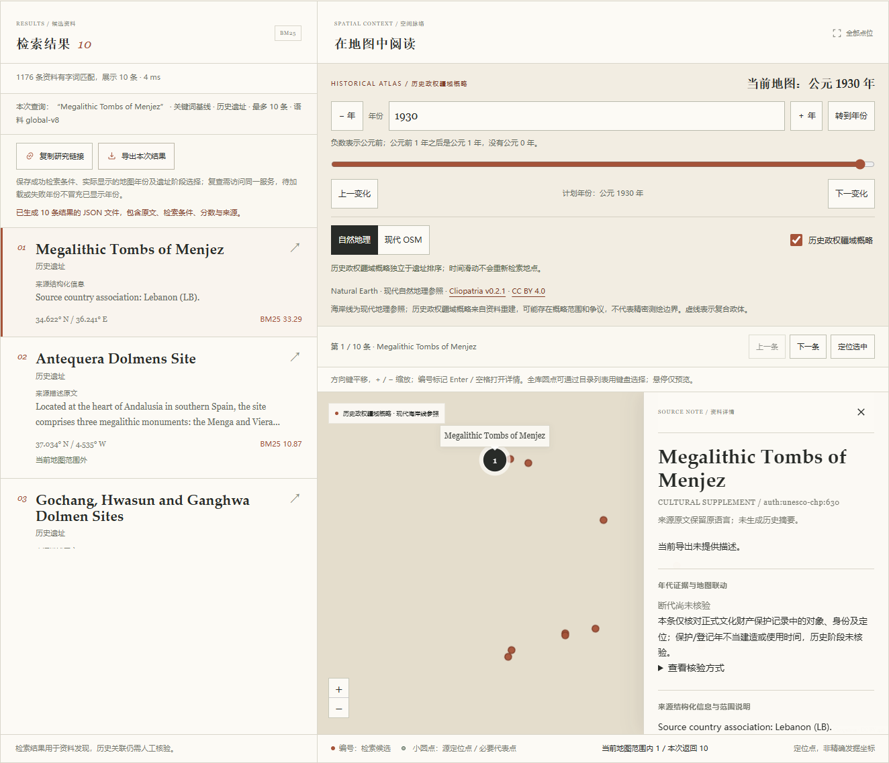
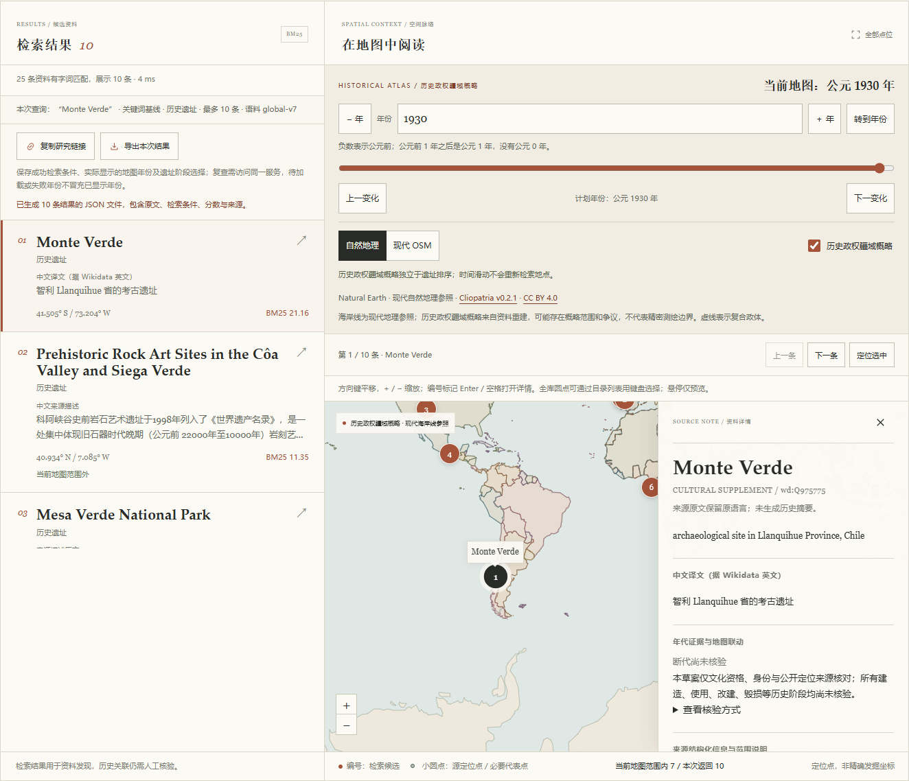
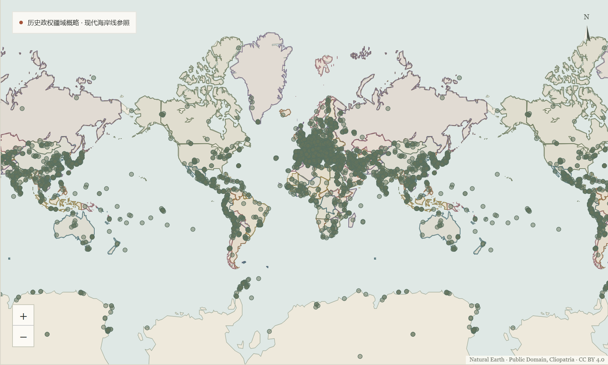
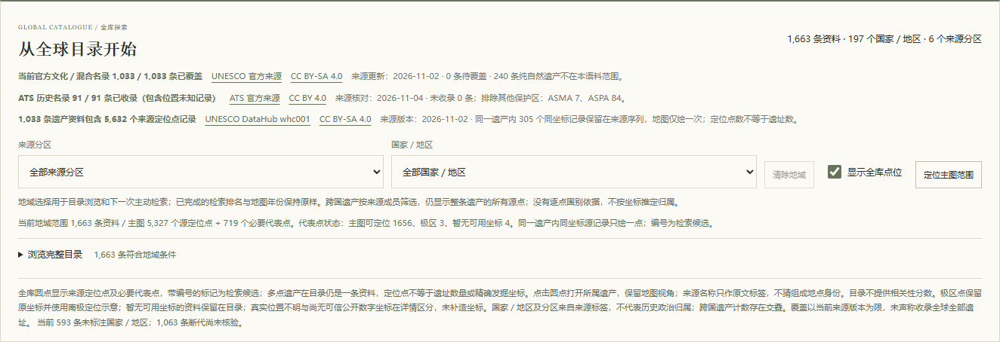
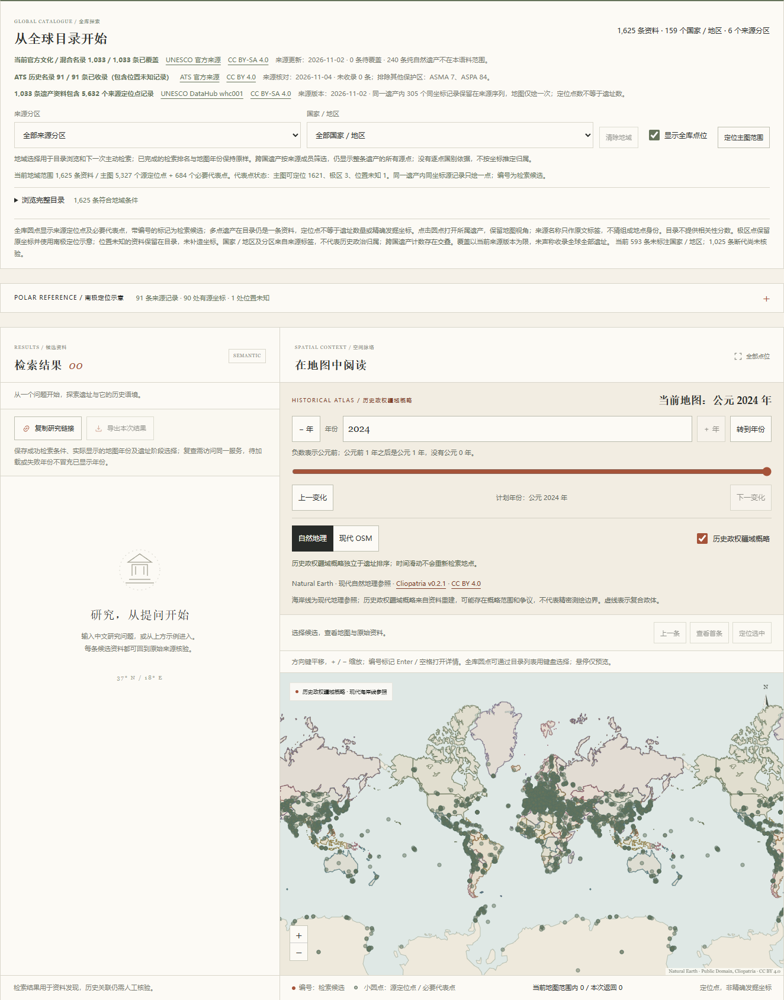
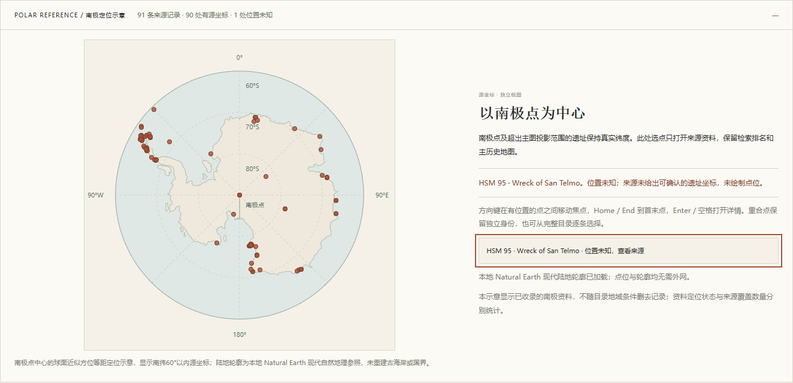
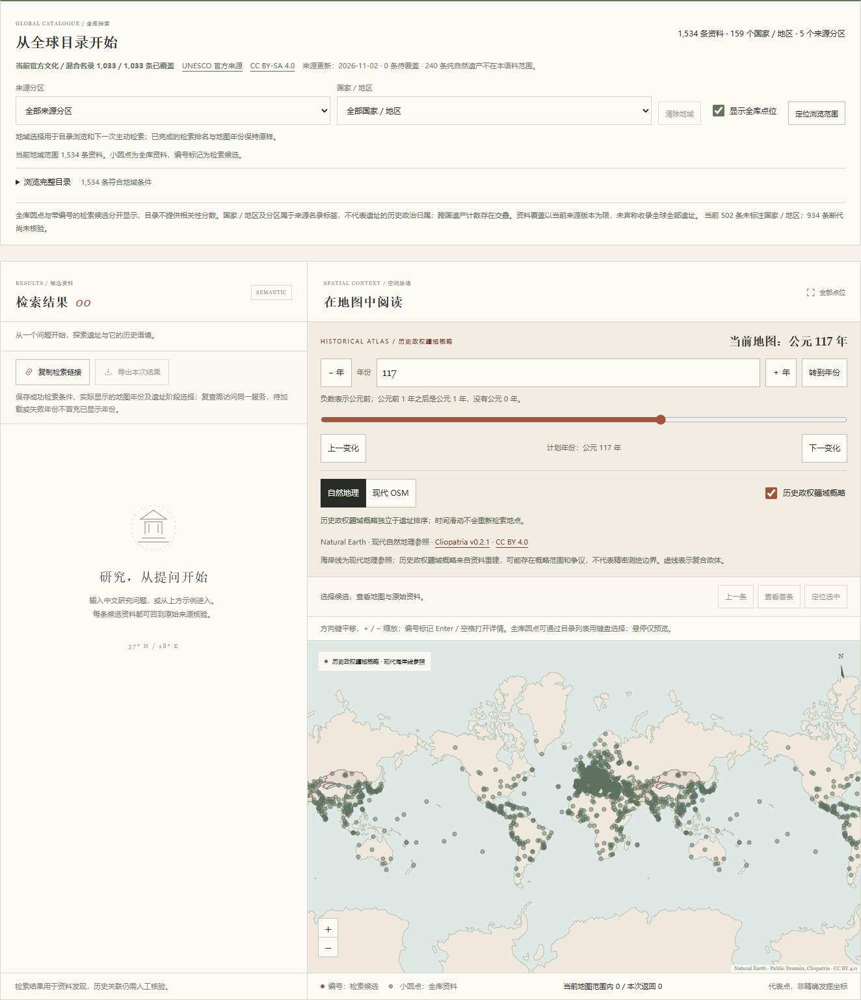
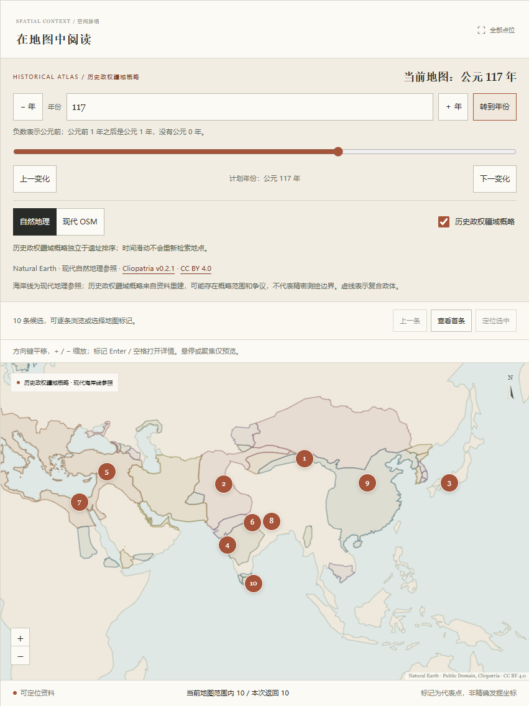

# 考古图志 · ArchSearch

面向古代遗址资料的语义检索与地图可视化课程项目。

当前语料 `global-v9` 共1800条：保留原500条Pleiades、100条已策展全球资料、934条文化／混合遗产名录记录及91条南极条约秘书处（ATS）正式历史遗址或纪念物，另有38处国家补充、26处北方／岛屿／内陆补充、11处南美文化遗址、95处海牙文化财产名录中的文化原址或历史建筑，以及5处非洲文化资料。覆盖197个来源国家／地区标签和6个来源分区，其中南极为独立分类，不作主权归属标注。地图分别保留世界遗产5632条原定位记录与海牙补充107条可绘文化定位记录，它们不增加遗址条目数。提供本地多语言语义检索、全库目录、原文证据与历史地图联动；这不是全球所有遗址或所有国家与属地的完整清单。

## 全球覆盖与完整目录

全球扩充使用 [UNESCO DataHub `whc001`](https://data.unesco.org/explore/dataset/whc001/) 的2026-11-02固定快照，采用 **CC BY-SA 4.0**。1273条来源记录中991条文化遗产、42条混合遗产入选，240条纯自然遗产排除；与原99个名录ID去重后新增934条，另保留原500条和非名录的Teouma资料。原600条的原文、坐标和历史阶段不覆盖改写。官方快照及其元数据SHA256随 `catalogue_manifest.json` 冻结，数据更新时拒绝静默换源。

这批名录记录保留来源的中文描述与六语名称；806条新增记录有官方中文描述，该批缺失翻译或英文原文时如实留空，不自动补写。新934条均标为“断代尚未核验”，不把世界遗产列入年份变成建造年代。原149处有来源支持阶段、451处证据不足的断代核验结果保持不变。

页面提供全库覆盖统计、国家／地区与来源分区下拉、独立Canvas点层及每页50条的可键盘操作目录；无需模型或查询即可浏览。目录按标题排序，没有相关性分数。点击目录或全库圆点可独立打开原文和来源，选中地点无需位于检索Top10／50内。编号标记属于当前检索候选，“选”标记属于独立选中地点，两者不混入对方的排名。

目录国家／地区条件用于下一次主动提交的检索；浏览、翻页和切换图层时，已有成功检索的条件与排名保持不变。查询参数 `country/region` 保存成功检索的过滤；`browse_country/browse_region/browse_offset/browse_bbox/points` 单独保存最后成功目录范围及即时点层开关。目录请求失败时保留成功列表与点层，分享和导出也保留该成功范围。无查询的目录与地图链接可以直接恢复遗址；模型缺失时保留待恢复查询，用户操作优先于晚到的初始化恢复。

国家／地区来自现代名录成员字段，不按代表点或历史疆域推断。跨国遗产计入各关联国家，各国计数不可相加作为总数。501条尚无来源地理标签，593条没有国家标签（另含来源未归类的耶路撒冷和91条南极资料）；两项是不同指标。各资料保留一个原代表点，地图另显示名录源定位记录；`point_count`不代表已逐一核验的组成遗址数。两处来源缺失定位点的世界遗产记录保留独立Wikidata证据，其中1567明确使用一个关联组成部分定位，不称为整体中心。

离线查看覆盖与来源分母：

```powershell
uv run --no-sync archsearch coverage
```

输出包括1800条来源统计、197个可筛国家／地区、三态断代计数，以及固定世界遗产名录覆盖1033／1033和ATS历史名录91／91。代表点单独统计为1786条主图可显示、3条极区点和11条暂无可用坐标，其中1条来源明确真实位置未知、1条按官方位置披露限制留空，其余尚未采纳可信公开数字点。海牙源175行的审核结果与新增量另列下节，不将175作为新增或完整全球分母。完整来源缓存不进Git；可从固定归档重新生成派生文件：

```powershell
uv run --no-sync python -m archsearch.catalogue_data --rebuild --download
```

默认缓存为 `.archsearch/downloads/unesco-datahub-v1/`；可用 `--source-cache <目录>` 指定已有固定快照。下载内容必须匹配冻结SHA，官方数据改版后应保留本地快照或明确更新来源版本。派生资料的署名、加工与同方式共享条款见 [名录资料许可](src/archsearch/data/CATALOGUE_LICENSE.md)。覆盖及浏览器验收见 [全球覆盖记录](docs/global-coverage.md)。

## 串联遗产的完整源定位记录

`world-locations-v1`使用同一份固定DataHub快照，将1033条文化／混合遗产的5632条定位记录单独保存。1031条有源点，868／1567两条源数组为空，继续使用已有独立证据的代表点。源记录共有5327个不同坐标，305次重合全部发生于同一遗产内部；原始顺序、重合记录和`components_list`名称／编号保留。名称和编号只是来源标签，编号可能重复，身份使用遗产ID＋原始序号，不按编号或坐标合并遗产。

全库Canvas层显示源点，并补绘与源点不重合的原代表点；原99条Wikidata代表点不替换。仅在绘图时合并同一遗产同坐标圆点，跨遗产的同址记录仍保留各自身份。地图点击源点可打开同一遗产详情，保留主图视角和检索排名；仍遵循遗产主条目的已有阶段年代联动，不为单个源点推断年代。用户手动调年继续优先于晚到详情。没有固定地图范围时，目录选择与“定位选中”使用原代表点；固定范围后目录选择保留主图视角，主动“定位选中”仍使用原代表点。目录始终是一条遗产一条记录，来源定位点不是新增遗址或精确发掘点。

地域筛选仍按整条遗产的来源成员字段作用，跨国遗产的全部源点保留，不按坐标推定各点所属国家。检索排序、候选编号和范围提示继续使用原代表点，完整源点由全库图层单独展示。详情可展开原始序号、名称、编号与坐标，导出`spatial`附上最后成功的源点版本及独立选中遗产的完整序列，保留重复。

源点侧车随代码分发，运行期不访问外部数据。丢失或损坏时明确提示准备指引，全库层退回原代表点，基础检索仍可用；修复后重启服务。从固定源缓存重建：

```powershell
uv run --no-sync python -m archsearch.spatial_data --rebuild
# 仅在缺少固定原档时联网下载；上游内容变化会被SHA校验拒绝
uv run --no-sync python -m archsearch.spatial_data --rebuild --download
```

默认原档目录与UNESCO名录重建共用，可用 `--source-cache <目录>` 指定。`world_locations.json`与清单绑定源文件、1033个身份和原始点序列；完整下载缓存不入Git。此批不改1625条文本、原坐标、阶段或语义索引合同，无需为地图源点重新下载模型。[源点许可](src/archsearch/data/SPATIAL-LICENSE.md)与[完整验收记录](docs/source-locations-validation.md)保留来源、加工及实际浏览器结果。

## 按当前地图范围浏览

将主图移到目标地区，点击“按当前地图范围浏览”，即可把当前可见矩形固定为目录条件；再次点击更新范围，“清除地图范围”移除矩形条件。平移或缩放不会自动修改已固定的条件，范围与目录国家／地区、来源分区取交集，API另支持类型交集。范围只作用于目录与主图全库点层，不进入检索请求，不改变已有候选、排名、年份或选中资料；南极定位示意仍为独立的全量视图。

只要原代表点或任一来源定位点落入矩形，该遗产就入选一次。全库点层只绘制范围内的匹配点，详情和导出仍保存完整原始点序列。例如Manaus的Teatro Amazonas来源点可以选入Amazonia Theaters，即使它的原代表点位于Belém；点击目录保留地图视角，主动“定位选中”仍可能移到范围外的原代表点。没有任何可用点的资料在范围条件启用时不入选，清除条件后恢复；此规则不按坐标推断国家或历史政治归属。

范围为WGS84的`west,south,east,north`闭区间，西界大于东界表示跨日期变更线，±180°按同一经线处理；经度跨度达到一周时使用`-180…180`。只规范化捕获的地图显示副本，不改写资料坐标。范围固定后保留经纬度文字，分享链接以`browse_bbox`保存。无效、重复或零面积范围会明确报错，须主动清除或重新捕获，不会静默恢复成全库成功状态；有效检索仍可独立恢复。错误范围尚未解决时保留原地址，暂停研究视图复制与导出，避免用原错误链接冒充当前检索；明确恢复目录后重新启用。

目录响应核对范围、资料版本、定位版本及匹配方式后才替换成功快照；取消、晚到响应、失败或版本不一致均保留之前的成功范围、列表和点层。源定位侧车不可用时明确退回仅原代表点匹配，响应及导出声明`representative-only`，不扩大范围。版本2导出的`browse`保存实际成功的`bbox`、`spatial_match_mode`和`spatial_version`。该功能批次未修改当时1689条语料、检索文档或E5索引；升级当前1800条语料则须重新`prepare`。[范围浏览验收](docs/map-bounds-validation.md)记录接口、故障与真实浏览器结果。

## 非洲内陆文化资料补充

`africa-supplement-v1`在原1795条之上追加5处来源可追溯的文化对象：刚果（金）的Dimba/Ngovo洞穴群、安哥拉Tchitundu-Hulu岩画复合体、尼日尔Bura与Djado，以及喀麦隆Bafut酋长宫。来源为缔约国提交的UNESCO**预备清单**，不等于已列入世界遗产；现有国家／地区标签仍为197个，未将新增记录数当作新增国家数。

在“国家／地区”选择Angola、Cameroon、Democratic Republic of the Congo或Niger即可浏览；目录选择保留检索排名和当前年份。Tchitundu-Hulu与Bafut使用经独立复核的公开Wikidata同实体代表点；其余3条保持空坐标，仍可通过目录、关键词或语义检索打开来源详情。启用地图范围后，无可用点的记录不入选，清除范围即可恢复；不使用城镇中心代替。原有两套5739条可绘来源定位不变，主图逻辑绘点增至6188。导出的多来源说明新增本批版本与混合权利署名，逐条来源保留各自许可，不将官方预备清单套用DataHub许可。

五条文化身份、范围、来源和点位均经独立代理对照冻结证据复核，不是专家或人工断代确认。没有新增建造或使用年份，阶段全部为“断代尚未核验”，选择后保留地图年份；当前断代计数为149条已核验、451条证据不足、1200条尚未核验。原1795条字段、顺序、检索文档和来源定位序列保持不变。

```powershell
uv run --no-sync python -m archsearch.africa_data --rebuild
uv run --no-sync archsearch prepare
# 可选：验证本机已保存的16份证据缓存；不联网重抓
uv run --no-sync python -m archsearch.africa_data --verify-source-cache .archsearch/downloads/africa-supplement-v1
uv run --no-sync archsearch evaluate --queries src/archsearch/data/queries-africa.json --output .archsearch/reports/evaluation-africa.json
```

重建只编译随代码分发的冻结复核事实。升级后重新`prepare`生成1800×384向量并重启服务，已下载模型可以离线复用，旧1795条索引会被明确拒绝；BM25保持可用。[来源与许可](src/archsearch/data/AFRICA-LICENSE.md)和[验收记录](docs/africa-validation.md)保留范围与点位限制。新增20对中英诊断是面向该批的专名及主题探测，不是盲测或相关性确认，所有指标继续为`null`。 本批五个中英专名对照中，中文E5四条未进Top10，失败排名完整保留；原文专名较稀少时可明确选择BM25，并结合国家／地区筛选或直接打开目录。

## 海牙名录中的文化原址与历史建筑

`protection-supplement-v1` 基于UNESCO DataHub `chp001` 的2026-10-31固定版本（CC BY-SA 4.0），完整审查175行：95处新文化地点纳入、35处对应已有实体、25处为已有组成地点、20处暂缓。`whc=false`不代表新遗址；例如Beaufort城堡仍能与既有世界遗产源组成点对照。所有旧1700条的字段、顺序和检索文档不变，不为增长数量重复收录或换用新源坐标。

新增分布为黎巴嫩60、乌克兰22、也门7、布基纳法索3、巴西2、墨西哥1，来源的地区标签数不增加。该名录地域集中，不是全球均匀抽样。包括考古原址、古代寺庙／桥梁、石墓、历史宗教建筑与有正式建筑价值依据的博物馆／纪念馆建筑；它们表示建筑或文化地点本身，不把馆藏物原址换成展示地址。8处纯储藏、避难或现代馆藏设施暂缓，11处与既有城市遗产的范围关系仍待核，660号浴场的组成点名称与正式范围冲突也暂缓。

来源没有逐处英文历史描述或中文原文，因此两种描述均保留缺失，仅使用源英法名称、来源国别事实及资格引用检索，不生成历史摘要或冒充官方中文。保护状态和列入年作为行政来源元数据展示，不能当作建造年；新增95处阶段均为`not_reviewed`，不自动切换地图年份。海牙批次完成时的170条、当前175条补充资料统一使用“文化遗址补充资料”类别，各自许可与具体来源仍可区分。

新批次保留108条原始定位审计、107条可绘文化位置。Menjez的一处石墓组保留12条源点，Mamluk学校组保留2条，不能将一个源条目标签中的两个建筑名称拆成两个坐标。Arqa的一条仓储记录完整留在冻结审计中，标为不可绘原址点；详情说明数量区别，地图和范围匹配排除此点。主代表点保持源`coordinates`的经度／纬度对象；组成串原为纬度、经度，严格转换且保留原序、ID及标签，不平均中心或承诺发掘精度。`geography.point_count`在补充批次仍表示代表点0／1，完整来源记录数量单独展示。

地图定位增加独立`protection-locations-v1`，与原`world-locations-v1`组合；世界遗产1033条／5632点的原始序列未改。全库共1128个有源序列的地点、5739条可绘源记录（含旧源重复），该批完成时主图6186个逻辑绘点，当前非洲补充后为6188个。`spatial_locations.source_groups`分别绑定数据集、版本、许可、原档SHA和地点身份；详情及导出按地点显示真正来源，不将海牙点标为世界遗产点。任一必需定位侧车损坏或缺失时统一明确退回原代表点，保留基本检索、目录和错误提示，不静默宣称完整多源覆盖。

```powershell
uv run --no-sync python -m archsearch.protection_data --rebuild
uv run --no-sync archsearch prepare
# 可选：已有原始证据缓存时验证固定源与被引用的范围依据，不联网重抓
uv run --no-sync python -m archsearch.protection_data --verify-source-cache .archsearch/downloads/protection-supplement-v1
```

普通运行只读随代码分发的冻结复核、资料、定位侧车和清单。完整源导出、官方登记PDF及机构页面缓存不进入Git；DataHub资料衍生遵循同方式共享，辅助来源不被自动重新许可。升级须重新`prepare`生成1800×384向量并重启服务，已有模型可离线复用。[许可与来源](src/archsearch/data/PROTECTION-LICENSE.md)及[验收记录](docs/protection-validation.md)说明完整175行审查、地图与检索证据和仍待核的范围。

新增[20对海牙资料诊断查询](src/archsearch/data/queries-protection.json)，连同既有四套问题分别比较BM25／E5 × 中文／英文，仍不预填相关性。来源只有名称而没有历史描述的条目，E5可能漏掉稀有专名；“寻找 Menjez 的巨石墓群”即未进Top10，失败问题仍在诊断中。界面的“Menjez 原名 · BM25”明确表示按完整来源名称使用关键词基线，点击才同步切换单选模式并发起一次检索，模型未准备时同样可用；它不是语义失败后的隐式降级。原检索模式、来源点范围、年份和历史阶段仍分别保存。

```powershell
uv run --no-sync archsearch evaluate --queries src/archsearch/data/queries-protection.json --output .archsearch/reports/evaluation-protection.json
```

## 南美文化遗址补充

`southamerica-supplement-v1` 增加11条有权威文化资格依据的资料，来自玻利维亚、巴西、智利、哥伦比亚、秘鲁及乌拉圭：Santa Elina、Lapa do Santo、Incallajta、Iskanwaya、Chamangá、El Abra、Monte Verde、Fell洞穴、Huaca Prieta、Pikimachay与La Leona洞穴。新增的是这些国家内的文化原址，197个来源国家／地区标签不变；该批完成时补充资料共75条，当前连同海牙批次共170条，统一显示为“文化遗址补充资料”。原1689条的全字段、顺序和检索文档保持不变，没有用现代城镇、自然山峰、博物馆或重复组成点凑数。

38份来源快照绑定SHA，文化身份、对象范围、地理关联、坐标及许可已由独立代理逐条复核；这不是考古专家或人工断代确认。Wikidata结构化字段保留CC0，官方文保页、论文和UNESCO预备名录的摘录保留各自权利，不将预备名录称作已入选世界遗产。所有新增历史阶段仍为“尚未核验”，未用发现、保护认定、提名或出版年份自动切图；该批结束时149条有来源支持阶段、451条证据不足、1100条尚未核验；当前连同海牙批次为1195条尚未核验。

10条采用来源支持的公开代表点。Incallajta使用2006年官方提名表的概略中心，坐标来源与文化资格来源分开保存；Lapa do Santo使用原作者公开的整处岩棚DMS，不替换成某个墓葬的位置。Chamangá采用同实体Wikidata代表点，不声明已经验证位于官方保护边界内，也不将YACARE地图未经核验转换为WGS84。Santa Elina的作者坐标有无效秒数、其他公开点与资料范围冲突，保留`repr_point=null`，不擅自进位修正、平均或补中心；这表示尚未采纳可信公开数字点，不宣称真实位置不明。空坐标资料仍可检索、目录浏览、分享与导出，启用地图范围时不参与匹配。

11条原CC0英文短描述增加忠实简中译文，并经另一代理对照固定实体版本、字段及SHA复核。译文单独标为“中文译文（据 Wikidata 英文）”，保留`translation:wikidata:*`来源与审查，不增添历史年代、用途或故事；没有将它们当作Wikidata原中文。检索共享原文、中文短描述、原有别名与资格短摘录，运行期仍不调用LLM或翻译API。

```powershell
uv run --no-sync python -m archsearch.southamerica_data --rebuild
uv run --no-sync archsearch prepare
# 可选：已有固定原始来源缓存时，离线校验38份证据，不重新下载
uv run --no-sync python -m archsearch.southamerica_data --verify-source-cache .archsearch/downloads/southamerica-supplement-v1
```

普通安装只需随代码分发的冻结复核、规范化资料与清单，无需完整来源缓存；重建是对已审查事实的确定性编译。该批最初扩展到1700条；当前重新`prepare`生成1800×384向量，已下载模型可离线复用，旧1689／1700条索引会明确失效；BM25保持可用。[来源与许可](src/archsearch/data/SOUTHAMERICA-LICENSE.md)和[本批验收](docs/southamerica-validation.md)保留具体来源限制与检查结果。

新增[20对南美诊断查询](src/archsearch/data/queries-southamerica.json)，含命名地点发现与地区主题。它用于BM25／E5 × 中文／英文的排名、耗时比较，不是代表性盲测；四套问题各自有独立标注合同，未确认相关性前指标均为`null`。

```powershell
uv run --no-sync archsearch evaluate --queries src/archsearch/data/queries-southamerica.json --output .archsearch/reports/evaluation-southamerica.json
```

## 北方、岛屿与内陆文化遗址

`regional-supplement-v1` 从实际地图稀疏区域增加26处资料：12处北纬60°以北遗址，12处太平洋岛屿与澳大利亚内陆文化对象，以及Shum Laka、Ishango两处非洲考古原址。国家标签数量不变，扩充的是原有国家／地区内的地点；不会把某个国家已出现一次当作充分覆盖。该批与国家补充共64条，当前连同南美、海牙批次共170条，在界面统一列为“文化遗址补充资料”。

北方资料包括Yana、Zhokhov、Ekven、Mangazeya、Pustozersk、加拿大北方历史遗址和格陵兰原聚落；岛屿与内陆包括关岛拉提石遗址、天宁岛House of Taga、美属萨摩亚炮台、甘比尔群岛历史教堂、查塔姆莫里奥里雕树保护地，以及澳内陆电报站、采金遗迹与历史传教区。完整源点和原代表点一起参与空间缺口诊断；已收录的遗产与组成点不重复新增，未用自然岛屿、行政中心或博物馆陈列位置填空。

23条采用可核的公开代表点。Ipiutak的官方名录为受限地址，保留文化身份与`null`，不把被拒数字点重发到公开清单；Talietumu的Wikidata点与对象范围冲突、Arahurahu尚无可信同对象数字点，均保持空坐标。Arahurahu当前布局重建及古代原址问题仍在详情保留，不声明重建位置或年份等于古代原址。Fort Conger保留81.75°N，Ekven保留西经；Shum Laka使用论文原址坐标而非不完整的预备页坐标；Ishango明确采用原发现地，未混用比利时博物馆位置。代表点及其小数位数不承诺发掘精度。

国家字段沿用既有来源关联代码；实际属地、原始代码和映射依据另外保存。格陵兰保留GL事实，并按官方Greenland遗产页的Denmark成员分组关联DK；不使用Realm上的废弃P297声明，也不声明GL等同DK。太平洋属地按UN M49实际地区映射到界面亚太分区，明确是本地加工，不冒充WHC报告分区或历史主权判断。

77份来源快照通过校验，26条均经另一代理逐条核对原文、身份范围、公开坐标、地区关联、许可和旧资料去重。历史阶段全部仍为“尚未核验”，不触发自动切年。该批结束时为149条阶段已核验、451条证据不足、1089条尚未核验；当前连同南美、海牙批次为1195条尚未核验。原1663条全字段、顺序与检索文档保持不变；新增审计范围说明公开保留在地理备注，来源分区、成员映射和位置限制不当作文化资格片段索引。

19条缺少原中文字段的Wikidata短描述，在保留CC0英文原文的同时增加忠实简中译文，逐条由另一代理对照固定实体版本复核。译文不补原文未说的“北极狩猎”、年代或用途；4条authority记录、2条英文缺失和1条已有原中文的记录不改。界面明确标为“中文译文（据 Wikidata 英文）”，来源与导出保留`translation:wikidata:*`引用及原字段／版本／SHA和翻译审查；不冒充Wikidata原中文、专家确认或生成式历史摘要。两种检索共享这些公开原文、译文及国家事实，运行期没有翻译服务或LLM调用。

BM25对Unicode词作NFKC与大小写归一，并为连续汉字保留完整串和相邻双字片段，使“西伯利亚”“电报站”可匹配较长中文描述；标点、拉丁字母与数字会分开汉字片段，不跨边界拼词。建议中文关键词至少两个字；单字只匹配资料中本来独立的单字，部分双字片段重叠也可能命中。这是片段匹配，不是中文词典分词或精确短语搜索，不实时翻译、扩词或转换繁简。英文及其他非汉字的词法保持原规则。字词匹配字段同时覆盖中文描述／译文和实际参与检索的资格短摘录，不把地区、成员或位置限制说明当命中证据。评测报告记录`lexical_contract`的`unicode-han-bigram-v1`及BM25参数；E5文档文本和向量不因这次词法修正而改变。

```powershell
uv run --no-sync python -m archsearch.regional_data --rebuild
uv run --no-sync archsearch prepare
# 可选：已有原始审查快照时验证77份来源文件，不联网抓取
uv run --no-sync python -m archsearch.regional_data --verify-source-cache .archsearch/downloads/regional-supplement-v1
```

重建只编译随代码分发的冻结复核事实；普通安装不需要原始页面或PDF缓存。`regional_supplement_review.json`、`regional_sites.json`与`regional_manifest.json`分别保存复核、规范化记录与来源合同，固定排序前缀为`regional-supplement-v1:`。该批首次扩充到1689条；当前连同南美、海牙批次，重新`prepare`生成1800×384索引，已下载模型可以离线复用。个别来源点缺失不影响基本检索、目录、分享和导出。[许可与加工](src/archsearch/data/REGIONAL-LICENSE.md)逐条保留权利边界。

[区域验收记录](docs/regional-coverage-validation.md)说明完整来源审查、中文匹配修复、真实离线浏览器和同口径空间诊断。632个固定粗网格样点中距现有资料点超过1000km的数量由129降至34；这不是全球面积或考古覆盖率，许多小岛不在该网格内。

新增[20对地区诊断查询](src/archsearch/data/queries-regional.json)，用于比较BM25／E5 × 中文／英文在这些新增主题上的排名与耗时；这是针对本批的诊断集，不是代表性盲测。原两套查询保持不变，全部相关性标注仍待人工确认，评测指标为`null`：

```powershell
uv run --no-sync archsearch evaluate --queries src/archsearch/data/queries-regional.json --output .archsearch/reports/evaluation-regional.json
```

## 补充国家文化遗址

`country-supplement-v1` 补齐固定世界遗产来源中没有文化／混合名录记录的37个缔约国标签，并加入列支敦士登。197个标签是196个公约缔约国与列支敦士登的来源关联集合；它不等于全球所有主权国家、属地或每个地区都已有充分资料。新增38处包括马图皮洞穴、Abourma岩画、Banwari Trace、Arai Te Tonga、Nanumea旧机场和Gutenberg城堡等可核对的固定文化对象，独立列为“补充国家文化遗址”，不将其全部称为已列入世界遗产。

新增记录使用 `wd:Q…` 或 `auth:<来源>:<稳定标识>`，逐条保存文化身份依据、来源国家与分区、坐标语句或权威原始坐标、许可及独立代理复核记录。153份不同来源快照以SHA256绑定，只有事实、短摘录和校验清单进入Git，完整页面及PDF缓存不入Git。Wikidata只用于可核对的结构化身份、别名和位置，文化资格需要另一个权威来源。科威特宫殿错误描述、城镇坐标、自然山峰和相邻地点的坐标均不作替代证据；利比里亚坐标保留所选preferred语句，不平均多个来源点。

35条有可核代表点，基里巴斯Betio海岸观察员纪念物、瑙鲁Anibare旧日军碉堡与Father Kayser纪念标记、纽埃Nukai Peniamina墓3条暂未取得可信公开数字坐标，保留 `repr_point=null`。这表示当前资料缺少可核坐标，不宣称遗址真实位置不明；这些记录仍可检索、筛选、分享和导出，“定位选中”不可用，也不会补零坐标或岛屿中心点。瑙鲁来源为拟议遗产名录，不表述为已正式指定保护地。来源国家是记录关联，不根据代表点推断疆域归属。

独立代理该批复核的是文化对象、来源关联、坐标与许可，未完成新增断代阶段复核，因此新增38条全部为“断代尚未核验”，不触发自动切年。该批完成时为149条阶段已核验、451条证据不足、1063条尚未核验；当前连同区域、南美、海牙与非洲批次为1200条尚未核验。新增检索文本使用原始描述、国家关联事实和资格短摘录；审计中提及的被排除对象不进入检索文档。原1625条规范化记录及检索文档保持不变，该批扩至1663条；当前完整索引为1800×384。

随代码分发的冻结复核清单可完全离线重建：

```powershell
uv run --no-sync python -m archsearch.supplement_data --rebuild
uv run --no-sync archsearch prepare
# 可选：已有原始审查快照时验证153份源文件，不下载页面
uv run --no-sync python -m archsearch.supplement_data --verify-source-cache .archsearch/downloads/country-supplement-v1
```

`country_supplement_review.json` 固定审查事实、原1625条合同与独立复核；`supplement_sites.json` 按 `SHA256("country-supplement-v1:"+id)` 排序；`supplement_manifest.json` 冻结编译结果、国家标签、坐标依据和来源快照SHA。重建是对已审查事实的确定性编译，不是自动抓取并重新认定权威页面；源快照缺失不影响普通安装和运行。后续来源更新需要重新复核并发布新版清单。[来源与许可](src/archsearch/data/SUPPLEMENT-LICENSE.md)保留逐条权利状态与加工范围；[验收记录](docs/country-supplement-validation.md)说明来源复核、检索与真实离线浏览器结果。

## 南极历史资料与极区定位

[ATS APA数据库](https://www.ats.aq/devph/en/apa-database)采用2026-11-04冻结快照：182条中纳入91条正式、未撤销的HSM，排除84条ASPA与7条ASMA；本批来源缺号12、13、25、31、58保持缺号。`ats:hsm:<编号>`与来源内部ID分别保存，查询响应及91份详情的SHA256随 `polar_manifest.json` 冻结。资料按[ATS版权声明](https://www.ats.aq/e/copyright.html)遵循CC BY 4.0，未收录照片、视频或其他媒体；具体署名与加工见 [ATS许可](src/archsearch/data/ATS-LICENSE.md)。

新91条均保留原文与来源核对记录，历史阶段为“断代尚未核验”，不把保护认定年转成建造年。原1534条的文件、原文、坐标与阶段不覆盖改写；已有149处有来源支持阶段、451处证据不足。南极批次完成时有1025处阶段尚未核验，当前连同国家、区域、南美与海牙补充为1200处。国家筛选不将提议方、管理方或探险队国籍变为南极主权归属。

91条中90条有源坐标：34号仅在来源DMS明确时换算；95号San Telmo沉船真实位置未知，最后目击参照只保留在原文，不作为遗址坐标。未知点的 `repr_point` 为 `null`、`point_count` 为0，继续参与检索、目录、分享和导出，不绘制标记。除ATS和补充国家批次外的资料仍要求有效代表点及至少一条来源定位记录。

1、24、80号保留超出Web Mercator范围的原始纬度，主图不夹取。页面可展开“南极定位示意”，以南极点为中心的球面近似方位等距投影显示90处源坐标，并单列未知位置资料。本地Natural Earth仅为现代自然地理参照，未重建古海岸或国界；极区示意不是测绘图或历史疆域图。点击或Enter／空格打开详情，方向键及Home／End可访问重合点；“查看极区位置”定位独立视图，保留主地图年份、视角和检索排名。本地轮廓失败时仍保留点位、网格及明确错误提示。完整目录暂未加载时，可凭已读取的ATS详情定位，明确标注“仅已读详情，完整目录未就绪”；目录恢复后替换为完整91条。

从固定原档重建南极派生资料：

```powershell
uv run --no-sync python -m archsearch.polar_data --rebuild --download
uv run --no-sync archsearch prepare
```

默认源缓存 `.archsearch/downloads/ats-hsm-v1/` 不入Git；已有缓存可省略 `--download`，或使用 `--source-cache <目录>`。下载拒绝与冻结SHA不符的更新；运行期不访问ATS。规范化资料已随代码分发，普通安装不必下载源缓存，只需重新 `prepare` 更新E5索引。实际来源、离线交互及验收见 [南极扩充记录](docs/antarctic-coverage.md)。

## 保留的600条资料与断代核验

原500条的ID、原文及名称／位置记录分期证据保持不变，原抽样矩形和 `roman` 条件只约束这批资料。新增资料使用 `wd:Q…` 命名空间ID，`historic-site`（历史遗址）类型用于全球古代至近现代资料。两批共享原文检索流程；原500条的其他类型标签也继续保留。

新增100条按东亚20、南亚15、西亚及中亚15、非洲15、欧洲10、北美10、南美10、大洋洲5分配；默认阶段的年代分组为公元500年前50条、501—1500年25条、1501—2024年25条。策展候选经过来源核对后，按 `SHA256("global-history-v1:"+id)` 固定排序；这是一份配额策展样本，并非对全球遗址的随机代表性调查。

`global_sites.json` 保存新增资料；`chronology.json` 分别保存600条核验记录和有来源支持的历史阶段；`global_manifest.json` 冻结ID、配额、来源版本与SHA256。加载时离线校验全部文件。原500条仍可用原固定归档独立重建，新增资料以冻结的策展清单和引用摘录复核，不依赖运行时抓取来源页面。

阶段区分建造、使用、改建、毁损及其他事件，记录原文摘录、来源、日期精度和默认阶段。明确单年、约略年份、区间及仅有时期描述分别保存；世纪边界只用于浏览，不意味着整个世纪持续活动。未找到独立断代证据的原记录显示“已核验，断代未确定”，不把 Pleiades 名称／位置的起止年份换成遗址生命周期。核验由代理对照来源进行，方法与范围随记录保存，不标成人工或专家确认。

当前149处有176个来源支持阶段（原500中49处、新增100处），451处保持断代未确定。新增100条的109个阶段由另一代理逐条核对出处、摘录、事件类型和精度；28个阶段为明确单年。地理去重按实体身份与资料颗粒度处理，整体遗产范围仍可能覆盖原语料中的单体遗迹（如迦太基整体遗产与一处罗马别墅），不宣称空间互斥。

新增记录的身份、别名和可核对代表点来自固定版本 Wikidata，权威遗产页面或考古文献提供历史阶段。UNESCO描述遵循 CC BY-SA 3.0 IGO，Wikidata结构化资料为CC0；其他文献仅保留引用与短摘录，各自许可见记录。代表点始终不是实测发掘坐标。

## 交付流程

初始化 `main` 后，所有功能在 `feature/dev` 开发。每个完整功能批次同步本文档，经过本地检查、独立审查和 CI，再由 GitHub Actions 机器人批准并 squash 合并；`main` 要求 `quality-gate` 和一个批准。

输入中文研究问题，在结果列表与地图间双向定位，查看原文、分期证据、代表点精度和来源。支持语义/BM25、类型与国家／分区过滤、10/20/50条结果，以及原研究问题、全球问题和地区诊断各20对双语评测查询。

## 阅读结果与证据

页面提供港口、浴场、别墅庄园、剧场、佛教石窟、工业遗产、南美考古和Menjez原名八组示例。一般示例沿当前模式使用中文问题／保留原文专名或英文关键词，并同步选择类型；明确标为“Menjez 原名 · BM25”的末项由用户主动选择关键词基线。它们用于熟悉操作，不代表总体检索效果；原固定20对双语问题保持，另有各批次独立诊断查询，全部未确认相关性标注。

结果上方保留成功提交时的查询、模式、类型、结果上限和资料版本。语义模式显示参与排序的资料数量，BM25显示有字词匹配的数量；这些数量不代表经人工确认的相关地点。改写输入或请求失败后，旧结果仍与原来的查询上下文对应。不同模式、不同查询的分数不能直接比较。

目录式描述优先展示可用的原始补充记录，并注明原文来源；`Untitled`显示为“未命名地点 · #编号”，详情继续保留来源标题。空补充字段和字面值`None`/`null`明确标为未提供，不生成中文历史摘要，也不改变规范化语料及索引文本。

原500条详情保留入选所需的`roman`分期依据，其他时期关联可展开阅读。起止年份属于整条名称或位置记录，可能跨越多个时期，不能当作单个分期的边界或遗址建造年代。负年显示为公元前，正年显示为公元；缺失值和0保持明确的来源状态。`confidence`与`association_certainty`提供中文释义并保留原值，推断类注明“无同时代证据”，依据[官方置信词表](https://pleiades.stoa.org/vocabularies/attestation-confidence)；`precise`/`rough`遵循[官方GIS字段定义](https://atlantides.org/downloads/pleiades/gis/)，不承诺米级误差或发掘坐标，概略代表点可能只是一个范围的中心。新增全球资料另外展示权威出处、Wikidata身份与代表点来源。

“原文字词匹配字段”仅说明词面重叠，不解释语义模型的排序依据。页面下方的方法指南说明发现、比较、核验三步用法，以及抽样范围、多标签类型计数、代表点和检索分数的阅读边界。

## 检索与地图交互

地图默认全球视图、公元117年，以本地Natural Earth现代自然地理轮廓参照展示“历史政权疆域概略”。可输入年份、拖动时间轴、逐年前后移动或跳转上一／下一疆域变化时点；公元前1年之后直接进入公元1年。自然地理与现代OSM底图可切换，疆域层独立开关，保留查询、排名、选中遗址与年份。复合政体无填色、虚线描边，普通政体使用浅填色；点击可读来源原名、原始区间、版本和许可。

主动点击或键盘确认遗址时，默认历史阶段的明确单年自动切图；约略年份、区间和时期先显示证据，须在详情选择观察年份并确认。切换阶段同样遵循此规则，悬停或聚焦预览不切年。来源早于公元前3400年等超出覆盖的阶段保持真实日期并提示“该年份无可用疆域数据”，保留成功地图，不夹到最近年份。断代未确定的资料不补造年份。

年份请求采用200毫秒防抖、请求取消与响应身份检查。手动调年优先于晚到的详情；旧成功或旧失败响应都不能回写新视图。失败时年份草稿和错误提示与“当前地图”年份分开展示，疆域及年份标签保持最后成功状态。遗址标记在疆域之上，位置仅供参照，不自动判断历史政治归属。跨日期变更线的结果按最短经度弧定位，显示副本保持源坐标不变，列表和地图范围统计仍对应原候选。

请求等待期间，相同查询、模式、类型和上限只提交一次；修改条件后可以提交新检索。“取消本次检索”停止浏览器等待并忽略晚到响应，保留已有列表、地图、链接和导出快照。已经开始的服务端模型计算可能仍会完成。结果区明确标示更新进度，等待期间仍可浏览已有候选。

请求失败后可“按原条件重试”：恢复失败时的查询、模式、类型及结果上限，再发起一次请求。它不会改用其他检索方式或悄悄放宽筛选。筛选区和空结果区均可清除当前类型，保留其他表单条件并重新检索；问题为空时不提交请求，同时停止旧请求的等待。

右上角刷新会同时检查运行状态并重新加载类型，首次类型加载失败后无需整页刷新即可恢复。刷新幂等替换类型选项并保留当前选择，不会清除并发出现的搜索错误；类型暂时刷新失败时保留之前加载成功的选项，已失效的选择会明确提示，要求改选或主动清除。

地图上方可按当前结果排名逐条浏览，显示选中序号、总数及地点名；首末位置不会循环。列表、地图高亮与详情同步，名称相近或代表点几乎重合的地点仍可逐条打开，坐标保持原值。“定位选中”关闭详情、将选中标记移到地图中心并聚焦；可用Enter或空格再次打开详情。“全部点位”恢复当前返回结果的整体范围。

悬停或用键盘聚焦结果卡片、地图标记，会同时预览对应的卡片与标记，并显示地点提示；焦点预览优先于鼠标。预览保留原来的选中项，不主动移动地图、滚动列表或请求详情；点击或Enter/空格才打开资料。重合点位也可以通过列表逐条预览与选择。

地图下方显示“当前地图范围内 X / 本次返回 N”，按代表点中心是否落在整个地图容器内计算，包含详情抽屉覆盖的部分；列表只为范围外地点提示“当前地图范围外”，无有效标记时说明无可用代表点。平移、缩放和调整窗口大小会更新提示，仍保留原始排名和全部返回候选，不提交新的检索；该候选提示与主动固定的目录范围条件独立。

打开详情时，地图按抽屉实际占用宽度将选中点移到可见区域；调整窗口大小时继续适配当前选中位置。用户手动平移或缩放后停止这种自动适配，新选择或主动定位时再调整视图。手机上空间不足以同时展示详情和标记时，可用“定位选中”查看地图。这些地图操作只作用于本次返回候选。

页面开头提供键盘可见的“跳至检索 / 跳至结果 / 跳至地图”入口。地图聚焦后可用方向键平移、加减键缩放，再Tab到标记并用Enter/空格打开详情。检索完成、取消或失败时，若焦点仍在等待区域，会移到可见的结果或反馈；用户已转去其他区域时保留其焦点。手机上会将交接目标滚动到屏幕内。

## 保存与复查检索

完成一次检索后，可在结果上方复制检索链接或导出本次结果JSON；成功的零结果也可以保存。两项操作始终使用最近一次成功请求的完整快照，改写输入、正在等待的新请求或请求失败不会混入旧结果。

检索链接用`q`、`mode`、`type`、`limit`保存条件，新增`year`、`basemap`、`boundaries`、`site`和`phase`保存成功地图视图与选择。旧检索链接继续可用，地图切换成功或改变选择后同步地址栏。重新打开时，页面先检查本地服务与类型，再按原条件检索一次，恢复选中遗址、阶段与显式保存的地图年份；保存年份优先于阶段默认年。非法或重复参数、未知类型会提示并停止自动检索；阶段失效会明确提示并保留年份。模型未就绪时保留条件，准备后需手动提交，不会替换为BM25或放宽类型。加载期间修改表单会取消待恢复的自动检索。链接支持界面的10/20/50条上限，不包含结果数据或模型；复查仍受服务和语料版本影响。

复制失败时显示并选中链接，可用Ctrl+C或Command+C手动复制。从`127.0.0.1`页面复制的地址仅指向访问者自己的设备；在Mac与Windows之间复查时，应从可访问的Tailscale Serve地址打开页面再复制链接。

导出使用 `schema_version: 2`，包含UTC时间、成功检索快照、完整API响应、目录状态、选择和多来源许可。`selected_site`附上独立选中遗址的完整资料，即使它不在检索候选中也不伪造分数或名次；读取完成前暂不导出。`map`保存最后成功显示的年份、底图、疆域开关、帧ID与疆域版本，尚无成功视图时为null；等待或失败的年份不冒充已显示年份。`spatial`保存成功目录的组合定位版本、`source_groups`及独立选中资料的实际来源、已纳入地图的序列／标签，原代表点单独保存。世界遗产原始序列及重复记录完整保留；海牙源中被排除的仓储或矛盾标签记录保存在冻结审计，不混入可绘原址序列，也不以圆点去重结果替换定位记录。它用于保存当次候选，未添加人工相关性判断或历史结论。JSON由浏览器本地生成，生成后释放临时下载地址。

界面放大了原文和关键辅助文字，窄屏保留两行摘录。打开资料详情后焦点进入详情区域，手机上同步滚动到详情；来源内容未变化时保留阅读状态，晚到的详情刷新不会让正在阅读的键盘焦点落到页面外层。关闭后重开同一地点时，已取消或过期的详情请求不会写入新详情或错误提示。地图标记可用Enter或空格打开；关闭或按Escape返回触发的结果卡片或地图标记，长资料的关闭按钮保持可见。

## 环境与数据验证

需要 Python 3.12 和 [uv](https://docs.astral.sh/uv/)。在仓库根目录执行：

```powershell
uv sync --locked --dev
uv run --no-sync archsearch prepare
uv run --no-sync archsearch prepare-history
uv run --no-sync archsearch serve
```

浏览器打开 `http://127.0.0.1:8000/`，API状态地址为 `/api/status`。首次准备下载固定版本E5模型（单份权重约471MB）并构建1800×384向量，需要联网。升级语料后须重新运行 `prepare`，旧索引会被明确识别为失效；已下载模型可离线复用。后续启动和新的中文查询只使用本地资源；首次查询包含模型加载，后续复用编码器。应用采用CPU推理，运行不需要Node.js、GPU或外部模型API密钥。

## 本地历史地图数据服务

首次联网准备历史政权疆域概略，之后运行期仅查询本地SQLite：

```powershell
uv run --no-sync archsearch prepare-history
uv run --no-sync archsearch serve
```

固定使用 [Cliopatria v0.2.1](https://github.com/Seshat-Global-History-Databank/cliopatria/releases/tag/v0.2.1)，提交 `5f433377139a6eeaeacbdc894b70f8805b72c8b5`，归档SHA256为 `e10a4e429fca708788ff9e7572a95fce801fae55852d217cffabc1c59cd4eed4`。准备命令校验下载和结构，在临时数据库完整构建及验证后原子发布；有效缓存直接复用，失败不替换旧库。完整归档保存在 `.archsearch/downloads/`，数据库为 `.archsearch/history/cliopatria-v0.2.1.sqlite3`，均不进Git。使用自定义目录时仍将 `--home <目录>` 放在子命令前。

API允许公元前3400年至公元2024年，负数表示公元前，不提供0年；按来源 `FromYear ≤ year ≤ ToYear` 闭区间查询，保留原始字段与有效区间，不插值。来源的6条终年0记录在查询中止于公元前1年，原值及转换说明保留。13797条来源中仅13412条POLITY参与索引，排除385条RELATION；复合政体通过原始Components识别，不能视为成员主权归属推断。16个来源退化环保留并计数，未宣称通过完整拓扑质量认证。

`GET /api/history/boundaries?year=117` 返回GeoJSON及 `metadata.year/valid_from/valid_to/frame_id/source/normalization`；117与126年为相同活动疆域帧，127年发生变化。响应支持gzip、ETag和304重验，服务缓存限制为4帧且最多32MiB；ETag包含请求年，帧ID表示相同活动集合。`Cache-Control: private, no-cache`允许保存并要求复查，普通检索API保持 `no-store`。缺失或损坏的历史缓存返回503及 `prepare-history` 指引，基础检索继续可用；`/api/status.history`提供就绪状态、版本、年份范围和变化时点。

本地 [Natural Earth](https://www.naturalearthdata.com/about/terms-of-use/) 1:110m陆地轮廓随应用分发，`static/data/land-source.json`记录固定提交、SHA256和公有领域许可。它是现代自然地理参照，未重建古海岸，也不提供现代国界。Cliopatria遵循CC BY 4.0，保留 James S. Bennett、Cliopatria贡献者和Seshat署名、来源及加工说明。疆域是来源中的历史重建，空间和时间精度不一，不等于逐年精确实测国界。

界面、字体回退、Leaflet、Natural Earth轮廓和已准备疆域均在本地；准备完成后断网仍可检索、切年和联动。现代OpenStreetMap参照底图需要联网，瓦片失败时会显示提示，资料、地图标记与点选仍可用；可重试或切回自然地理。语义模型未准备时提供明确指引，可手动选择BM25；不会将关键词结果冒充语义结果。

默认模型、索引与报告在当前工作目录的`.archsearch/`。可用全局参数 `archsearch --home <目录> prepare`指定其他目录，serve和evaluate使用相同目录；该参数应放在子命令前。准备完成后再次prepare会校验并复用模型、重建索引。安装若受本机镜像配置影响，可用 `uv sync --locked --dev --default-index https://pypi.org/simple`明确选择官方源。

已提交的 `src/archsearch/data/` 包含原500条规范化地点、所选ID、清洗清单和新增全球资料及阶段核验文件，可直接离线读取。以下命令只重新生成原500条，不覆盖全球策展记录：

```powershell
uv run --no-sync python -m archsearch.corpus --rebuild --download
```

归档缓存位于 `.archsearch/downloads/`。清单记录原始归档与语料SHA256、源版本、筛除计数和加工规则：经纬度矩形 `[-6,29,37,46]`、有效代表点、六类人工遗存、名称或位置的 `roman` 分期证据，再按 `SHA256("mvp-v1:"+id)` 排序取500条。7,849条符合条件；全部原始分期、原文和贡献者继续保留。

依赖固定使用官方PyPI与PyTorch CPU源，模型下载缓存、虚拟环境和索引不进入Git。仓库维护者可运行 `./scripts/github_admin.ps1 -Operation Verify` 回读PR保护设置；该脚本从本机Git Credential Manager读取身份，凭据仅存于进程内存。

前端源码位于`src/archsearch/frontend/`，审批回归为`approval.test.ts`，均使用严格TypeScript。开发需要Node.js 24与pnpm，版本由根`packageManager`固定为11.25.0；依赖由根`pnpm-lock.yaml`管理：

```powershell
pnpm install --frozen-lockfile
pnpm typecheck
pnpm build
pnpm test:frontend
pnpm test:workflows
```

`pnpm build`生成`static/app.js`、`research.js`、`map-view.js`、`history.js`、`explore.js`、`polar-view.js`及各自source map，均随源码提交；应用逻辑编辑TypeScript，由构建生成JavaScript。`research.ts`处理独立检索／目录链接和版本2导出，`map-view.ts`处理预览、跨日期线定位与范围提示，`history.ts`处理历史视图，`explore.ts`处理全库目录、覆盖与点层，`polar-view.ts`处理极区投影、未知位置和独立键盘定位。测试执行实际助手源码，覆盖竞争请求、三态断代、地理过滤、成功快照、图层和范围统计。Leaflet保留本地原版资源。运行仍只需Python和已生成资源，Node.js与pnpm用于开发构建。

CI在Windows与Ubuntu执行Python锁定安装、Ruff、mypy、pytest，以及pnpm冻结锁文件安装、TypeScript检查、构建、前端交互助手测试和真实Octokit回归；同时校验编译产物与源码一致，不下载模型或全量资料。`main`要求一个批准及`quality-gate`，管理员同样受约束，禁止强推和删除。默认分支的`workflow_run`核实可信仓库、作者、分支、最新CI及当前head后，由Actions机器人批准并自动squash合并；审批任务不检出或运行PR代码。

每批合并后，备份旧head并保存工作区；确认远端开发分支仍为已合并head，才使用明确旧SHA的`--force-with-lease`对齐main。租约失败停止同步，保留远端新增提交。

## 检索与 API

两种检索共享`build_document()`构造的原文，包含名称、别名、类型、描述及补充记录。地图年份不筛选检索候选；未加入LLM或历史政治归属推断。BM25使用正Robertson IDF、k1=1.5、b=0.75；无词项匹配就返回空结果。英文词语、地名和已有中文别名适合关键词基线，中文零命中不意味着资料不存在相关地点。

语义检索使用 [multilingual-e5-small](https://huggingface.co/intfloat/multilingual-e5-small)，固定revision `fd1525a9fd15316a2d503bf26ab031a61d056e98`。文档添加`passage: `、查询添加`query: `，L2归一化后以NumPy精确点积排序。两种方法共享多语种来源文本，包括可用的官方中文描述。模型最多512 token，新版有96条长文档被截断，BM25仍使用完整词项；完整原文保留。相似度是排序分数，不是相关概率，候选仍需人工核验。

索引绑定地点顺序、检索文本hash、模型revision、前缀、归一化和模型文件校验和。缺失或损坏时明确标为未就绪，语义请求返回503；BM25继续可用，不进行隐式替代。修复后可刷新状态；模型加载失败时重新prepare并重启服务。

| 接口 | 用途 |
| --- | --- |
| `GET /api/status` | 语料版本、数量、语义状态、历史版本与年份，以及独立源点数据就绪状态 |
| `GET /api/history/boundaries?year=...` | 本地年度政权疆域GeoJSON、原始区间、来源与帧元数据 |
| `GET /api/facets` | 类型ID、中文标签和数量 |
| `GET /api/coverage` | 全库国家／分区、来源、断代三态、定位三态及两类官方名录覆盖分母 |
| `GET /api/catalogue` | 全库定位目录，含原repr_point、定位状态、完整source_points及同序来源标签，可选country／region／type交集 |
| `GET /api/sites` | 无查询分页目录，offset及limit（1—100），国家／分区／类型与可选bbox取交集，返回实际匹配方式与定位版本 |
| `POST /api/search` | 查询、模式、类型筛选及候选排序 |
| `GET /api/sites/{id}` | 原文、别名、代表点、分期证据、多来源、核验状态、历史阶段和默认阶段 |
| `GET /api/sites/{id}/locations` | 原代表点与已审可绘定位序列分别返回，按地点绑定真正来源、组合版本、标签和许可；无效侧车503，不影响基础检索 |
| `GET /openapi.json` | 完整接口与字段定义 |

地图目录示例：`GET /api/sites?bbox=-60.05,-3.16,-60,-3.10&limit=50`。`bbox`只接受单个1—200字符的十进制CSV，四个数均须有限，经度为±180°、纬度为±90°，南界小于北界；全经度请用`-180,south,180,north`。响应回显`bbox`并提供`spatial_match_mode`与`spatial_version`；`GET /api/catalogue`拒绝`bbox`，仍用作全库来源点缓存，`POST /api/search`也不接受此字段。

搜索请求示例：

```json
{"query":"罗马时期的剧场","mode":"semantic","type":"theatre","limit":10}
```

`mode`支持`semantic`或`bm25`；type、country、region可省略或为null，country为来源ISO双字母大写代码，region从coverage列表选；limit默认10、范围1—50。过滤采用交集，空候选不进行查询编码。空查询、超过500字符、未知／空筛选及额外字段返回422，未知地点404；目录GET也拒绝重复参数。响应包含Site、分数、词面匹配字段、耗时和语料版本；匹配字段不是模型的因果解释。

## 可复现评测

`src/archsearch/data/queries.json`提供20对中文和忠实英文查询。相同语料分别运行BM25/E5 × 中文/英文四组；中文组体现跨语言检索，英文组提供同语言对照。中文BM25的劣势不能单独证明语义排序普遍更优。

```powershell
uv run --no-sync archsearch evaluate
uv run --no-sync archsearch evaluate --queries src/archsearch/data/queries-global.json --output .archsearch/reports/global-queries.json
```

默认生成`.archsearch/reports/evaluation.json`、`evaluation.pool.json`及带签名的空白标注模板。`--output`接受JSON文件路径。报告独立记录固定预热查询的冷启动时间，四组均值、中位数和p95仅统计预热后的编码与检索，不包括下载。

人工标注流程：

1. 将报告`artifacts.qrels_template`指向的模板复制为`.archsearch/reports/qrels.reviewed.json`。
2. 填assessor；为四组Top10并集的全部候选填写relevance（0不相关、1部分相关、2高度相关）与原文依据evidence。
3. 核实全部20个问题后，将confirmed设为true，保留原有语料与查询契约hash。
4. 运行：

```powershell
uv run --no-sync archsearch evaluate --qrels .archsearch/reports/qrels.reviewed.json
```

未提供、未确认、未完成标注或检索失败时，metrics保持null。过期语料/查询、未知或重复ID、缺失依据及未知字段会被拒绝。模板升级会生成新签名文件，不覆盖已有人工标注。

Recall@5以已标注相关地点为分母，nDCG@10采用分级收益；候选池未穷尽全库全部相关地点，因此不能称为全库真实召回率。无已标相关地点的问题不参与指标均值，报告保留计数与覆盖范围。

## 验证

```powershell
uv run --no-sync python -m archsearch.corpus
uv run --no-sync ruff check .
uv run --no-sync mypy src
uv run --no-sync pytest
```

真实模型离线查询与浏览器交互另行本地验证；CI使用小型确定性夹具验证状态、排序与错误处理。

## Windows运行，Mac展示

Windows终端保持`archsearch serve`运行；两端Tailscale应登录同一tailnet并允许相互访问。Windows执行：

```powershell
tailscale status
tailscale serve --bg 8000
tailscale serve status
```

按首次HTTPS配置提示完成设置，将输出的`https://<设备名>.<tailnet>.ts.net`地址复制到Mac浏览器。该地址通过 [Tailscale Serve](https://tailscale.com/docs/features/tailscale-serve)代理本机`127.0.0.1:8000`，只在获准的tailnet内访问。Serve需要后端服务持续运行。

演示前在Mac验证中文查询、关键词切换、时间轴、地图点选和来源详情；历史疆域及自然地理轮廓由Windows本地服务提供，现代OSM瓦片仍由Mac浏览器联网加载。无法访问时先确认Windows服务、两端在线状态与tailnet访问策略，再检查`tailscale serve status`。Mac端跨设备访问需在你的两台设备上完成验收。

## 数据及范围

数据来自 [Pleiades v4.1](https://github.com/isawnyu/pleiades.datasets/releases/tag/v4.1)，采用 CC BY 3.0，地点详情保留贡献者与来源。`roman` 指 [罗马早期帝国](https://pleiades.stoa.org/vocabularies/time-periods/roman)。坐标是代表点，不能视为精确发掘坐标。模型和全量下载缓存不提交到 Git。

本项目进行了地理范围筛选、HTML转纯文本、字段规范化和索引加工；引用原始资料应遵循 [Pleiades引用规范](https://pleiades.stoa.org/help/how-to-cite-pleiades)。源模型遵循官方模型卡所载许可。首版定位为资料发现入口，未加入训练、聊天问答、账号或路线规划。

Leaflet 1.9.4按其BSD-2-Clause许可本地分发，许可位于`src/archsearch/static/vendor/leaflet/LICENSE`；底图署名为©OpenStreetMap贡献者，遵守 [OSM瓦片使用政策](https://operations.osmfoundation.org/policies/tiles/)，不提供批量预取或离线瓦片包。

## 界面预览

上一批`global-v8`的多来源定位：Menjez原名使用明确选择的BM25，父条目与来源组成点仍为一条文化资料，1930年历史参照保留。详情如实显示来源没有历史描述、断代尚未核验：



上一版`global-v7`的南美资料实际检索：Monte Verde排名、原文与独立中文译文，以及保留的1930年历史参照。断外网使用本地模型、历史库和自然地理轮廓；该排名实例不是总体相关性证明：



上一版`global-v6`的1689条资料与6069个主图逻辑绘点，未提交查询或选择遗址的本地全球视图（2024年，相邻世界副本）：



实际1663条资料、197个来源国家／地区与6046个主图绘点的覆盖面板（断网本地参照）：



实际1625条资料与6011个主图绘点，包含完整源定位记录及必要原代表点（2024年，断网本地参照）：



实际1625条版本的南极定位示意，90处源坐标与1条未知位置分别展示（断网本地参照）：



实际1534条全库目录、覆盖统计与历史地图（断网本地参照）：



实际600条本地模型中文查询与离线历史地图截图（117年）：



本次真实数据、离线浏览器及性能验收记录见 [历史地图验收](docs/history-validation.md)。人工相关性标注未完成，性能通过不等于检索相关性已获证明。

## 本地阶段汇报

`ai_archaeology_proposal/` 保存原开题模板与本地演示材料，整个目录按要求由 Git 忽略，不随仓库推送。2026-10-28 的 MVP 汇报位于 `ai_archaeology_proposal/mvp_progress_2026-10-28/`，包含 LaTeX 源码、真实界面与语料图、逐页讲稿，以及可全屏播放的 PDF。

在该目录执行 `./build.ps1`，使用 XeLaTeX 编译两次，生成 `考古图志_MVP阶段汇报_2026-10-28.pdf`。需要 Beamer、ctex、xeCJK、fontspec、TikZ 等标准宏包，字体随材料附带。汇报区分已实现功能、历史验收与待完成人工标注，未将运行耗时或界面测试解释为检索相关性效果。
