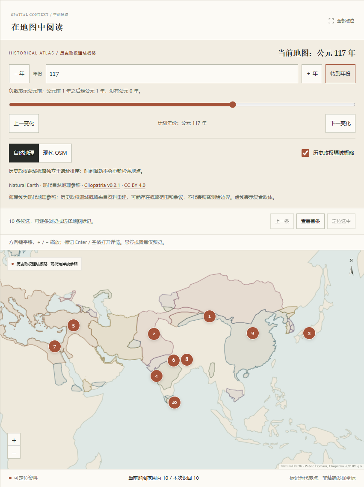

# 考古图志 · ArchSearch

面向古代遗址资料的语义检索与地图可视化课程项目。

当前语料 `global-v2` 共600条：保留 Pleiades v4.1 地中海罗马资料500条，新增全球历史遗址100条，覆盖古代至近现代。提供本地多语言语义检索、BM25 对照、原文证据与地图联动。

## 600条资料与断代核验

原500条的ID、原文及名称／位置记录分期证据保持不变，原抽样矩形和 `roman` 条件只约束这批资料。新增资料使用 `wd:Q…` 命名空间ID，`historic-site`（历史遗址）类型用于全球古代至近现代资料。两批共享原文检索流程；原500条的其他类型标签也继续保留。

新增100条按东亚20、南亚15、西亚及中亚15、非洲15、欧洲10、北美10、南美10、大洋洲5分配；默认阶段的年代分组为公元500年前50条、501—1500年25条、1501—2024年25条。策展候选经过来源核对后，按 `SHA256("global-history-v1:"+id)` 固定排序；这是一份配额策展样本，并非对全球遗址的随机代表性调查。

`global_sites.json` 保存新增资料；`chronology.json` 分别保存600条核验记录和有来源支持的历史阶段；`global_manifest.json` 冻结ID、配额、来源版本与SHA256。加载时离线校验全部文件。原500条仍可用原固定归档独立重建，新增资料以冻结的策展清单和引用摘录复核，不依赖运行时抓取来源页面。

阶段区分建造、使用、改建、毁损及其他事件，记录原文摘录、来源、日期精度和默认阶段。明确单年、约略年份、区间及仅有时期描述分别保存；世纪边界只用于浏览，不意味着整个世纪持续活动。未找到独立断代证据的原记录显示“已核验，断代未确定”，不把 Pleiades 名称／位置的起止年份换成遗址生命周期。核验由代理对照来源进行，方法与范围随记录保存，不标成人工或专家确认。

当前149处有176个来源支持阶段（原500中49处、新增100处），451处保持断代未确定。新增100条的109个阶段由另一代理逐条核对出处、摘录、事件类型和精度；28个阶段为明确单年。地理去重按实体身份与资料颗粒度处理，整体遗产范围仍可能覆盖原语料中的单体遗迹（如迦太基整体遗产与一处罗马别墅），不宣称空间互斥。

新增记录的身份、别名和可核对代表点来自固定版本 Wikidata，权威遗产页面或考古文献提供历史阶段。UNESCO描述遵循 CC BY-SA 3.0 IGO，Wikidata结构化资料为CC0；其他文献仅保留引用与短摘录，各自许可见记录。代表点始终不是实测发掘坐标。

## 交付流程

初始化 `main` 后，所有功能在 `feature/dev` 开发。每个完整功能批次同步本文档，经过本地检查、独立审查和 CI，再由 GitHub Actions 机器人批准并 squash 合并；`main` 要求 `quality-gate` 和一个批准。

输入中文研究问题，在结果列表与地图间双向定位，查看原文、分期证据、代表点精度和来源。支持语义/BM25切换、类型筛选、10/20/50条结果与20对中英文评测查询。

## 阅读结果与证据

页面提供港口、浴场、别墅庄园、剧场、佛教石窟和工业遗产六组示例：语义模式使用中文问题，BM25模式使用英文原词，点击示例会同步选择对应类型。全球示例涵盖莫高窟等石窟和近现代工业遗产。它们用于熟悉检索方式；正式效果对照仍使用固定的20对双语评测查询。

结果上方保留成功提交时的查询、模式、类型、结果上限和资料版本。语义模式显示参与排序的资料数量，BM25显示有字词匹配的数量；这些数量不代表经人工确认的相关地点。改写输入或请求失败后，旧结果仍与原来的查询上下文对应。不同模式、不同查询的分数不能直接比较。

目录式描述优先展示可用的原始补充记录，并注明原文来源；`Untitled`显示为“未命名地点 · #编号”，详情继续保留来源标题。空补充字段和字面值`None`/`null`明确标为未提供，不生成中文历史摘要，也不改变规范化语料及索引文本。

原500条详情保留入选所需的`roman`分期依据，其他时期关联可展开阅读。起止年份属于整条名称或位置记录，可能跨越多个时期，不能当作单个分期的边界或遗址建造年代。负年显示为公元前，正年显示为公元；缺失值和0保持明确的来源状态。`confidence`与`association_certainty`提供中文释义并保留原值，推断类注明“无同时代证据”，依据[官方置信词表](https://pleiades.stoa.org/vocabularies/attestation-confidence)；`precise`/`rough`遵循[官方GIS字段定义](https://atlantides.org/downloads/pleiades/gis/)，不承诺米级误差或发掘坐标，概略代表点可能只是一个范围的中心。新增全球资料另外展示权威出处、Wikidata身份与代表点来源。

“原文字词匹配字段”仅说明词面重叠，不解释语义模型的排序依据。页面下方的方法指南说明发现、比较、核验三步用法，以及抽样范围、多标签类型计数、代表点和检索分数的阅读边界。

## 检索与地图交互

地图默认全球视图、公元117年，以本地Natural Earth现代自然地理轮廓参照展示“历史政权疆域概略”。可输入年份、拖动时间轴、逐年前后移动或跳转上一／下一疆域变化时点；公元前1年之后直接进入公元1年。自然地理与现代OSM底图可切换，疆域层独立开关，保留查询、排名、选中遗址与年份。复合政体无填色、虚线描边，普通政体使用浅填色；点击可读来源原名、原始区间、版本和许可。

主动点击或键盘确认遗址时，默认历史阶段的明确单年自动切图；约略年份、区间和时期先显示证据，须在详情选择观察年份并确认。切换阶段同样遵循此规则，悬停或聚焦预览不切年。来源早于公元前3400年等超出覆盖的阶段保持真实日期并提示“该年份无可用疆域数据”，保留成功地图，不夹到最近年份。断代未确定的资料不补造年份。

年份请求采用200毫秒防抖、请求取消与响应身份检查。手动调年优先于晚到的详情；旧成功或旧失败响应都不能回写新视图。失败时年份草稿和错误提示与“当前地图”年份分开展示，疆域及年份标签保持最后成功状态。遗址标记在疆域之上，位置仅供参照，不自动判断历史政治归属。跨日期变更线的结果按最短经度弧定位，显示副本保持源坐标不变，列表和地图范围统计仍对应原候选。

请求等待期间，相同查询、模式、类型和上限只提交一次；修改条件后可以提交新检索。“取消本次检索”停止浏览器等待并忽略晚到响应，保留已有列表、地图、链接和导出快照。已经开始的服务端模型计算可能仍会完成。结果区明确标示更新进度，等待期间仍可浏览已有候选。

请求失败后可“按原条件重试”：恢复失败时的查询、模式、类型及结果上限，再发起一次请求。它不会改用其他检索方式或悄悄放宽筛选。筛选区和空结果区均可清除当前类型，保留其他表单条件并重新检索；问题为空时不提交请求，同时停止旧请求的等待。

右上角刷新会同时检查运行状态并重新加载类型，首次类型加载失败后无需整页刷新即可恢复。刷新幂等替换类型选项并保留当前选择，不会清除并发出现的搜索错误；类型暂时刷新失败时保留之前加载成功的选项，已失效的选择会明确提示，要求改选或主动清除。

地图上方可按当前结果排名逐条浏览，显示选中序号、总数及地点名；首末位置不会循环。列表、地图高亮与详情同步，名称相近或代表点几乎重合的地点仍可逐条打开，坐标保持原值。“定位选中”关闭详情、将选中标记移到地图中心并聚焦；可用Enter或空格再次打开详情。“全部点位”恢复当前返回结果的整体范围。

悬停或用键盘聚焦结果卡片、地图标记，会同时预览对应的卡片与标记，并显示地点提示；焦点预览优先于鼠标。预览保留原来的选中项，不主动移动地图、滚动列表或请求详情；点击或Enter/空格才打开资料。重合点位也可以通过列表逐条预览与选择。

地图下方显示“当前地图范围内 X / 本次返回 N”，按代表点中心是否落在整个地图容器内计算，包含详情抽屉覆盖的部分；列表只为范围外地点提示“当前地图范围外”，无有效标记时说明无可用代表点。平移、缩放和调整窗口大小会更新提示，仍保留原始排名和全部返回候选，不提交新的检索，也不是全库的地图范围筛选。

打开详情时，地图按抽屉实际占用宽度将选中点移到可见区域；调整窗口大小时继续适配当前选中位置。用户手动平移或缩放后停止这种自动适配，新选择或主动定位时再调整视图。手机上空间不足以同时展示详情和标记时，可用“定位选中”查看地图。这些地图操作只作用于本次返回候选。

页面开头提供键盘可见的“跳至检索 / 跳至结果 / 跳至地图”入口。地图聚焦后可用方向键平移、加减键缩放，再Tab到标记并用Enter/空格打开详情。检索完成、取消或失败时，若焦点仍在等待区域，会移到可见的结果或反馈；用户已转去其他区域时保留其焦点。手机上会将交接目标滚动到屏幕内。

## 保存与复查检索

完成一次检索后，可在结果上方复制检索链接或导出本次结果JSON；成功的零结果也可以保存。两项操作始终使用最近一次成功请求的完整快照，改写输入、正在等待的新请求或请求失败不会混入旧结果。

检索链接用`q`、`mode`、`type`、`limit`保存条件，新增`year`、`basemap`、`boundaries`、`site`和`phase`保存成功地图视图与选择。旧检索链接继续可用，地图切换成功或改变选择后同步地址栏。重新打开时，页面先检查本地服务与类型，再按原条件检索一次，恢复选中遗址、阶段与显式保存的地图年份；保存年份优先于阶段默认年。非法或重复参数、未知类型会提示并停止自动检索；阶段失效会明确提示并保留年份。模型未就绪时保留条件，准备后需手动提交，不会替换为BM25或放宽类型。加载期间修改表单会取消待恢复的自动检索。链接支持界面的10/20/50条上限，不包含结果数据或模型；复查仍受服务和语料版本影响。

复制失败时显示并选中链接，可用Ctrl+C或Command+C手动复制。从`127.0.0.1`页面复制的地址仅指向访问者自己的设备；在Mac与Windows之间复查时，应从可访问的Tailscale Serve地址打开页面再复制链接。

导出升级为 `schema_version: 2`，包含UTC导出时间、成功检索快照、完整API响应、选择和多来源许可。`map`保存最后成功显示的年份、底图、疆域开关、帧ID与疆域版本，尚无成功视图时为null；等待或失败的年份不冒充已显示年份。它用于保存当次候选，未添加人工相关性判断或历史结论。JSON文件由浏览器本地生成，无需额外服务；生成后释放临时下载地址。

界面放大了原文和关键辅助文字，窄屏保留两行摘录。打开资料详情后焦点进入详情区域，手机上同步滚动到详情；来源内容未变化时保留阅读状态，晚到的详情刷新不会让正在阅读的键盘焦点落到页面外层。关闭后重开同一地点时，已取消或过期的详情请求不会写入新详情或错误提示。地图标记可用Enter或空格打开；关闭或按Escape返回触发的结果卡片或地图标记，长资料的关闭按钮保持可见。

## 环境与数据验证

需要 Python 3.12 和 [uv](https://docs.astral.sh/uv/)。在仓库根目录执行：

```powershell
uv sync --locked --dev
uv run --no-sync archsearch prepare
uv run --no-sync archsearch prepare-history
uv run --no-sync archsearch serve
```

浏览器打开 `http://127.0.0.1:8000/`，API状态地址为 `/api/status`。首次准备下载固定版本E5模型（单份权重约471MB）并构建600×384向量，需要联网。升级语料后须重新运行 `prepare`，旧500条索引会被明确识别为失效；模型文件可复用。后续启动和新的中文查询只使用本地资源；首次查询包含模型加载，后续请求复用编码器。应用采用CPU推理，运行不需要Node.js、GPU或外部模型API密钥。

## 本地历史地图数据服务

首次联网准备历史政权疆域概略，之后运行期仅查询本地SQLite：

```powershell
uv run --no-sync archsearch prepare-history
uv run --no-sync archsearch serve
```

固定使用 [Cliopatria v0.2.1](https://github.com/Seshat-Global-History-Databank/cliopatria/releases/tag/v0.2.1)，提交 `5f433377139a6eeaeacbdc894b70f8805b72c8b5`，归档SHA256为 `e10a4e429fca708788ff9e7572a95fce801fae55852d217cffabc1c59cd4eed4`。准备命令校验下载和结构，在临时数据库完整构建及验证后原子发布；有效缓存直接复用，失败不替换旧库。完整归档保存在 `.archsearch/downloads/`，数据库为 `.archsearch/history/cliopatria-v0.2.1.sqlite3`，均不进Git。使用自定义目录时仍将 `--home <目录>` 放在子命令前。

API允许公元前3400年至公元2024年，负数表示公元前，不提供0年；按来源 `FromYear ≤ year ≤ ToYear` 闭区间查询，保留原始字段与有效区间，不插值。来源的6条终年0记录在查询中止于公元前1年，原值及转换说明保留。13797条来源中仅13412条POLITY参与索引，排除385条RELATION；复合政体通过原始Components识别，不能视为成员主权归属推断。16个来源退化环保留并计数，未宣称通过完整拓扑质量认证。

`GET /api/history/boundaries?year=117` 返回GeoJSON及 `metadata.year/valid_from/valid_to/frame_id/source/normalization`；117与126年为相同活动疆域帧，127年发生变化。响应支持gzip、ETag和304重验，服务缓存限制为4帧且最多32MiB；ETag包含请求年，帧ID表示相同活动集合。`Cache-Control: private, no-cache`允许保存并要求复查，普通检索API保持 `no-store`。缺失或损坏的历史缓存返回503及 `prepare-history` 指引，基础检索继续可用；`/api/status.history`提供就绪状态、版本、年份范围和变化时点。

本地 [Natural Earth](https://www.naturalearthdata.com/about/terms-of-use/) 1:110m陆地轮廓随应用分发，`static/data/land-source.json`记录固定提交、SHA256和公有领域许可。它是现代自然地理参照，未重建古海岸，也不提供现代国界。Cliopatria遵循CC BY 4.0，保留 James S. Bennett、Cliopatria贡献者和Seshat署名、来源及加工说明。疆域是来源中的历史重建，空间和时间精度不一，不等于逐年精确实测国界。

界面、字体回退、Leaflet、Natural Earth轮廓和已准备疆域均在本地；准备完成后断网仍可检索、切年和联动。现代OpenStreetMap参照底图需要联网，瓦片失败时会显示提示，资料、地图标记与点选仍可用；可重试或切回自然地理。语义模型未准备时提供明确指引，可手动选择BM25；不会将关键词结果冒充语义结果。

默认模型、索引与报告在当前工作目录的`.archsearch/`。可用全局参数 `archsearch --home <目录> prepare`指定其他目录，serve和evaluate使用相同目录；该参数应放在子命令前。准备完成后再次prepare会校验并复用模型、重建索引。安装若受本机镜像配置影响，可用 `uv sync --locked --dev --default-index https://pypi.org/simple`明确选择官方源。

已提交的 `src/archsearch/data/` 包含原500条规范化地点、所选ID、清洗清单和新增全球资料及阶段核验文件，可直接离线读取。以下命令只重新生成原500条，不覆盖全球策展记录：

```powershell
uv run --no-sync python -m archsearch.corpus --rebuild --download
```

归档缓存位于 `.archsearch/downloads/`。清单记录原始归档与语料SHA256、源版本、筛除计数和加工规则：经纬度矩形 `[-6,29,37,46]`、有效代表点、六类人工遗存、名称或位置的 `roman` 分期证据，再按 `SHA256("mvp-v1:"+id)` 排序取500条。7,849条符合条件；全部原始分期、原文和贡献者继续保留。

依赖固定使用官方PyPI与PyTorch CPU源，模型下载缓存、虚拟环境和索引不进入Git。仓库维护者可运行 `./scripts/github_admin.ps1 -Operation Verify` 回读PR保护设置；该脚本从本机Git Credential Manager读取身份，凭据仅存于进程内存。

前端源码位于`src/archsearch/frontend/`，审批回归为`approval.test.ts`，均使用严格TypeScript。开发需要Node.js 24与pnpm，版本由根`packageManager`固定为11.25.0；依赖由根`pnpm-lock.yaml`管理：

```powershell
pnpm install --frozen-lockfile
pnpm typecheck
pnpm build
pnpm test:frontend
pnpm test:workflows
```

`pnpm build`生成浏览器执行的`static/app.js`、`static/research.js`、`static/map-view.js`、`static/history.js`及各自source map，均随源码提交；修改应用逻辑时编辑TypeScript源码，由构建生成JavaScript。`research.ts`集中处理链接校验和版本2导出，`map-view.ts`处理预览、跨日期线定位和范围提示，`history.ts`处理时间轴、独立图层与地图请求状态。前端测试执行实际助手源码，覆盖年份0、竞争请求（包括旧失败）、快照一致性、图层和范围统计。Leaflet保留本地原版发行文件。应用运行仍只需Python和已生成资源，Node.js与pnpm用于开发构建。

CI在Windows与Ubuntu执行Python锁定安装、Ruff、mypy、pytest，以及pnpm冻结锁文件安装、TypeScript检查、构建、前端交互助手测试和真实Octokit回归；同时校验编译产物与源码一致，不下载模型或全量资料。`main`要求一个批准及`quality-gate`，管理员同样受约束，禁止强推和删除。默认分支的`workflow_run`核实可信仓库、作者、分支、最新CI及当前head后，由Actions机器人批准并自动squash合并；审批任务不检出或运行PR代码。

每批合并后，备份旧head并保存工作区；确认远端开发分支仍为已合并head，才使用明确旧SHA的`--force-with-lease`对齐main。租约失败停止同步，保留远端新增提交。

## 检索与 API

两种检索共享`build_document()`构造的原文，包含名称、别名、类型、描述及补充记录。地图年份不筛选检索候选；未加入LLM或历史政治归属推断。BM25使用正Robertson IDF、k1=1.5、b=0.75；无词项匹配就返回空结果。英文词语、地名和已有中文别名适合关键词基线，中文零命中不意味着资料不存在相关地点。

语义检索使用 [multilingual-e5-small](https://huggingface.co/intfloat/multilingual-e5-small)，固定revision `fd1525a9fd15316a2d503bf26ab031a61d056e98`。文档添加`passage: `、查询添加`query: `，L2归一化后以NumPy精确点积排序。模型最多512 token，本语料有2条长文档会被截断，BM25仍使用完整词项；完整原文保留。相似度是排序分数，不是相关概率，候选仍需人工核验。

索引绑定地点顺序、检索文本hash、模型revision、前缀、归一化和模型文件校验和。缺失或损坏时明确标为未就绪，语义请求返回503；BM25继续可用，不进行隐式替代。修复后可刷新状态；模型加载失败时重新prepare并重启服务。

| 接口 | 用途 |
| --- | --- |
| `GET /api/status` | 语料版本、数量、语义状态及历史版本、可用年份与就绪原因 |
| `GET /api/history/boundaries?year=...` | 本地年度政权疆域GeoJSON、原始区间、来源与帧元数据 |
| `GET /api/facets` | 类型ID、中文标签和数量 |
| `POST /api/search` | 查询、模式、类型筛选及候选排序 |
| `GET /api/sites/{id}` | 原文、别名、代表点、分期证据、多来源、核验状态、历史阶段和默认阶段 |
| `GET /openapi.json` | 完整接口与字段定义 |

搜索请求示例：

```json
{"query":"罗马时期的剧场","mode":"semantic","type":"theatre","limit":10}
```

`mode`支持`semantic`或`bm25`；type可省略或为null；limit默认10、范围1—50。空查询、超过500字符、未知类型及额外字段返回422，未知地点返回404。响应包含Site、分数、词面匹配字段、耗时和语料版本；匹配字段不是模型的因果解释。

## 可复现评测

`src/archsearch/data/queries.json`提供20对中文和忠实英文查询。相同语料分别运行BM25/E5 × 中文/英文四组；中文组体现跨语言检索，英文组提供同语言对照。中文BM25的劣势不能单独证明语义排序普遍更优。

```powershell
uv run --no-sync archsearch evaluate
```

默认生成`.archsearch/reports/evaluation.json`、`evaluation.pool.json`及带签名的空白标注模板。`--output`接受JSON文件路径。报告独立记录固定预热查询的冷启动时间，四组均值、中位数和p95仅统计预热后的编码与检索，不包括下载。

人工标注流程：

1. 将报告`artifacts.qrels_template`指向的模板复制为`.archsearch/reports/qrels.reviewed.json`。
2. 填assessor；为四组Top10并集的全部候选填写relevance（0不相关、1部分相关、2高度相关）与原文依据evidence。
3. 核实全部20个问题后，将confirmed设为true，保留原有语料与查询契约hash。
4. 运行：

```powershell
uv run --no-sync archsearch evaluate --qrels .archsearch/reports/qrels.reviewed.json
```

未提供、未确认、未完成标注或检索失败时，metrics保持null。过期语料/查询、未知或重复ID、缺失依据及未知字段会被拒绝。模板升级会生成新签名文件，不覆盖已有人工标注。

Recall@5以已标注相关地点为分母，nDCG@10采用分级收益；候选池未穷尽全库全部相关地点，因此不能称为全库真实召回率。无已标相关地点的问题不参与指标均值，报告保留计数与覆盖范围。

## 验证

```powershell
uv run --no-sync python -m archsearch.corpus
uv run --no-sync ruff check .
uv run --no-sync mypy src
uv run --no-sync pytest
```

真实模型离线查询与浏览器交互另行本地验证；CI使用小型确定性夹具验证状态、排序与错误处理。

## Windows运行，Mac展示

Windows终端保持`archsearch serve`运行；两端Tailscale应登录同一tailnet并允许相互访问。Windows执行：

```powershell
tailscale status
tailscale serve --bg 8000
tailscale serve status
```

按首次HTTPS配置提示完成设置，将输出的`https://<设备名>.<tailnet>.ts.net`地址复制到Mac浏览器。该地址通过 [Tailscale Serve](https://tailscale.com/docs/features/tailscale-serve)代理本机`127.0.0.1:8000`，只在获准的tailnet内访问。Serve需要后端服务持续运行。

演示前在Mac验证中文查询、关键词切换、时间轴、地图点选和来源详情；历史疆域及自然地理轮廓由Windows本地服务提供，现代OSM瓦片仍由Mac浏览器联网加载。无法访问时先确认Windows服务、两端在线状态与tailnet访问策略，再检查`tailscale serve status`。Mac端跨设备访问需在你的两台设备上完成验收。

## 数据及范围

数据来自 [Pleiades v4.1](https://github.com/isawnyu/pleiades.datasets/releases/tag/v4.1)，采用 CC BY 3.0，地点详情保留贡献者与来源。`roman` 指 [罗马早期帝国](https://pleiades.stoa.org/vocabularies/time-periods/roman)。坐标是代表点，不能视为精确发掘坐标。模型和全量下载缓存不提交到 Git。

本项目进行了地理范围筛选、HTML转纯文本、字段规范化和索引加工；引用原始资料应遵循 [Pleiades引用规范](https://pleiades.stoa.org/help/how-to-cite-pleiades)。源模型遵循官方模型卡所载许可。首版定位为资料发现入口，未加入训练、聊天问答、账号或路线规划。

Leaflet 1.9.4按其BSD-2-Clause许可本地分发，许可位于`src/archsearch/static/vendor/leaflet/LICENSE`；底图署名为©OpenStreetMap贡献者，遵守 [OSM瓦片使用政策](https://operations.osmfoundation.org/policies/tiles/)，不提供批量预取或离线瓦片包。

## 界面预览

实际600条本地模型中文查询与离线历史地图截图（117年）：



本次真实数据、离线浏览器及性能验收记录见 [历史地图验收](docs/history-validation.md)。人工相关性标注未完成，性能通过不等于检索相关性已获证明。

## 本地阶段汇报

`ai_archaeology_proposal/` 保存原开题模板与本地演示材料，整个目录按要求由 Git 忽略，不随仓库推送。2026-10-28 的 MVP 汇报位于 `ai_archaeology_proposal/mvp_progress_2026-10-28/`，包含 LaTeX 源码、真实界面与语料图、逐页讲稿，以及可全屏播放的 PDF。

在该目录执行 `./build.ps1`，使用 XeLaTeX 编译两次，生成 `考古图志_MVP阶段汇报_2026-10-28.pdf`。需要 Beamer、ctex、xeCJK、fontspec、TikZ 等标准宏包，字体随材料附带。汇报区分已实现功能、历史验收与待完成人工标注，未将运行耗时或界面测试解释为检索相关性效果。
