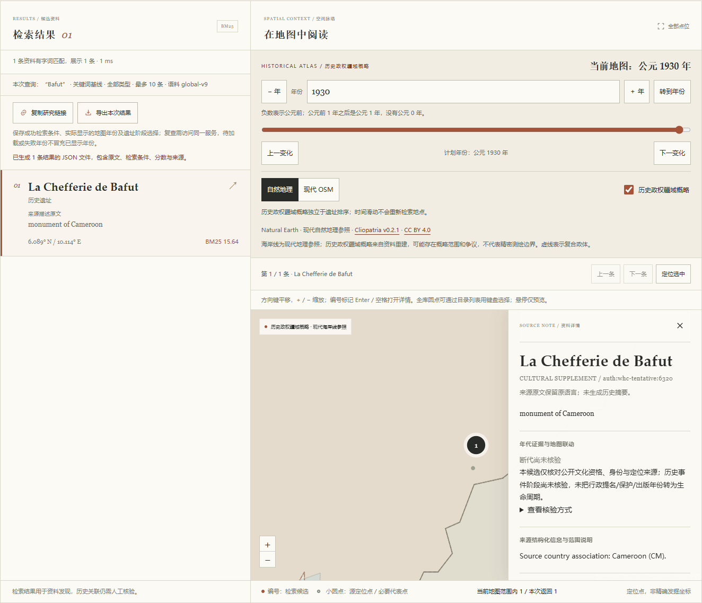

# 非洲文化资料补充验收

本批为`africa-supplement-v1`，语料由1795条追加至`global-v9`的1800条。五个文化对象来自刚果（金）、安哥拉、尼日尔和喀麦隆的正式预备清单；预备清单不是已列入世界遗产，也不是UNESCO对候选文化价值的最终认可。本批不宣称非洲或全球完整覆盖。

## 来源、范围与定位

独立代理对照16份固定来源字节、官方对象与国家页面、Wikidata身份声明、两个被采用的P625声明及原1795条记录／5739条可绘源位置，完成144项校验。源审报告SHA-256为`00cffa1fd91d20af0f6b12b891379ef817b3f19ab534256c722e0aa55750663c`，仅复核文化身份、范围、公开点位与权利边界，不是专家或人工断代确认。

| 对象 | 来源身份 | 本批定位处理 |
|---|---|---|
| Dimba/Ngovo洞穴群 | `auth:whc-tentative:961` | 两洞群尚无核定共同数字代表点，保留空值 |
| Tchitundu-Hulu岩画复合体 | `auth:whc-tentative:6251` | 公开同实体P625原值`[12.877028,-15.938057]` |
| Bura考古遗址 | `auth:whc-tentative:5045` | 本批未采用精细遗址点，保留空值 |
| Djado文化组团 | `auth:whc-tentative:5044` | 不用较宽地貌高原的单点代替整组文化对象，保留空值 |
| Bafut酋长宫 | `auth:whc-tentative:6320` | 公开同实体P625原值`[10.1138,6.0888]`，不修猜官方不规则DMS |

坐标为经度、纬度顺序；precision仅保留在来源证据中，`location_precision`仍为空，不据此标为精确发掘点。三处空值表示本批未采用数字代表点，不表示真实位置未知。未平均多址、不取行政中心、不用现代馆藏地址代替原址。

五条阶段均为`not_reviewed`，没有新增建造或使用年代。文化身份审批不会升级断代状态；当前149条已核验、451条证据不足、1200条尚未核验。所有旧1795条字段、顺序及共享检索文档SHA均逐项保持不变；原世界遗产5632条及海牙107条可绘来源定位未改。

辅助候选目录里历史遗留的`base-sites.json`仍为旧1689条，独立审查已识别且未将它当作当前基线。生产合同使用准确的1795条完整记录SHA `7ce905be26b382ca0484c4e3c7bed04752beb9c0c1252f27e9cfcc7aac268ffa`与身份SHA `2f3badcb912fc0585c554d65f19f68236e2b4b0d9728c81b3e86a509877f3e47`，旧辅助文件不参与运行或重建。

## 离线重建与检查

冻结复核`africa_review.json` SHA为`b3de78f6b0db17c347da2028b351cfae140b9bc5eb15bac871f477986fbca1df`；派生资料`africa_sites.json` SHA为`31ae3d3ca8076e4f1159008ae766fd922dd2483614873fe9474a94192b2165a6`。复核与派生文件由代码中的独立pin约束，离线重建重复两次字节一致；16份可选本地原始证据缓存的实际SHA全部通过。缓存不进入Git，普通运行无需原页面。

检查结果：Ruff通过、Mypy的20个模块通过、Python 719项通过及3项本机Windows符号链接权限相关跳过；pnpm冻结安装、TypeScript检查、构建、前端163项和审批流程21项全部通过。新增47项测试覆盖源审批绑定、原基线、损坏清单、派生字段、路径穿越、来源冲突、空点元数据、地区浏览、范围排除与无模型BM25检索。

原1795条索引被明确识别为失效；使用既有固定模型离线重建1800×384的float32归一化索引。15份模型文件SHA保持不变，无模型或历史全量下载进入CI。`archsearch coverage`统计仍为197个来源国家／地区标签和6个来源分区；代表点1786条主图可显示、3条极区点、11条未采用坐标。多源定位仍是1128个原身份、5739条可绘源记录；加入两个必要代表点后主图6188个逻辑点，三个世界副本绘制18564个Canvas圆点。

## 真实本地检索与限制

原研究问题、全球、区域、南美、海牙及本批六套查询各20对，分别运行BM25／E5与中文／英文，共480次，均完成并生成排名、耗时、候选池和待标注模板。所有相关性指标保持`null`，尚无确认的人工相关性标注。

本批热态单查询E5中文中位约14.02ms、英文约11.90ms；BM25中文中位约3.44ms、英文约2.95ms。此处为本机诊断进程的检索耗时，不包含浏览器、网络或冷启动，也不是通用性能保证。

| 固定专名诊断 | 中文BM25目标排名 | 中文E5目标排名 | 英文E5目标排名 |
|---|---:|---:|---:|
| a01 Dimba/Ngovo | 1 | 6 | 1 |
| a02 Tchitundu-Hulu | 1 | 未进Top10 | 1 |
| a03 Bura | 5 | 未进Top10 | 1 |
| a04 Djado | 1 | 未进Top10 | 1 |
| a05 Bafut | 1 | 未进Top10 | 1 |

这些是含拉丁专名的固定中文诊断，不是对所有中文问题的统计。没有删除失败问题、写入人工分数、添加猜测译名或隐式切换检索方式。完整来源标题结合来源国家筛选的BM25实际API测试五条均为第1；可明确选择BM25或从地区目录进入详情。原文描述缺失和范围不确定性继续展示。

## 浏览器验证

真实Chrome阻断所有外部请求，仅允许本机8766服务，七组交互验收全部通过，未发现本批生产缺陷。报告SHA-256为`666de1fd9180e6ab34df39ac06b0f1cb05452dd1e4c4a223b89d767bf7bec2d3`。桌面及390px截图分别目检，确认无横向溢出。

- 全球1800条、18564圆点与两来源元数据一致；Africa目录95条分两页，五条新增记录均可打开。
- Angola 2条、Cameroon 3条、Democratic Republic of the Congo 3条、Niger 3条目录均正确，筛选保留既有检索排名与1930年历史地图。
- 三条空点可从独立分享链接恢复、打开详情和导出，定位按钮禁用；启用全世界范围矩形仍被排除，清除范围恢复，不出现零坐标。
- 两条代表点原值正确，选择后未触发虚构年代；详情链接与导出批次mixed rights署名正确，源定位仍属于原两个数据集。
- 五个BM25短专名在全库条件下均为第1；首个浏览器中文E5请求成功编码但Bafut未进Top10。该次API耗时5459.07ms可能包含首次模型加载，不能称为热态耗时。
- 分享与导出保留实际1930年、版本和独立选中资料；Space／Enter打开、Escape回原入口，390px键盘流程可用。

本地请求、快照与完整截图在忽略目录`.archsearch/qa/africa/browser/`。下面为实际BM25选择Bafut、保留1930年及未核验断代说明的桌面预览，非生成示意图：



## 复现

```powershell
uv run --no-sync python -m archsearch.africa_data --rebuild
uv run --no-sync archsearch prepare
uv run --no-sync archsearch coverage
uv run --no-sync archsearch serve
uv run --no-sync archsearch evaluate --queries src/archsearch/data/queries-africa.json --output .archsearch/reports/evaluation-africa.json
```

在目录选择来源国家／地区后打开资料，点位空缺不妨碍原文、来源及许可展示；若启用地图范围，清除范围可恢复无点资料。来源与加工权利详见[AFRICA-LICENSE.md](../src/archsearch/data/AFRICA-LICENSE.md)。大面积物理空缺与尚未复核断代仍然存在，下一批继续基于官方证据独立审查。
