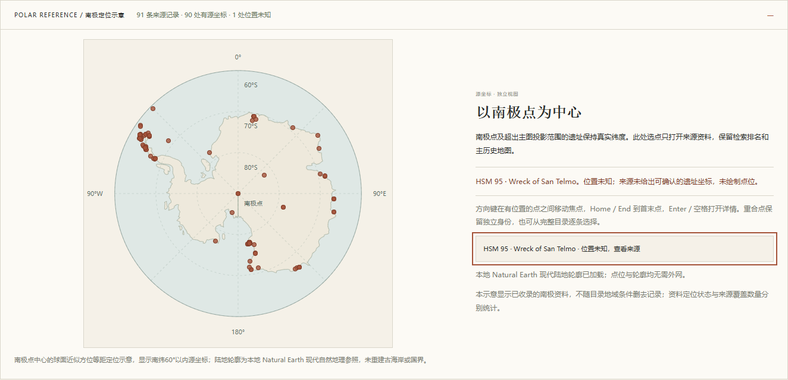

# 南极历史资料、未知位置与极区验收

2026-11-04，语料 `global-v4`。本批在原1534条上增加91条正式南极历史遗址或纪念物；历史时间轴仍为前3400年至2024年，背景年份不筛选检索候选。未接入LLM，不生成疆界、坐标、归属或历史阶段。

## 覆盖与冻结来源

| 项目 | 上批 | 本批 |
| --- | --- | --- |
| 全库资料 | 1534 | 1625 |
| ATS正式HSM | 0 | 91／91 |
| 来源国家／地区 | 159 | 159，不推断南极主权 |
| 来源分区 | 5个UNESCO报告分区 | 原5区＋独立南极分类 |
| 主图可显示代表点 | 1534 | 1621 |
| 有坐标但超出主图投影 | 0 | 3 |
| 真实位置未知 | 0 | 1 |
| 有来源支持的阶段／断代证据不足／尚未核验 | 149／451／934 | 149／451／1025 |

国家／地区数与地球空间覆盖不是同一指标。本批扩展到南极，不将提议国、管理国或探险队国籍填为国家归属；因此国家数保持159。来源分区也不是七大洲分类。新版501条无来源地理标签、593条无国家标签，含91条明确保持国家中立的南极资料。

主来源为[南极条约秘书处（ATS）APA数据库](https://www.ats.aq/devph/en/apa-database)，抓取日2026-11-04。公开客户端使用只读POST `https://www.ats.aq/devphbackend/api/apa/search?lang=e`、请求体 `{}`；详情由 `/api/apa/{内部ID}?lang=e`读取。上游没有不可变发布版，故固定原始查询及91份详情的SHA256，拒绝静默更新。

- 原始查询182条：HSM 91、ASPA 84、ASMA 7。选择 `type.id == 1 && isDeDesignated == false`；后两类整体排除，包含其中已撤销记录。
- 查询344370字节，SHA256 `f2e9b4132d3521731d6aa571f942a3640df410735f60ae435080d96cc9ebd694`。
- HSM编号1—96，源快照缺12、13、25、31、58；不补造或推断缺号原因。
- `ats:hsm:<编号>`为本地稳定ID，来源数据库内部ID另存，用于正确的公开详情链接；两者不可互换。
- [官方版权声明](https://www.ats.aq/e/copyright.html)明确CC BY 4.0，版权页原档SHA256 `396f426ddb211048ca4f26c398976168e2ef343e4356328ee9babd87d0d7b7ac`。保留ATS署名、源链接和加工说明，排除媒体。
- 原文仅做HTML转纯文本、空白规范化及字段组织；未生成中文历史摘要。`polar_manifest.json`保存逐ID来源、校验、定位方法和核查记录。

`polar_sites.json` SHA256为 `1eb2c3d31f15c20d3e4ac3e5243ca0f40a32e730c24b859ecaa317f80bd04db3`。重建方式：

```powershell
uv run --no-sync python -m archsearch.polar_data --rebuild --download
uv run --no-sync archsearch coverage
uv run --no-sync archsearch prepare
```

源缓存默认 `.archsearch/downloads/ats-hsm-v1/`，可指定 `--source-cache <目录>`，已有缓存可省略 `--download`。完整缓存不入Git。运行期只读规范化资料，普通部署不需原始缓存。先前所有11个数据文件与原HEAD逐字一致，原1534条检索文本、坐标、阶段不变。

## 定位与断代语义

90条有来源参照坐标，其中87条可由主图Web Mercator如实显示，3条超出纬度上限85.0511287798°。原始坐标始终为WGS84 `[经度,纬度]`。

| 记录 | 保留的证据与行为 |
| --- | --- |
| HSM34 Arturo Prat胸像 | 原十进制空，官方DMS为62°50′S、59°41′W，严格换算为[-59.68333333333333,-62.833333333333336]；原胸像2003年迁走及2008年替代物原文保留 |
| HSM95 San Telmo沉船 | 来源[-70,-62]为最后目击参照，沉船真实位置未知；`repr_point=null`、`point_count=0`，保留检索、目录、详情与导出，不绘制遗址标记 |
| HSM1与HSM80 | 原纬度-90保留，经度为来源参照约定；两个记录身份独立，不因重合而合并或改变位置 |
| HSM24 Amundsen石堆 | 原纬度-85.173278保留，不在主图夹取到投影边缘 |
| HSM68补给点 | 1994年物品移走的原文保留，不宣称原物仍在原处 |

91条均完成官方名录身份、原文与定位语义核对，历史阶段则为 `not_reviewed`。保护认定、采用文书与管理年份不转换为建造或使用阶段；例如80号原文1911-12-14搭建帐篷与2005年保护认定含义不同。本批无默认阶段、无自动切年。新增阶段仍需逐条核查事件、精度、出处并由独立代理复核，不把本轮核查标成专家或人工鉴定。

## 地图、接口与保存

全库统计、目录分页和检索保留1625条资料。`/api/catalogue`每条附 `location_status=mapped|polar|unknown`；`repr_point`允许为null。`/api/coverage.locations`为1621／3／1，`polar_authority`独立保存ATS 91／91与排除类型，原世界遗产分母1033／1033保持不变。

主图只绘制mapped点；极区与未知位置各有明确提示。南极定位示意采用以南极点为中心的球面近似方位等距投影，南纬60°在外圈，0°在上、90°E在右。源经纬度保持原值；不宣称椭球精密测绘或米级距离。轮廓由本地Natural Earth裁至60°S并投影，现代自然地理参照不等于古海岸、国界或政治归属。

示意内90个有坐标点保留独立按钮，未知位置另列。方向键、Home／End逐点聚焦，Enter／空格明确选择，重合的南极点记录仍可分别访问。选择极区点打开示意但不抢焦；“查看极区位置”关闭详情并聚焦原点，Space可重开详情，Escape返回触发按钮。若该示意或目录已折叠，则焦点回到持续可见的选中摘要。示意失败明确显示错误，保留成功轮廓、已知点与网格；新旧响应使用取消及身份检查。

极区操作不移动主图、不改历史年份、不改检索排名；示意显示全库南极资料，不随目录筛选删去点。分享保留 `ats:hsm:`身份、`antarctica`分区和实际成功地图年份。v2导出保留完整独立选中资料与null坐标、实际检索快照和ATS CC BY4署名，不补分数或政治归属。模型及历史数据库均未准备时，目录仍可浏览和复制研究链接。

完整目录初次失败时，仍可从单条详情或检索结果获取已验证ATS资料，用于独立定位；示意明确标注“仅已读详情，完整目录未就绪”及当前真实条数，不冒充91条全库。完整目录重试成功后原子替换为全量资料，保留当前选择。轮廓重试按钮隐藏前将键盘焦点移到持续可见反馈。

## 独立核查与本机验证

另一代理逐条对照91份实际源缓存，核实身份、内部ID、原文、源SHA、未知语义、DMS、极纬、国家中立及断代状态；重新联网回读查询、版权、34和95详情，与冻结原档逐字一致。两次真实缓存重建均字节一致。伪造位置、极纬夹取、提议国当归属、DMS、内部ID、许可和自更新哈希的修改均被拒绝。

域模型引入可空点后，明确保留旧资料非空坐标与至少一条来源定位记录约束。独立复查发现并修复了旧99条地理叠加绕过Site校验的路径，新增自更新清单哈希的两路攻击回归。实际1625条轻量目录与17页完整目录无漏重；同一旧1534条在变更前后80次BM25及模拟语义查询的ID、分数、匹配字段和候选数一致。

Windows Chrome1440×1100和390×844，本地FastAPI服务，阻断浏览器全部非本地网络：

1. 1625条总数、159国家、6分区、ATS91／91与UNESCO1033／1033正确；南极目录50＋41条，无伪AQ国家。
2. 90点与1条未知分别显示，三处极纬不变；本地轮廓加载成功，无依赖外部瓦片。
3. 真实本地E5新中文查询可返回80号帐篷及95号沉船候选；不是整体相关性评测结论。
4. 95号可搜、可分享、可导出，定位禁用，无沉船标记，导出原始null和1930实际显示年份。
5. 改年保留排名；极点Enter／Space、Home／方向键、Escape焦点返回正常；折叠触发视图后焦点落到可见摘要。
6. 无查询链接恢复未知位置与2024年，不发起检索；缺模型和历史库时目录链接仍可复制。
7. 模拟本地轮廓503仍保留90点、未知入口及网格；过期成功／失败响应不能覆盖新轮廓。
8. 390px无横向溢出，主图视角与年份不受极区操作影响，无控制台错误。
9. 初次目录503且链接含南极分区时，合法独立详情仍可读取并定位；部分资料范围明确标注，目录恢复后原子补全91条并保留选择。独立详情恢复错误不会被目录成功误清。

本机热态15次测量中位数：覆盖3.6ms、全库目录15.4ms、南极50条分页6.1ms、1930疆域116.6ms、2024疆域100.8ms，含本地HTTP、gzip解码及JSON解析。1930最大140.5ms、2024最大192.7ms；仅代表本机。离线初始全库视图约403ms，展开示意并加载本地轮廓约30ms。

1625×384本地E5索引已重建。原20对研究问题和20对全球问题完成BM25/E5 × 中文/英文共160次检索，两报告 `runs_complete=true`、`status=awaiting_manual_judgments`、`metrics=null`。96条文档超过512 token，模型按上限截断，BM25及详情保留全文；不以单个命名问题命中证明排序普遍改善。

285项Python、134项前端及21项审批工作流测试通过；Ruff、Mypy、TypeScript和构建通过。CI使用固定夹具，不下载完整源档或模型；Windows与Linux检查由PR的 `quality-gate`汇总。



## 仍需推进

当前官方世界遗产与ATS覆盖不等于全球遗址全集，各国文保名录及名录外遗址仍需按权威来源扩充。149处阶段有来源支持，其余1025处新名录资料需要独立事件断代核验；451处已核验但证据不足保持未知。纯自然遗产不为增加数量改称历史遗址。相关性人工标注和Mac经Tailscale跨设备验证尚未完成。
