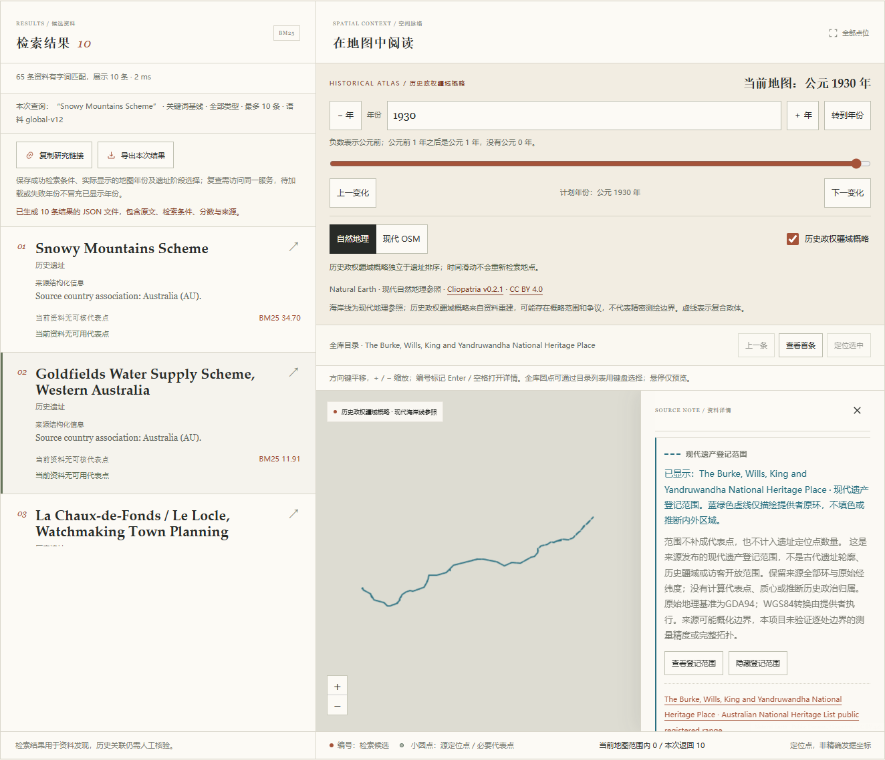

# 澳大利亚文化资料与现代登记范围验证记录

本批将原 1940 条资料追加为 `global-v12` 的 **1999 条**。60 个候选中 59 个纳入、1 个待核；纳入对象包含来源分类 Historic 46 个、Indigenous 13 个。来源、工程、最终整批审查、本地全量检查、真实模型诊断和浏览器验证已有实际结果；跨平台 CI 和 PR 交付保留待确认状态。

## 已完成：来源、范围与权利复核

独立源审完成 2443 项检查，读取全部 60 个候选的官方文化身份与 Location 证据，对照全部原属性、现代公开范围，以及原 1940 条资料和 5851 条来源点。164 件冻结源池文件及 124 件候选来源文件实际字节已核对。生产合同增加 UN M49 固定表，维护缓存合计 125 件必要来源文件，实际 SHA 全部通过；其中网页正文提取结果明确标为派生证据，不冒充原始 HTTP 归档。

| 固定输入或报告 | SHA-256 |
|---|---|
| 源候选 | `0eb2ab872b5051a7ed8aada4643fa5871233c0f54750b5dd2f5e04517124078c` |
| 独立逐条源审 | `b67bd41424df6df95c6dc4fe0a3ec352d1d376cc9ffd2d1877c339dd98477b70` |
| 独立方案投影 | `bb2775051443d346affb14b49d1a3d3eb5ab86dc3a9dc5861fc13441f6f60928` |
| 独立工程复核 | `43f4bbcf762ef96e906f309fd541f31513e679d404269e5dbee2a9daf0106bb0` |

Recherche Bay (North East Peninsula) Area（`105665`）保持 `hold`：文化身份有据，但现有来源尚未精确区分其与既有 Tasmanian Wilderness 及已纳入游憩区的对象边界关系。不能用同名、相邻关系或旧代表点不在多边形内，代替整体／组成部分的范围证据。它不增加 Site 或可显示范围。

内部范围交会也按文化对象审查：South Australian Parliaments 与 Adelaide Parklands／City Layout 的对象范围有正式区别；Centennial Park 与 Mardi Gras Route 的文化关联不同，路线记录不被重述成整个公园的古代建筑。跨 SA／QLD 的同一登记号保留两个原要素，仍只计一个对象。

公开 GIS 与结构化字段采用特定 NHL 数据集的 CC BY 3.0 Australia，保留提供者、原版权、来源及加工说明；官方网页、原住民知识或证词、照片及第三方材料不因此统一开放。本批非开放 URI 的不同英文摘录最大合计 11 词。具体权利与限制见 [AUSTRALIA-LICENSE.md](../src/archsearch/data/AUSTRALIA-LICENSE.md)。

## 已完成：国家或地区、代表点与原环保真

| 项目 | 当前值 |
|---|---:|
| 总资料 | 1999 |
| 来源国家或地区标签／来源地区分组 | 202／7 |
| 主图可用代表点／极区代表点／未采用代表点 | 1898／3／98 |
| 本批新增且没有采用代表点的对象 | 59 |
| 可用现代登记范围的对象／来源要素 | 59／60 |
| 来源原环／经纬度记录 | 366／68490 |
| 既有多来源点记录／主图逻辑点 | 5851／6301，均未增加 |

98 条“未采用代表点”是定位状态，不表示 98 处实际位置未知。其中本批 59 条可另行读取现代登记范围；范围不会变成代表点，不进入点层 bbox 匹配、代表点统计或遗址计数。原 5632 条 WHC、107 条海牙和 112 条 NPS 来源点保持原合同。

HMS Sirius 的官方原文仍为 `Kingston, EXT, Australia`，保留 AU 关联。追加 NF 依据是同对象官方 Norfolk Island 文字与 UN M49 的 Norfolk Island／574／NF／NFK 行，不是坐标推国或统一 `EXT→NF`。原来源值与 AU 保留，新标签不覆盖既有国家或地区；来源分组仍为 7 个。

完整保留来源原 15 个属性字段、要素身份、来源顺序及原始适用状态。原地理基准为 GDA94／EPSG:4283，提供者按 `outSR=4326` 返回 WGS84；项目不重新投影、算质心或以顶点补点。全部原环以独立不填色虚线显示，不将 Esri 环强行转换为推测的内外环关系，也不宣称逐处拓扑或发掘精度已确认。

原住民来源存在概化或范围未完全确定等限制；公开图层与缺少单条保密标志不构成精点恢复许可。这里的范围始终是现代登记范围，不是古遗址当时轮廓、古代疆域或游客准入范围。59 条阶段均为 `not_reviewed`，没有新增阶段、分期或历史简介，登记／编辑日期不转为遗址年代。代理来源复核不等于专家或人工考古确认。

## 已完成：实际编译、接口与工程检查

方案投影完成 1746 项检查，使用临时真 pin 离线重建两次，核心资料、清单和范围侧车均字节相同。正式来源缓存校验通过，实际范围 CLI 重建与固定侧车一致。

| 生产文件 | SHA-256 |
|---|---|
| `australia_review.json` | `ecc0205e858b3c7f12d2412f5e04aa2cbdadd5f7d63db644d2a7fd8ee271021b` |
| `australia_sites.json` | `3af625722fa43a8b9559b2ceb81df8835b0cfd1e4ea5213e5d36687d5f70baae` |
| `australia_manifest.json` | `91e33ca37c4fef5360e73cd04811a92fc2883884027ee25caf2142444b96b750` |
| `registered_areas.json` | `2ffa50621c5a1b685770c252e284ca78e58b0e4753a84574ac1e97c9af759ece` |

实际加载后的原 1940 条资料字段、顺序、对象及共享检索全文全部保持不变；其规范化基础合同 SHA 为 `c38269207ddd35bc939f8d20e7e4e9f08e4b4e665a3369fc6cea0979efaef12b`。59 条新资料与批准候选一致，仅加入明确审核绑定和已批准的 Sirius 地区证据；空描述和空阶段保持空。

工程独审绑定 29 个实际工作文件 SHA，无未解决阻塞。独立复跑结果为：80 项 Python 针对性测试、182 项前端测试、18 项范围控制器探针及 TypeScript 检查通过；隔离编译的 4 组变更 JS 与生产资源字节一致，source map 在解析输出相对路径后相同。负例覆盖未配置 pin、伪造来源／范围／国家关联、退化闭环、缺失范围版本、旧响应、路径越界、坏下载与损坏侧车。

真实本地 API 探针逐一核对 59 个新增详情与范围响应。`GET /api/status` 返回范围就绪版本和统计，`GET /api/sites/{id}/areas` 独立返回原环及来源；无范围的旧记录为空数组，未知 ID 为 404。运行期下载调用为 0。损坏范围侧车时，范围清空并提示 `--rebuild`，BM25 和资料详情继续可用。

选择资料仅读取范围；用户主动点击“查看登记范围”才描线和适配视图，不修改历史年份、检索结果或排名。隐藏、关闭、切项与版本变化清理范围并中止旧请求；晚到响应不能替换当前身份。既有历史疆域、时间轴和 1930 年等年度服务的合同未在本批更改，不能以范围数据宣称补出了古代边界。

导出只有在范围真实显示、选中 ID 一致、成功检索／当前语料一致、当前范围版本一致时才加入独立原环快照；隐藏、切项、读取失败或上下文失配均不沿用旧 geometry。来源版本、许可、URI 和 SHA 随快照保留。范围显隐不写入分享链接，恢复链接后仍需主动查看。桌面抽屉遮挡与窄屏紧凑布局已有代码、夹具及下述真实浏览器覆盖。

范围说明随后仅去重一处重复文字：成功读取时保留完整 API 说明，前置“范围不补成代表点，也不计入遗址定位点数量”；加载或空说明时仍保留完整后备声明。独立对比确认只改该赋值及对应测试断言，没有改请求、几何、绘图或导出行为；单独重跑 15 项范围测试及隔离编译通过，4 个实际文件的补充审查 SHA 为 `8f5ac23e647232cec3c98a03aef812f6a4bac0b20bcf240a9bac52e6d82397e7`。原 `43f4…` 工程报告及其历史文件指纹未被改写。

最终整批独审另外冻结 39 个实际代码、数据、README、测试及生成资源路径的 SHA，未发现未解决的阻塞；报告 SHA-256 为 `3d0c3e9eb1f4d6db25d813adac32864fb908a5723b0ec3d5499b03c62d766166`。本次重点复核资料链、NF 注册、新增 4 项真实整合测试、旧批次测试合同、20 对诊断及 CI 构建一致性；4 项真实整合测试独立复跑通过。两份本批文档与预览 PNG 由未参与撰写的主代理另行复核，未以文档作者自审替代。README 中遗漏的当前计数和版本引用已修正，历史批次计数保持原义。

## 已完成：全量检查、真实模型与检索诊断

Ruff 全库检查通过，Mypy 的 25 个模块通过；全量 Python 为 **936 项通过、5 项跳过**。跳过均为本机 Windows 无特权符号链接限制，不代表相应 Linux 场景已在本机执行。pnpm 冻结安装、TypeScript 检查、构建、182 项前端测试及 21 项审批工作流测试全部通过。最终 Python 原日志位于忽略目录 `.archsearch/qa/australia/python-final.log`；跨平台实际 CI 仍单独待取得。

在 `HF_HUB_OFFLINE=1` 下复用固定缓存模型，完成 1999×384 索引准备；15 件原模型文件的 SHA 保持不变。原问题集、全球、区域、南美、海牙、非洲、太平洋／内陆、NPS 及 AU 共九套问题，各 20 对，分别运行 BM25／E5 与中／英文四组，共 **720 次**，全部完成。所有相关性指标继续为 `null`；运行成功、来源审核和目标名次均不代替确认的人工相关性标注。

新增 20 对是面向本批来源的主题诊断，不是盲测或全澳大利亚问题覆盖。其中多条中文问题包含英文专名。以下是完整全库条件下的实际目标名次，不能改述为总体准确率：

| 诊断与目标 | 中文 E5 | 英文 E5 | 中文 BM25 | 英文 BM25 |
|---|---:|---:|---:|---:|
| au07：HMS Sirius Shipwreck | 未进入 Top10 | 1 | 1 | 1 |
| au09：Snowy Mountains Scheme | 8 | 1 | 1 | 1 |
| au12：Burke／Wills／King／Yandruwandha 登记对象 | 1 | 1 | 1 | 1 |
| au16：Sydney Gay and Lesbian Mardi Gras Parade Route | 1 | 1 | 1 | 1 |

没有因 au07 中文语义漏检而改题、补猜中文简介、改排序或隐式切换模式。目录浏览和用户主动选择的原名 BM25 保留为独立入口。

AU 诊断进程内热态查询中位数为中文 E5 **13.6123ms**、英文 E5 **12.19895ms**、中文 BM25 **5.2244ms**、英文 BM25 **3.8572ms**；该组初始化／预热记录 **1381.5252ms**。这些是本机单进程测量，不包含浏览器、网络和完成渲染，不保证完整交互或其他电脑性能。汇总与逐查询原报告分别位于忽略目录 `.archsearch/qa/australia/evaluation-summary.json`、`.archsearch/reports/global-v12/`。

## 已完成：真实离线浏览器

最终真实 Chrome 在阻断非本机来源后完成 **9 组验收、152 个本机请求**，错误列表为空。报告 SHA-256 为 `77098f10ed4da9e5d26e24334f4236e46f8fa86a570e3d3354d340ae55d4e1fc`，原请求、导出和截图保存在忽略目录 `.archsearch/qa/australia/browser/`。最终报告绑定去重后的实际静态资源；初轮结果没有冒充最终截图或请求记录。

1. 页面与 API 的 1999／202／7、1898／3／98、5851 来源点／6301 逻辑点及 18903 个世界副本圆点一致。59 条新记录均为空代表点，范围原数组逐项保留，待核 `105665` 未入库。
2. AU 73 条、NF 1 条可独立目录浏览，不要求先查询；NF 关联保留 Sirius 的原 AU 与 EXT 证据。
3. Burke 跨州两个来源要素由用户主动显示，Canvas 原环不填色，桌面轮廓避让右侧抽屉；空代表点的“定位选中”保持禁用，1930 年、选择身份、检索排名和点计数不变。实际显示时导出保留原环、来源 SHA 与许可；隐藏后及分享重载均导出 `registered_areas=null`，没有冒充已经显示。
4. Snowy 大范围、Sirius 海难范围和 Mardi Gras 文化路线均可主动查看。目录 bbox 仍只匹配来源点／代表点，不把这些空点范围自动纳入；清除 bbox 后恢复目录，已显示范围独立保留。
5. 无范围的普通资料保留原代表点和详情，成功空范围与读取失败状态不同。
6. 快速切项中止旧请求并忽略晚到 Snowy 响应；503 读取失败清理旧范围，主动重试恢复，不影响检索排名或历史年份。
7. 范围版本改变立即清层并导出空快照，明确拒绝旧版本响应；恢复状态后仍需主动重试。
8. 390px 的 Space／Enter 范围按钮、隐藏回焦点、Escape 关闭清层均通过；42% 抽屉给地图留位，来源长行无横向溢出。
9. 只模拟模型未就绪状态，目录和用户主动选择的 BM25 继续可用，没有删除真实模型或隐式回退。

最终浏览器提交新中文问题“寻找 Snowy Mountains 的历史水利遗产”，实际 E5 请求 **16.73ms**，目标仍未进入 Top10；用户明确以原名 `Snowy Mountains Scheme` 另发 BM25，目标首位，请求 **2.33ms**。这与诊断表 au09 的含专名完整中文题是不同问题；不同条件的结果和耗时分别保留，没有人工相关性判定，也不把 API 用时当作完成渲染时间。

以下是实际桌面预览，展示独立的 Snowy BM25 排名、选中的 Burke 登记范围及仍为 1930 年的历史参照；不是生成示意图。发布副本与最终 `desktop-preview.png` 字节一致，SHA-256 为 `f8d11d454ac3c3a2c645a7885b6b75fc637aa377a07ac6e27ce0b8eca45d0ed1`。



## 本轮待验证

以下剩余项目尚未取得完整结果，不能以历史批次或上述来源、模型和浏览器记录代替。

| 项目 | 当前状态与完成条件 |
|---|---|
| 跨平台 CI 与 PR | 本轮待验证；需分别确认 Windows／Linux、`quality-gate`、机器人批准和实际 squash 合并 |

## 复现命令

在仓库根目录执行。核心资料可由随仓库分发的批准合同重建；范围重建需要固定几何缓存。`--download` 是显式准备联网选项，普通运行和 `RegisteredAreasIndex` 不联网。

```powershell
uv run --no-sync python -m archsearch.australia_data --rebuild
uv run --no-sync python -m archsearch.registered_areas --rebuild
uv run --no-sync python -m archsearch.australia_data --verify-source-cache .archsearch/downloads/australia-nhl-v1
uv run --no-sync archsearch coverage
uv run --no-sync archsearch prepare
uv run --no-sync archsearch serve
```

维护环境缺少固定公开几何缓存时，可显式执行以下命令。下载只请求批准的官方逐对象几何；响应受 5MiB 上限及固定 SHA 约束，来源变动时会失败，不默默换用新形状。它不补下载完整官方网页或额外敏感坐标；完整 125 件来源核验需要维护者持有对应固定来源文件。

```powershell
uv run --no-sync python -m archsearch.registered_areas --rebuild --download --source-cache .archsearch/downloads/australia-nhl-v1
```

模型首次准备与评测命令按 README 执行；仅在已持有固定模型时使用离线准备。检索运行成功、来源审核和代码测试都不能代替相关性标注；最终诊断必须保留失败与缺失状态，不通过改问题或隐式切模式修饰效果。
