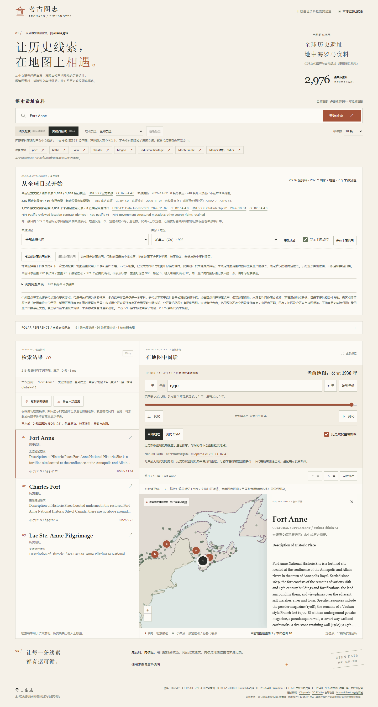

# 加拿大历史文化资料验收

## 来源与收录

本批使用固定的加拿大公园局 Federal Heritage Designations 发布资源，数据版本注明截至2026-03-31。3889条混合认定记录中，按原 `Designation type` 精确选出1014条 `National Historic Site of Canada`，由六页原始响应核对唯一业务编号及全部28字段（含内部`_id`）。独立代理逐条核对文化对象与范围，结果为977条新增、9条关联已有身份、6条关联已有整体组成部分、22条待核或不采用；关联行不增加遗址数。

新增977条全部保留原名、别名和原英文描述，不生成中文历史简介。源池47条缺描述、2条缺主要名称和70条纪念理由／牌文行政复核提示均有独立核对；缺主要名称时明确采用来源第一别名。法国的两条记录仍保留France，未因登记机构位于加拿大而改国别；两条均因既有整体范围关系待核而未新增。全部新增对象来自13个加拿大省／地区，完整库的加拿大筛选为原15条加977条，即992条。

主体来源合同报告SHA为`f6a5a5543aa1ceba17c71eb4a50e5583394bc5821e89ff89aaca2f5dad309530`；最终身份／原文审批SHA为`fba0902bec6fdaffba4dd85997b50b32d21f24fab95f9a0072be612fb2a25232`。两份报告分别覆盖12599与19414项核对。它们不审批坐标或历史阶段，不能当作专家或人工确认。

## 坐标与范围关系

独立点审实际回读全部1014条政府字段及1008个精确`P2526`关联的原Wikidata实体响应，逐SHA、revision、声明、rank、地球坐标及限定符核对；其余6条无精确编号桥，不以名称相近补齐。最终新增资料中965条采用公开参考点：12条NRCan实际`outSR=4326`输出、953条Wikidata原始地球声明；12条不采用整体代表点并保留原声明和原因。

12条空代表点不等同于实际地点未知：长水道两端或不同部位的多个坐标不能任取作整体中心。4条负precision保留完整原声明，采用精度为空，并公开说明；不得取绝对值或换成米级精度。12条多normal声明按原引用来源独立选择，所有其他声明完整保留，不因更多小数位而声称更准确。739号战场通过精确`P2526`／`P821`编号链核对正式遗址地名，未采用指向河流的点；原称、原别名和同省约束保持。

132条范围关系候选逐条回读，89条获批为物理关系，43条仅为背景、邻近、历史比较或存在源冲突；另补5条直接原文证据，形成94条直接有向关系：包含34、位于范围内42、部分重叠14、同址不同历史层2、同处一地但资源不同2。未作自动逆向、传递、范围中心或历史政治归属推断。每条绑定双端原行、原描述、分页SHA与来源URI；新资料的入向、出向关系均公开说明方向。

Blackfoot Crossing与其土屋村、条约签署地保留整体／子址粒度；Fort Anne与Charles Fort保留同址不同层。不同编号不证明空间互不重叠；同一地名、邻近或代表点重合也不证明同一对象。现代认定的纪念区域可以使用公开参考点，但明确其角色，不冒充已找到的原遗址。

点来源审查SHA为`8a2d065c9bf7a5959050dce12ce52788376dcfeb834df3b14b34dc26df6e1e52`；范围报告SHA为`ae0f67fa32851b12b694244b6caac2270ad7860589b02670fd8cb338497247d5`。560／13271的4个端点或部分位置另留呈现提案，尚未接入来源点图层，未将其标为整体代表点。这是仍待完善的多点呈现内容。

## 派生与工程检查

| 文件 | SHA-256 |
| --- | --- |
| `canada_review.json` | `4cfdd4fb896c2769de3d77daaf481fdb1544fc79d0e6d8db4911d97d8ad8afbc` |
| `canada_sites.json` | `f0f31d8c14bd1560975da2c7e454befdda3623198916921aa115248056497aaf` |
| `canada_manifest.json` | `9455bf3ababbd110d2413c61d0ec3dc76f74d4ae1fcf1d44c745d9b57ae9ffb2` |

规范化总库为`global-v13`／2976条，原1999条的对象、全部字段、顺序和共享检索文本逐项保持不变，原库合同SHA为`c35e44db219b9abb61b038bb80c6832d41d368fa840ef91aa7bc19283fb7d313`。最终投影独审完成40385项核对，1068份实际缓存逐SHA通过，连续两次离线派生重建字节一致，报告SHA为`c5cfdb9c687e92f63053583a6192066c82dcab9cc2ecfdae80b2adf89d114ade`。

代码独审发现并修复一项审批绑定缺口：原roster只绑定来源原行与点收据，重新签SPEC／SITES后可能把hold改成include或改挂旧目标。现外部roster绑定完整处置、目标、理由、证据、原行与收据；94条关系另有独立固定校验。原攻击与新增负例实际拒绝，未跳过保护。最终业务代码独审SHA为`c792af54f32d4e41c9c52138cd77a82ece70aa2986acdaa8741aa07d488bafe2`，144项单元测试和11项独立探针通过；永久激活仅替换11个固定校验值并复制已审3份派生文件，补充对比证明没有其他逻辑变化。

全库Ruff、Mypy的26个模块通过；Windows本地Python为1084项通过、5项跳过。跳过来自无特权符号链接限制，不能当作本机已经运行了Linux测试。pnpm冻结安装、类型检查、构建、182项前端测试、21项审批工作流测试通过。另有4项真实加拿大集成测试由独立代理复跑通过，覆盖完整旧库保留、确定性重建、真实目录／详情／BM25及无模型评测状态。CI不下载模型或完整来源缓存。

新增977条仍全部“断代尚未核验”，无新阶段；全库三态为149已核验、451证据不足、2376尚未核验。建造、认定、更新与出版日期未转成阶段。地图代表点为2863可显示、3极区、110未采用；原三个来源定位组保持1239身份／5851条原点／5546个不同坐标／305次同身份重合，补绘必要代表点后为7266个逻辑点，三个世界副本实际21798个Canvas圆点。

## 本地模型与实际诊断

在`HF_HUB_OFFLINE=1`下完成2976×384索引准备；15件原模型文件SHA全部不变，向量为有限float32，最大单位范数误差`1.7881393432617188e-07`。旧1999条索引实际被拒绝并提示重新prepare；没有删除模型或隐式回退检索方式。

原问题集、全球、区域、南美、海牙、非洲、太平洋／内陆、NPS、澳大利亚和加拿大共十套，每套20对，分别运行BM25／E5与中／英文四组，共800次，全部完成。相关性指标均为`null`，人工标注未确认。新增题是面向来源的诊断，部分中文题含英文专名，不是盲测，也不代表全加拿大研究问题覆盖。

下表只记录这些题中指定对象的实际名次，不是人工相关性指标；未入Top10的失败完整保留：

| 题与对象 | 中文E5 | 英文E5 | 中文BM25 | 英文BM25 |
| --- | ---: | ---: | ---: | ---: |
| ca01：Banff Park Museum | 未入Top10 | 1 | 3 | 1 |
| ca06：Fort Anne | 未入Top10 | 1 | 7 | 1 |
| ca07：Charles Fort | 未入Top10 | 2 | 8 | 1 |
| ca10：Elgin and Winter Garden Theatres | 4 | 1 | 1 | 1 |

加拿大诊断进程内热态查询中位数：中文E5为13.1051ms、英文E5为15.4517ms、中文BM25为7.32935ms、英文BM25为8.8635ms；初始化／预热记录1394.91ms。不含浏览器、网络和完整渲染，不保证其他电脑性能。

真实浏览器以Canada条件提交新中文问题“寻找加拿大新斯科舍省的历史要塞”，热态API为13.32ms，Fort Anne未入Top10；用户明确以原名`Fort Anne`另发BM25为首位，API为7.78ms。首次浏览器语义请求记录5459.01ms，包含首次编码器加载且当时并行运行整库测试；冷态、热态与无国家条件的诊断题分别保留，没有混为一次测量或准确率。

## 真实浏览器与地图

Chrome阻断全部非本机来源后，实际遍历加拿大992条完整目录的20页，核对全部977个新ID；无需查询即可浏览。53个本机API请求无页面异常，原文、双向范围关系、主动BM25、E5、已显示1930年及版本2导出均核对；切换国家目录不改已经成功的检索排名和年份。

390px下，长原文／关系详情无横向溢出，Enter关闭和目录键盘选择可用，选择未核验年代的资料保持1930年。另用全局视图逐层计数确认21798个Canvas圆点；1930和2024切年后数量不变，没有据代表点自动赋予历史政治归属。

独立热态探针测得年度API完整响应墙钟时间分别87.14ms、78.99ms；年份提交到成功年份并经过两次requestAnimationFrame分别351.85ms、367.62ms。两次均是本机单次热态测量，满足本次300ms／1秒检查目标，不是其他机器或所有年份的性能保证。历史视图采用本地Natural Earth参照，未重建古海岸；外网失败不影响这些历史地图和本地资料功能。

以下为实际2976条版本的Canada浏览、Fort Anne原名BM25及1930年历史参照。PNG与浏览器产物字节一致，SHA为`f3b37503919ca3d6d9a05e47f538f869d2e3cedfe05c1ad2427a7973e260f3f9`。

## 交付状态

本文件先记录本地已取得的证据。PR、Windows／Linux实际CI、机器人对当前head批准、实际squash合并与精确租约分支同步，须以远端最终结果另行确认；本地检查不能代替这些步骤。完整源响应、模型、索引、排名报告与人工待标注文件均在Git忽略目录中。全球覆盖和中文跨语言检索仍有待完善，未声称所有遗址已收齐或人工评测已经完成。
