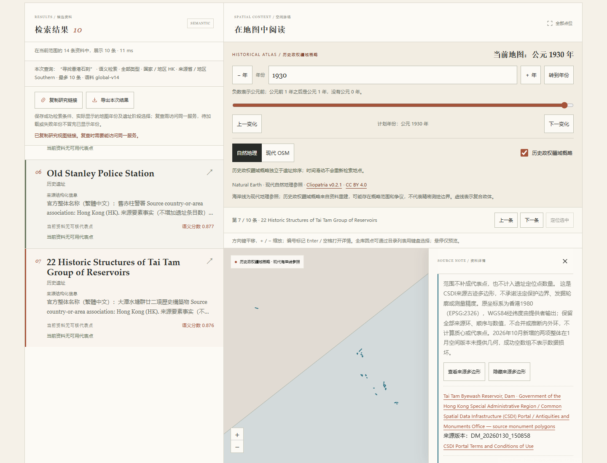

# 香港整体古迹、地区浏览与来源多边形验收

本批将语料从2976扩充到3116条、来源国家／地区标签从202增至203，版本为`global-v14`。七种资料分组保持不变；不是全球全部遗址或全部文化财产的完整清单。

## 原始来源与身份

固定核对2026-01-30的CSDI空间发布及同期138项整体名录，另对照2026-10-02官方140项名录和两项新增公告。逐项核验英文、原繁体中文、限定范围、原业务页面、现库2976身份与范围，最终140项全部合格收录，无重复旧记录或待核项。项目业务页面ID不是永久法定编号。

174个原要素含133个same-whole和41个明确组件关系。上窰村自身与窰址保留同一整体的不同关系；大潭22项构筑物、薄扶林等复合对象不按地图要素或重名重复计数。原始HTTP页、字段和几何收据逐SHA固定，独立原来源核查3220项、正式Core／Polygon投影读回4530项、最终地区侧车读回5518项通过。核验是独立代理对照来源，不是专家或人工确认。

审查发现并修正了UN M49原HTML注释中被误读的旧分类：只接受15个有效单元格。原原始文件校验和、HK／344／HKG及亚洲／东亚关系未改；弃用的提案和修订记录保留在本机审计目录，没有将旧分类发布入库。完整规范化事实另有外部SHA，重签派生文件不能使未审整体标题或分组获得采用。

原2976条的全部序列化字段、顺序与共享检索文本保持原值；149个有阶段对象、176个阶段不改。新增140条无采用代表点、无新阶段。宣布年份保留为现代元数据，不能据此切换历史地图年份。

## 地图与地区规则

提供者实际返回WGS84的174要素、180个原环及4050条坐标记录，未自行转换、概化、合并、推断内外环或计算代表点。138项整体有“来源古迹多边形”，两项10月新增整体在1月空间版本中为空，成功空态区别于来源损坏。它们不被泛称为法定边界、古代轮廓或测量精度。

来源有17种`DISTRICT`值，对应174份原字段证据，去重为139项关联、覆盖138个整体；另外两项不从名字或大区补区级字段。大潭关联Southern及Wan Chai，选择任一区均保留完整整体和全部22项构筑物。这不是香港行政区总数，也不代表整体或全部图形都在所选区。加拿大原993项证据和992个对象保持原值。

香港与澳大利亚图层合计197个有范围对象、234个要素、546个环、72540条坐标记录；澳大利亚原59／60／366／68490不变，仍标为“现代遗产登记范围”。两种来源各保留原语义和许可，单来源损坏不禁用另一个正常来源。范围多边形不进入点位统计或矩形点匹配；全库逻辑点仍为7266，三个世界副本仍为21798个Canvas圆点。

## 本地模型与评测

固定多语言E5模型离线重建3116×384、float32归一化向量，全部有限，最大范数误差`1.7881393432617188e-07`；15个模型文件与扩充前逐SHA相同。旧2976索引被明确拒绝时，原名`李鄭屋漢墓`的BM25仍可工作，没有隐式冒充语义结果。

新向量SHA为`0434c335b2a8a0b455f39554cd8a21c6766f72da18a35b4ab5a2440fe3de6e36`。新增20对中英诊断包含简体问题与原繁体名称对照，完整保存失败名次；这些题不是盲测或人工相关性判断。未完成并确认相关性标注，指标必须保持`null`。

11套各20对中英问题，BM25／E5×中文／英文共880次无过滤诊断已完成，另做24次`country=HK`观察，不混作通用评测。两条石刻英文题依原名修正为复数、一条主题说明收紧后，仅重跑香港80次及24次国家条件观察，原880次证据完整保留。下表汇总当前十套原800次与最终香港80次的逐次热进程耗时，属于两个执行批次，非同一进程的880次性能测试；所有报告指标为`null`，待标注候选全部未填，15个模型文件和66个既有标注文件未变。

| 模式 | 平均ms | 中位数ms | p95 ms |
|---|---:|---:|---:|
| BM25中文 | 6.82 | 6.71 | 10.55 |
| BM25英文 | 7.00 | 6.87 | 10.53 |
| E5中文 | 14.47 | 14.35 | 17.35 |
| E5英文 | 14.47 | 14.55 | 17.50 |

预先指定的六个整体仅作发现诊断目标，不是相关性标签，以下是其在最终无过滤Top10中的实际名次；不能由此推算检索准确率。其他套的问题、未命中与耗时保留在各自原始报告，未因本批新增而删题。

| 问题目标 | BM25中文 | BM25英文 | E5中文 | E5英文 |
|---|---:|---:|---:|---:|
| 大浪湾石刻 | 1 | 1 | 1 | 1 |
| 上窰村及窰址组件 | 1 | 1 | 1 | 4 |
| 李鄭屋漢墓 | 1 | 1 | 1 | 1 |
| 大潭水塘群历史构筑物 | 2 | 1 | 1 | 1 |
| 灣仔洪聖古廟 | 1 | 1 | 2 | 1 |
| 赤柱清真寺 | 1 | 1 | 1 | 3 |

加入`country=HK`条件的独立观察中，上窰村英文E5从第4变为第2，赤柱清真寺从第3变为第1，其余22个名次不变。HK目录不加点位矩形时为140项，加全球点位矩形后为0项：当前矩形条件只匹配采用代表点或原来源定位点，不匹配来源多边形，不能据空结果认定当地没有遗产。

## 实际浏览器验证

使用本机Chrome和独立的`127.0.0.1:8767`测试服务，拦截所有外部网络请求。实际读取140条香港目录，三页分别为50／50／40条；繁体原名`李鄭屋漢墓`的BM25首条是对应整体。新的中文问题`寻找香港石刻`实际经本地E5编码，没有将BM25结果冒充语义结果。首次服务模型加载耗时5580.22ms、浏览器5640.03ms；同一请求重复时API为11.58ms、浏览器43.57ms。这是本机单次观察，后续复验均为热态，不作性能保证。

Southern目录14项、Wan Chai目录6项均可选择大潭整体；切换浏览条件后保留原检索排名、公元1930年及选中对象，主动显示时保留22个要素／22个环／613条坐标，并与原接口及实际Canvas图形逐值比对。上窰村保留2个要素／3个环／40条坐标；澳大利亚106061对象仍保留2个要素／2个环／728条坐标和原登记范围标签。139、140项为空态，不出现重试故障、零坐标标记或现代宣布年份切图。

模拟香港范围接口503后会移除旧轮廓，保留检索与年份，导出不夹带失败的几何；重试恢复完整22要素。版本2导出保存实际1930年、原几何、原版本和各自来源权利，并分别保留Southern检索条件、Wan Chai浏览条件。分享链接恢复查询、浏览、年份与整体选择；来源多边形须重新主动显示。

390px实测无横向溢出，长来源署名换行，Enter可查看／隐藏范围且保留键盘焦点。检查中发现范围按钮实际只有36px高，已局部修正为至少44px，并在实际Chrome复验通过。现代OSM请求被真实拦截时，列表、检索排名和本地来源多边形仍可使用。

截图保留历史政权疆域概略与现代自然地理参照；没有据位置推断古迹政治归属。

## 自动检查

本地Windows完整Python检查为1189项通过、5项因符号链接权限跳过；Ruff通过，Mypy检查29个源文件通过。pnpm冻结安装、TypeScript类型检查和构建通过，201项前端测试、21项审批工作流测试通过，编译JS及source map随代码提交。新增测试覆盖独立来源事实固定、保留原2976条、错误或缺失多边形隔离、成功空态、来源要素地区关联与API集成；CI不下载模型或完整来源归档。

## 来源权利及复现

CSDI原字段及多边形适用自定义条款，保留香港特区政府、CSDI平台、古迹办署名与权利链接。古迹办整体名录、短事实和外链内容保留各自权利，没有分发原介绍全文、照片、原网页或PDF。见[来源与加工](../src/archsearch/data/HONG-KONG-LICENSE.md)。

普通安装只需要随仓库分发的固定资料及派生多边形；模型、历史库、来源原档和评测输出不进入Git。可按README离线重建已核事实／地区侧车；只有另有159份原缓存时才执行来源核验及多边形重建。更新语料后运行`archsearch prepare`并重启服务。
