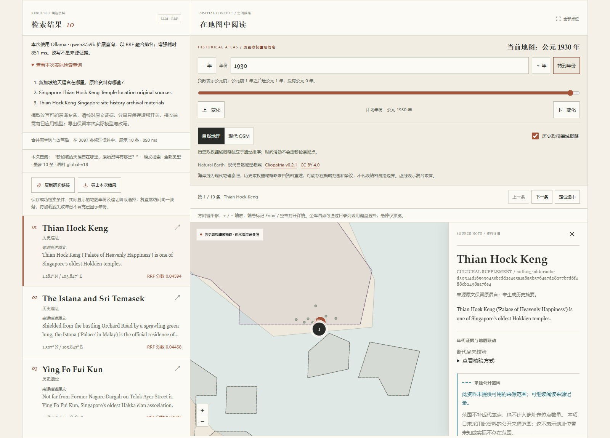

# LLM查询增强与模型配置

日常启动见[README](../README.md)，地图和资料来源见[使用与维护指南](system-guide.md)。本轮保持`global-v18`的3897项资料与原E5索引，不改原文、别名、坐标、历史阶段或来源核验状态。

## 本地Ollama

1. 打开Ollama程序，或在独立终端执行`ollama serve`，保持服务运行。
2. 在另一个终端、仓库根目录执行`uv run --no-sync archsearch serve`，打开`http://127.0.0.1:8000/`。
3. 展开“查询增强与模型设置”，模型服务选择“本地Ollama”，Base URL默认为`http://127.0.0.1:11434`。
4. 页面自动获取已安装模型，也可点击“刷新模型列表”；选择`qwen3.5:9b`，点击“应用所选模型”。
5. 勾选检索区的“LLM增强”，输入研究问题并检索。

本机已有`qwen3.5:9b`与`qwen3.5:2b`，无需重新下载。新环境须先安装Ollama及支持对话的模型，例如自行执行`ollama pull qwen3.5:9b`；应用不会调用模型下载接口。仅做嵌入的模型不适用于查询改写。

Base URL由Windows后端访问。通过Mac的Tailscale页面操作时，默认`127.0.0.1:11434`仍指Windows上的Ollama，Mac无需安装模型，也无需开放Ollama端口。基础E5／BM25检索不要求Ollama运行。

## OpenAI兼容API

首次切换到API模式时，Base URL、API Key及模型选择为空；不会自动调用预设商业服务。

- Base URL填写服务的完整兼容接口前缀，例如`https://api.example.com/v1`。应用在其后追加`/models`和`/chat/completions`，不自动补`/v1`。
- API Key使用密码输入框；服务允许无密钥时可留空。地址或密钥输入完成后自动获取模型列表，也可手动刷新，再选择支持对话的模型并应用。
- 改变地址或服务类型时，不会将旧服务的密钥继承给新地址。已经保存密钥的同一地址，留空可保留当前密钥；“清除已应用模型与密钥”会停用模型并清除密钥，无需上游服务可用。
- 请求通过同源后端转发，密钥仅作为上游Authorization头使用，不放入URL或提示词。API模式会把研究问题发送至所填服务，不发送语料原文。

设置由同一服务进程共享，仅保存在内存，重启后清空。密钥不回传浏览器，不写入浏览器存储、Git、分享链接或导出。修改尚未应用的草稿不会改变已经显示的检索结果；版本冲突会明确要求刷新配置。

模型设置的主机名校验默认接受localhost、IP字面量及Tailscale的`.ts.net`地址，网络访问仍按既有部署方式建立。使用自定义网页域名时，在启动服务前通过`ARCHSEARCH_LLM_TRUSTED_HOSTS`显式指定域名，例如：

```powershell
$env:ARCHSEARCH_LLM_TRUSTED_HOSTS = "research.example.com"
uv run --no-sync archsearch serve
```

该项限制的是访问网页的主机名，与模型服务的Base URL分别管理。

## 检索如何增强

LLM最多提出两条查询改写；始终保留原问题，对原问题与有效改写分别执行所选的E5或BM25检索，再按`1 / (60 + rank)`累加进行RRF排名融合。每次使用相同的类型、国家／地区、来源省区等用户筛选条件，模型不能自动增加筛选或修改地图年份。E5对全部筛选候选排名，BM25仅融合有字词匹配的候选。

页面显示本次实际使用的服务、模型、原问题与改写，以及RRF排序分数。RRF分数不是相似概率，也不与基础E5／BM25分数直接比较。词面匹配字段可包含扩展查询的字词，不作为模型因果解释。

Ollama使用原生`/api/tags`与`/api/chat`；本机Qwen3.5支持关闭thinking，使用`think:false`、JSON Schema格式、4096上下文及最多512个输出token。接口字段见[Ollama Chat官方文档](https://docs.ollama.com/api/chat)。API兼容模式要求服务支持Chat Completions与JSON对象输出。

外部输出须通过严格JSON、数量、长度及重复项检查。没有配置模型或配置版本已失效时，增强检索明确拒绝；已配置模型的调用失败时，按原查询执行同一基础检索模式，并显示“LLM增强不可用，本次已按原查询检索”。语义索引缺失仍需修复或手动选择BM25，不会暗中切换模式。

连接超时最多3秒、读取超时最多30秒，并在读取块时检查截止时间及128KiB响应大小；这不是严格的整体墙钟上限。模型发现最多返回500项，缓存最多保留8个端点／密钥组合。重写采用单工锁，避免并发查询同时占用本地模型。浏览器取消会停止等待并忽略迟到响应，服务端已经开始的模型计算可能仍会继续。

模型改写属于检索假设，可能误译、错误转写或换错地点。保留原问题和实际改写供核对，不把它们写成遗址事实或别名，也不生成历史疆界。可关闭增强、改用来源原名，或先选择明确的来源地区再检索。

## 本机测试记录

以下为4070 SUPER（12282MiB）现有桌面负载下的三个短查询样本，均使用最终通用提示词、关闭thinking；没有训练模型或人工相关性标注。

| 已缓存模型 | 输出速度样本 | 热态改写HTTP耗时 | 当时剩余显存 |
|---|---:|---:|---:|
| Qwen3.5 2b，Q8_0 | 141–146 tokens/s | 0.155–0.169秒 | 6688MiB |
| Qwen3.5 9b，Q4_K_M | 69–70 tokens/s | 0.582–0.723秒 | 3407MiB |

速度按Ollama返回的`eval_count / eval_duration × 10^9`计算，计时字段单位见[官方接口说明](https://docs.ollama.com/api/generate)。它不包含模型载入；最终提示词这组测试的9b首个请求约4.24秒，后续短查询如表。显存为请求后快照，不是峰值或模型独占量，其他桌面应用也占用显存；这些样本不是其他设备或长查询的性能保证。

2b在“马约特青戈尼的十六世纪清真寺”中错误替换了国家；9b保留Mayotte，但仍将专名转写为Qongoni。基于这些场景与资源余量，界面优先推荐已安装的9b，保留2b速度选项，不声称专名误译已经解决。

在同一3897项语料、无地区过滤的真实HTTP发现诊断中：

- “新加坡的天福宫在哪里，原始资料有哪些？”：基础BM25和E5均未将既有Thian Hock Keng记录排入Top10；9b增强后的两种模式均排第1。
- 上述马约特清真寺问题：基础两种模式均未进Top10；增强E5排第5，增强BM25仍未进Top10。
- 另保留一条罗马公共浴场主题探针的完整排名与耗时，未事后为主题题补造目标或相关性标签。

这是少量发现案例，不能推算准确率、Recall或nDCG。所有未确认人工标注的相关性指标仍为`null`。

## 分享、导出与接口

分享链接只保存`enhance=1`增强意图，不携带服务地址、密钥或服务revision；接收端须确认并应用当前可用模型。缺少配置时会提示先配置，也可明确取消增强。模型和改写可能不同，因此链接不保证重现相同LLM排名。

版本2导出保留已成功显示的实际模型、提供者、原问题、扩展查询、融合方式、耗时和失败回退状态；修改草稿不篡改旧快照。原地图实际显示年份、来源许可及资料证据仍按既有规则保存。

| 接口 | 用途 |
|---|---|
| `GET /api/llm/config` | 当前公开配置、revision及是否已有密钥；不返回密钥 |
| `POST /api/llm/models` | 使用草稿provider、base_url和可选api_key获取模型；不应用配置 |
| `POST /api/llm/config` | 应用已发现的model及expected_revision；model空串用于停用 |
| `POST /api/search` | 新增可选enhance及llm_revision；增强时两者须一致，响应含enhancement实际快照 |

默认不启用增强，原检索请求与旧分享链接继续按基础模式处理。`/api/status.llm`表示已应用的公开配置，不是服务在线保证；实际连接状态以模型发现和查询结果为准。

## 实际界面

本机Chrome中的真实Qwen9b查询扩展、RRF结果和1930年历史参照；生成查询没有写入遗址原文或断代。


