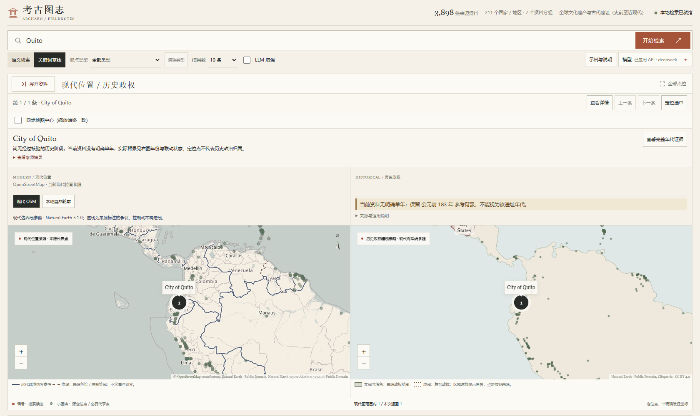
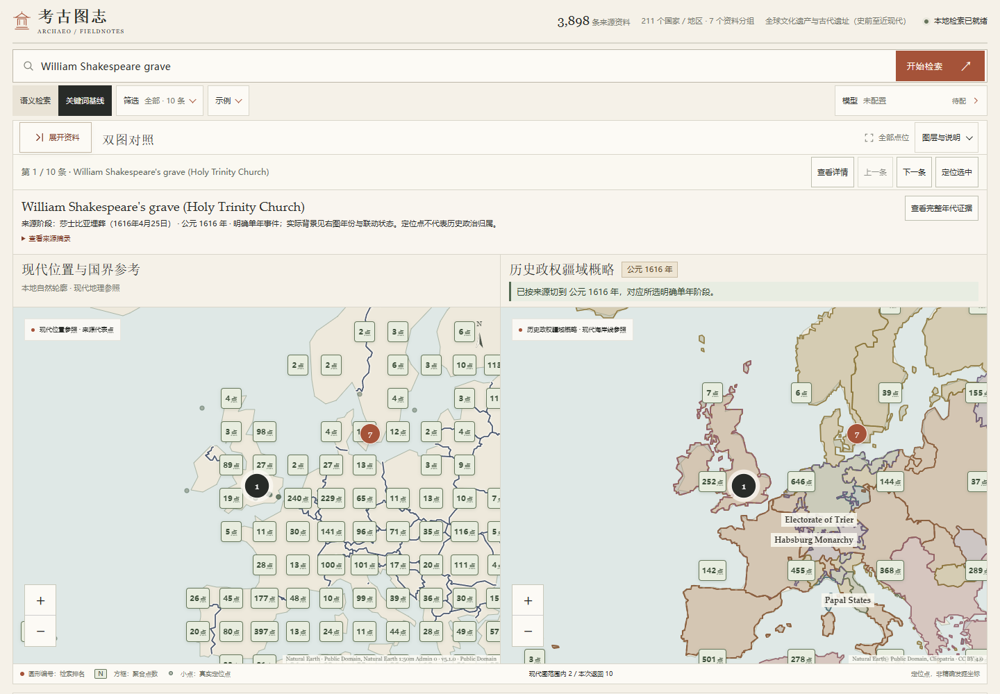
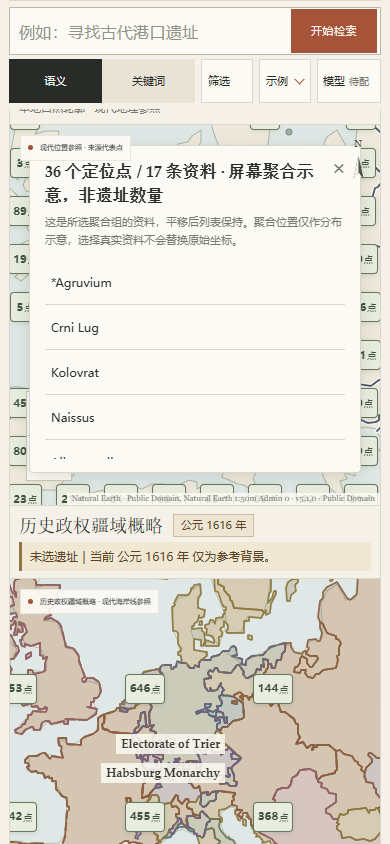
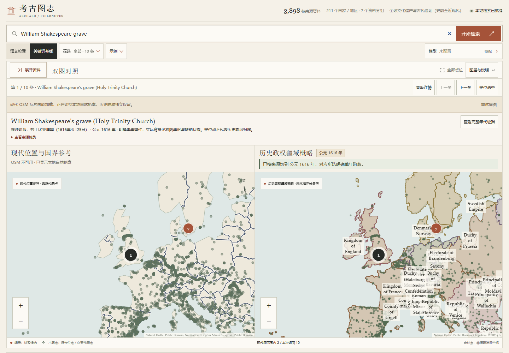
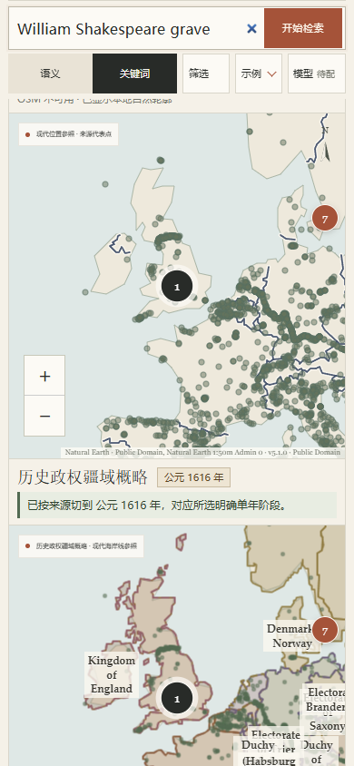
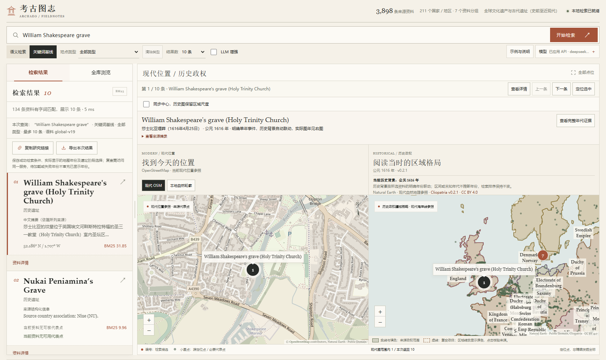
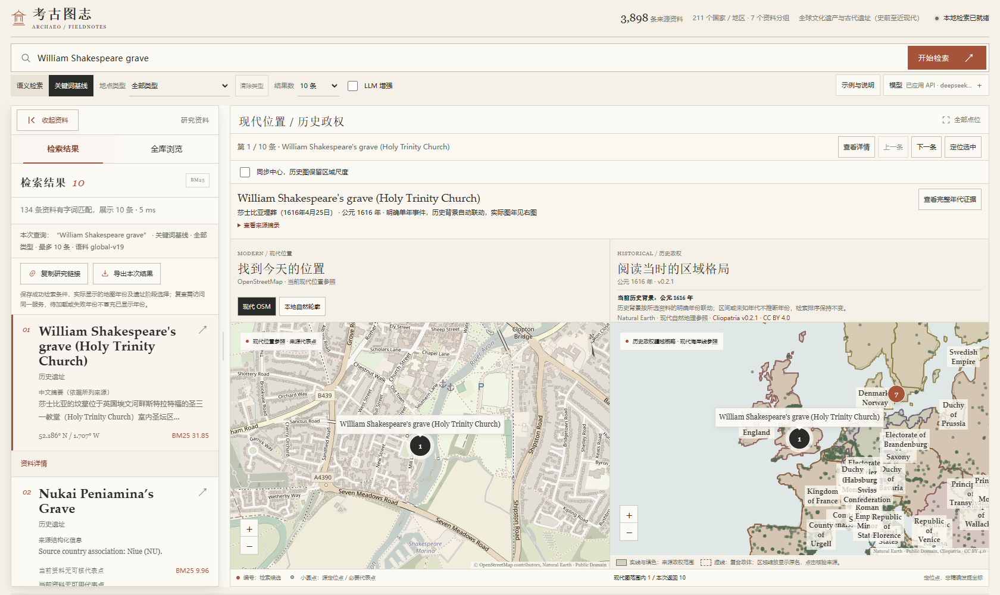
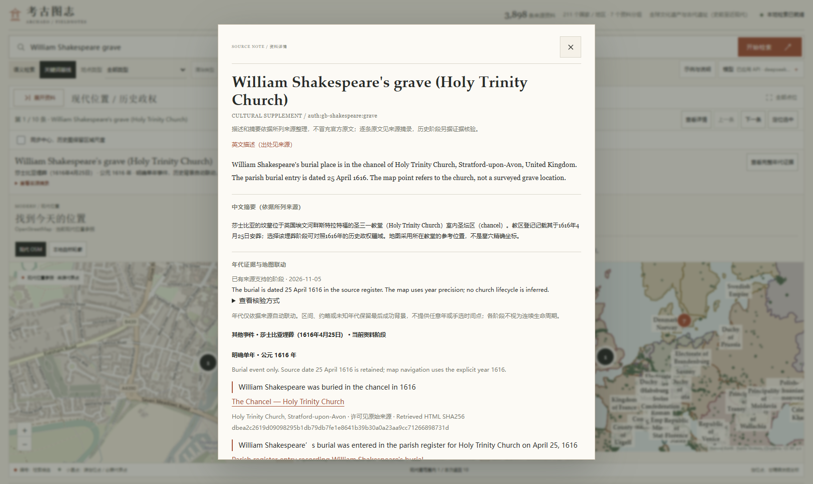
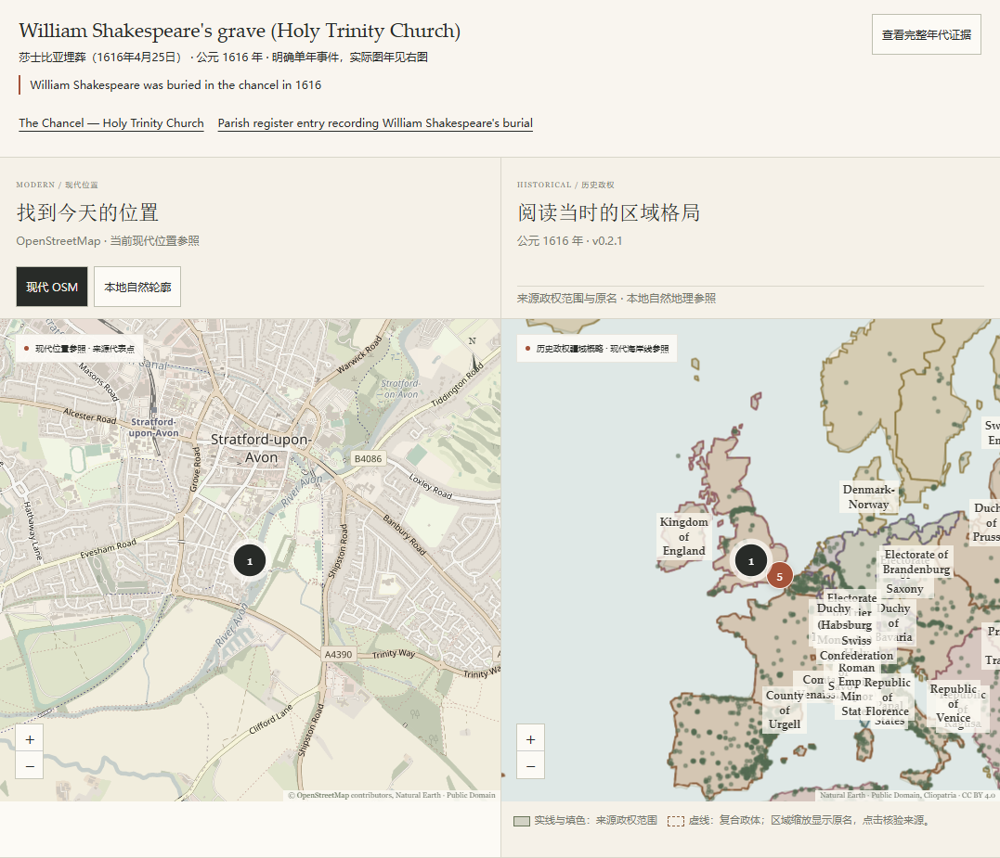

# 现代与历史地图对照

启动方法见[README](../README.md)。页面以双图工作台展示现代位置与资料年代对应的历史政权疆域概略；桌面左右对照，窄屏上下排列。

## 使用

1. 顶部输入问题；用工作区左上角的资料按钮展开或收起悬浮面板，其中“检索结果”查看排名，“全库浏览”按地区浏览。
2. 两图显示同一批结果与同一选中地点，缩放始终保持一致（1—9级），主动定位统一为4级区域视图。现代图叠加本地现代陆地国界参考，历史图显示实际年份的来源政权范围。
3. 明确单年的默认阶段自动切换历史年份；区间、约略或未知年代不选取任意年份，保留最后成功背景并说明证据范围。页面不提供时间轴、年份输入或阶段时间选择器。
4. 点击结果卡片会定位两图；点击每条“资料详情”或地图标记打开弹窗。弹窗可用关闭按钮、Esc或遮罩关闭，焦点返回入口；关闭弹窗保留选中地点和已明确显示的来源范围。

任一图缩放会同步另一图；“同步地图中心”仅控制平移中心是否联动，关闭后仍保持同级缩放。两图适配结果范围时使用共同可容纳的缩放级别。旧分享链接的现代15级／历史4级视野恢复为两图4级，并保留各自中心、显示兼容说明；仅有现代视野时使用其可用缩放。界面支持的共同上限为9级，放大不意味着来源几何更精确。

### 图层与说明

展开地图上方“图层与说明”可切换现代底图、设置平移同步，并分别查看现代国界和历史政权图例、版本与来源。展开内容进入页面文档流；收起或调整侧栏时，两图重新适配尺寸，保留地理中心、缩放、结果、选中地点和历史背景，不重新检索。Escape可关闭当前聚焦的说明并回到入口。

现代位置与历史政权分别以可见标题标识，历史标题旁的年份只表示已经成功显示的背景；加载中或失败时保留上次成功年份，关联提示继续区分来源年与背景年。无候选且未选地点时收起候选操作，选中目录资料或出现候选后恢复。手机端两图仍上下同时保留，缩放、说明和候选操作入口使用至少44px的触控高度。

### 密集点位与政权名称

全库背景中的密集定位点按各图的当前缩放与可用空间聚合为方框数字，放大后逐步展开为真实点。现代图保留较细的点位分布，历史图使用更宽松的聚合，为政权名称留白；两图仍保持相同缩放。方框数字统计定位点，成员列表另列不同资料数；一条多点资料可能贡献多个点，世界副本不重复计入同一聚合。聚合位置仅为浏览示意，不能视为遗址坐标、遗址数量或政治归属，背景年也不用于筛选资料。

方框超过999点时简写为`999+`，完整定位点数和不同资料数可在提示及弹窗中查看。点击聚合方框可分页浏览全部真实成员并选择资料，也可继续放大；达到9级或多个成员坐标完全相同时，仍可通过成员分页和全库目录选择。单点保留原始代表点／源定位点说明；检索圆形编号和独立选中标记单独展示。聚合开合和平移缩放只调整当前已加载点层，不改变查询条件、排名、来源坐标或历史年份；从成员中明确选择资料后继续按原有年代规则联动。

历史政权的常驻名称依据当前可用空间择显，避开其他名称、编号、聚合点与地图控件；同名碎片和世界副本保留一个合适的常驻名称。较小、拥挤或过长的名称可能省略，来源多边形与记录均保留，点击疆域仍可读取完整原名、适用区间和许可。这只是显示布局，不推断政权重要性、遗址归属或疆域精度。

现代参考线在OSM和本地轮廓上均有深色描边与浅色外描边；虚线保留来源标注的争议、控制或不确定分类，不含海洋划界。准备好的线层随网页本地提供，加载失败可单独重试。版本、许可与可复现处理见[现代边界线说明](modern-boundaries.md)。

## 为什么可能一直显示1616年

历史图没有固定在1616年：默认参考年为117，莎士比亚墓的明确埋葬阶段会切到1616。当前3898条资料的默认展示阶段只有29条具有明确单年，101条仅有时期描述、6条约略年份、14条区间年代，3748条没有可用的默认阶段。选择后者时保留最后成功背景，不补造年份。

右图醒目状态区分“已按来源切图”“保留参考背景”“正在核对／加载”“来源年代与背景不一致”和“未选遗址”。背景保留1616时会明确说明它不能视为当前遗址年代；新检索清除选择后不继续声称上一条资料已联动。旧链接指定1930背景但选择1616阶段、加载失败或来源年代超出数据范围时，界面分别保留真实背景年及来源年，不误称已切到来源年。

可依次选择莎士比亚墓（1616）、莫高窟（366）、悉尼歌剧院（1973）、Mutina（公元前183），核对明确单年切图；然后选择断代未确定的资料，核对“保留参考背景”提示。出处和日期精度仍以各条资料详情为准。

以下为依次切换这些明确年份后选择Quito资料的本地实拍：背景保留公元前183年，状态明确说明不能据此断代Quito，未用资料描述中的其他数字自动补出日期。



桌面资料面板独立悬浮，展开时地图预留可见区域，不遮挡选中点；收起后两图铺满工作区。可拖动面板右缘调宽，也可聚焦分隔条后使用左右方向键、Home／End。面板各页签独立滚动；检索完成切换到结果页签，但不会擅自展开已经收起的面板，展开后可继续阅读原有结果。

窄屏首次默认收起，展开后以浮层阅读资料；主动选择可定位的结果卡片、目录条目或“定位选中”会收起面板返回双图。“资料详情”仍打开独立弹窗，关闭后回到可见入口；无可用主图点的资料保留说明，极区定位会展开全库中的独立示意。来源点点击保留实际组成点所在视野，避免跳回整体代表点。迟到的详情响应不会再次收起已被用户重新展开的面板。

本机仅保存面板宽度和收起状态，旧版仅含宽度的布局偏好可继续使用，不保存查询或模型凭据。旧分享链接仍可恢复原来的年份和两侧视野。

## 点位聚合与名称避让验收（2026-11-13）

在相同视口和地图中心下，原版每图绘制23,724个背景圆点（7,908个逻辑定位点的世界副本）。新版只绘制当前视图附近的单点和聚合符号，全部7,908个逻辑点及其来源坐标保持不变。以下数量是绘制符号数，包含视口边缘缓冲，不是遗址数量或检索质量指标。

表中桌面视口为1440×1000、资料侧栏展开，欧洲地图中心约东经10°／北纬48°；手机为390×844，横屏为844×390。下方桌面实拍收起了侧栏，绘制数量会随可用画布与视野改变。

| 视图 | 现代图符号 | 历史图符号 | 常驻名称相交对数：前版 → 新版 |
| --- | ---: | ---: | ---: |
| 全球117年，1级 | 85 | 32 | 0 → 0（该级别不常驻名称） |
| 欧洲1616年，4级 | 127 | 40 | 44 → 0 |
| 欧洲1930年，4级 | 127 | 40 | 13 → 0 |
| 390px手机1616年 | 91 | 30 | 43 → 0 |
| 844×390横屏1616年 | 104 | 30 | 44 → 0 |

拥挤区域减少常驻名称后，1616年欧洲仍显示4个、1930年显示6个，手机及横屏各保留3／4个可读名称；未常驻的原名仍可点击疆域读取，原始几何与许可未变。测试同时检查名称不压住编号、聚合方框或控件，以及显示中的聚合方框互不交叠。





本轮真实Chrome验证聚合分页、平移和尺寸调整保留当前页与焦点、点层开关、反复国家筛选、双图缩放和选址年代联动、完整政权来源弹窗，以及320／390／844px聚合弹窗的触控和遮挡。最高9级同坐标25个身份的完整分页、日期线两侧20点的聚合使用隔离浏览器夹具；不是新增遗址或实际坐标记录。文档实拍采用真实本地检索、目录、几何与年度接口，模型接口固定响应、OSM阻断用于本地回退，不执行LLM增强。

## 前版布局验收（PR #39，2026-11-13）

在相同的初始空查询与本地轮廓回退状态下，真实Chrome视口测量如下；这里只比较布局面积，不作为性能或检索质量评测。

| 视口 | 比较项 | 前版 | 当前 |
| --- | --- | --- | --- |
| 1440×1000 | 每图画布高度 | 433px | 583px |
| 1440×800 | 每图画布高度 | 263px | 383px |
| 390×844 | 现代画布距页面顶部 | 494px | 353px |
| 320×720 | 现代画布距页面顶部 | 522px | 353px |

本轮使用真实本地BM25搜索 `William Shakespeare grave` 并选择墓记录，双图保持同级缩放，历史背景成功联动1616年。为避免接触实际模型服务，浏览器中的模型接口使用固定响应，未执行LLM增强；OSM请求被阻断以检查本地回退，地图几何、检索、地点与年份接口使用真实本地响应。



手机图为390×844视口滚动后的局部对照：保留检索栏、现代图和历史标题、1616年背景及关联提示。两张地图都在页面中，并非切换后只保留一张。



另检查320／390／520／900px与844×390横屏、说明展开、键盘操作、侧栏收起与调宽、地图中心和排名保留、未知／区间／约略年代、现代边界和历史加载失败重试。原许可及来源限制保留在“图层与说明”和页面底部。

## 前版工作台实拍（2026-11-05）

2026-11-05在本地Chrome使用BM25检索 `William Shakespeare grave`：墓记录位于第1，点击卡片后两图以相同缩放展示区域，现代图叠加现代边界参考，历史图显示1616年来源疆域。以下截图使用真实本地服务响应，未启用LLM增强。

收起资料面板后，现代和历史图使用工作区全部宽度，展开入口仍保持可见。折叠或调宽不改变当前地理中心、历史年份、选中遗址和检索排名。



展开后继续阅读原结果，也可切换全库浏览；桌面为两图预留可见区域，右侧边缘可拖动调宽。



资料详情在独立弹窗中阅读，关闭后继续对照地图；弹窗保留英文原文、中文来源摘要、逐阶段断代依据及出处。



1680px桌面与390px窄屏均已检查。窄屏模型入口保持单行，资料浮层可独立滚动，两图上下显示且没有页面横向溢出。侧栏宽度在切换窄屏后仍可恢复；检索在途收起、详情关闭后晚到响应、键盘调宽及旧年份链接另有浏览器复核。当前改动只涉及前端和文档，未修改语料、模型或索引；更新后刷新页面即可，不需要重新准备数据。

## 莎士比亚墓案例

全库检索“寻找莎士比亚的坟墓”，选择 **William Shakespeare's grave (Holy Trinity Church)**：

- 所在地是英国埃文河畔斯特拉特福的圣三一教堂室内圣坛区（chancel），依据[教堂官网](https://www.stratford-upon-avon.org/the-chancel)。
- 默认阶段为1616年埋葬事件；[原始教区登记的档案说明](https://shakespearedocumented.folger.edu/resource/document/parish-register-entry-recording-william-shakespeares-burial)记载1616年4月25日。它不是教堂建造年份，也不是推定的连续使用期。
- 代表点来自[教堂的 Wikidata 实体](https://www.wikidata.org/wiki/Q472082?oldid=2517889057)。这是所在教堂的参考位置，不能解释为墓穴测量坐标或考古确认的遗骨位置。

新增记录使用项目命名空间 `auth:gb-shakespeare:grave`，不冒用整个教堂的文保编号。资料从原3897项追加到 `global-v19`，原记录的字段、顺序与检索文本不变；E5索引需重新准备。这是针对实际漏检的资料覆盖修复，不代表查询改写能找到资料库未收录的任意地点。

以下为上一版双图实拍，地图资料与证据仍适用；当前版已将检索与全库目录移入侧栏、将详情改成弹窗并去除手动时间控件。



墓、墙面纪念碑和整座教堂是不同对象。新记录的断代采用代理对照来源复核，未标成专家鉴定或人工相关性确认；未完成确认标注的评测指标仍为 `null`。逐项权利与摘要加工方式见[来源与许可](../src/archsearch/data/NAMED-PLACES-LICENSE.md)。

## 前版检索与地图验收留档

2026-11-05在Windows本地、Chrome中测试同一问题“寻找莎士比亚的坟墓”：基础BM25、基础E5、`deepseek-flash`增强BM25／E5，以及Ollama原生`qwen3.5:9b`增强E5，正确墓记录均排第1。API自动发现2个模型，页面密码框为空，只展示已配置Key数量与槽位；文件中的真实Key未提交。这是单个覆盖修复案例，不是总体准确率评测。

真实OSM瓦片、双图同时显示、1616年联动、键盘选择、来源弹窗和遗址点点击已检查。390px下两图上下排列且没有页面横向溢出。另以明确标记的请求延迟、失败和浏览器外网阻断检查晚到详情、年份竞争、分享／导出、缺历史库和底图回退；外网阻断是浏览器级模拟，不是操作系统物理断网测试。

历史图使用真实年份切换重新计时：1616→1930约374毫秒、1930→2024全球视图约384毫秒；对应热态年度API约113／109毫秒。均包含本次观察的客户端交互和绘制等待，未注入年度响应，未声称冷启动、峰值负载或其他设备保证；同年重复提交的无重绘时间已排除。

## 历史图显示什么

历史疆域来自固定的 [Cliopatria v0.2.1](https://github.com/Seshat-Global-History-Databank/cliopatria/releases/tag/v0.2.1)，采用来源适用区间内的真实几何，主层排除 `RELATION`。复合政体以无填色虚线区分，点击疆域可查看名称、来源和原始适用时段。资料遵循 CC BY 4.0，署名与加工说明保留在接口和页面中。

这是来源对历史政体的重建概略，时空精度不均，不代表逐年精确实测国界。选择遗址只将代表点叠加在背景上，不自动认定其历史政治归属。自然地理轮廓为现代 Natural Earth 陆地参照，未重建古海岸、古街道或古建筑平面。

现代图使用 OpenStreetMap 瓦片，需要联网；瓦片失败时保留本地陆地参照与标记。历史图准备完成后仅读取本地疆域与自然地理资料。完整归档、SQLite库、模型、索引、源页面缓存和私人 `.env` 均不进入 Git。

重建新增地点公开资料：

```powershell
uv run --no-sync python -m archsearch.target_data
uv run --no-sync archsearch prepare
```

第一条只使用已提交的紧凑核验记录重建规范化资料；第二条使用固定E5模型重建新语料索引，已有完整模型时不重复下载。数据准备、完整许可与故障处理见[使用与开发指南](system-guide.md)。
