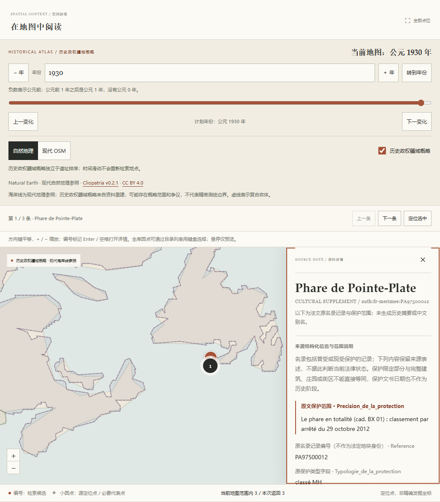
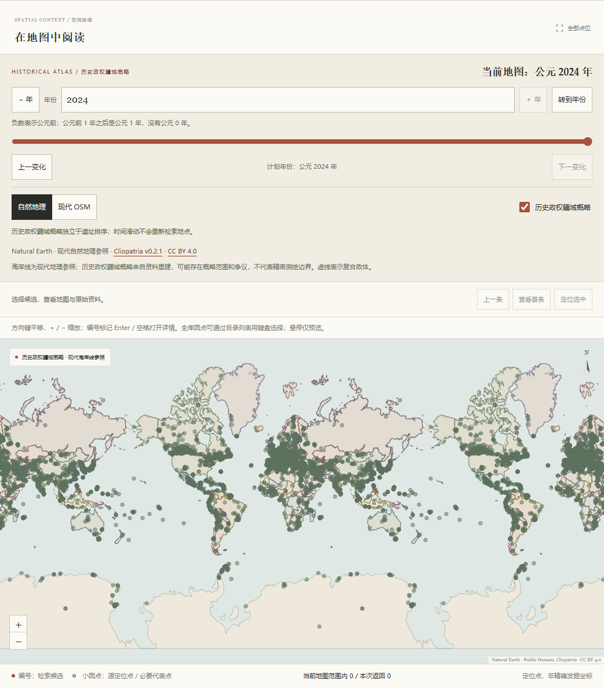

# 法属圭亚那、马约特与圣皮埃尔和密克隆文化资料验收

`global-v18`共3897项资料。本批新增122项来源限定文化名录范围，原3775项全部字段、顺序和共享检索文本保持不变。目录新增三个现代统计区域标签，总覆盖211个国家／地区标签；不将登记范围数称为互不重叠的遗址数或完整全球清单。

## 来源与范围复核

采用与上一批相同的法国文化部固定Mérimée发布。原CSV有46761行、78字段；按原Region精确筛选Guyane91、Mayotte16、Saint-Pierre-et-Miquelon16，共123行。四个官方API分页的9594个字段与固定CSV逐值核对，其中6128个空串在API中呈null，仍保留CSV原空串。原档、网页与API缓存不进入Git。

独立代理逐条对照来源复核身份、限定范围、公开点、地理关联和权利，不标为人工或专家确认。Susky岩棚部件`PA97300012`关联包含它的Mamilipann整体`PA97300021`，前者保留审计记录，不再新增Site、别名或地图点。其余122项按原通知及限定范围采用；同址、同地籍或相近标题不单独构成合并依据。

凯宴AD10涉及的省议会、修道院／省署及火药库保留独立来源范围；Tsingoni清真寺原保护文字排除宣礼塔，塔另有通知。医院与医生住宅、Breslar住宅与Dôme的交叠或2026年修改文字均保留，不声称各项空间互斥。Iles du Salut保留来源中的Cayenne市镇和三岛整体名称，不按常识改成另一个市镇。保护、撤销、更新和建筑世纪原值不生成历史阶段；122项均无新增阶段或生成中文别名。

| 随仓库分发的规范化资料 | SHA-256 |
|---|---|
| 全123条原字段及来源回执 | `a7461cf8ec1070ec8ed49350f977bfab4ae18cbb12315079f0860c186b380e17` |
| 独立复核与现代统计区域对照 | `1bea70c52cbf37a8264d1919888aa6cd9f7151cbdd3f5e6987b2b776cc6e425d` |
| 122项采用资料 | `10a86bec621e6d55c951069d4301e5f02db25468ea616f4d844ba91bf87fb076` |
| 资料清单 | `26247f476ee4531f63a78b9769e4eba6e00d29c0754a56bda71063ca6383ae45` |

15份固定来源材料及全表／API重放校验通过。完整CSV校验、数据集时钟与Licence Ouverte / Open Licence2.0署名见[来源说明](../src/archsearch/data/MERIMEE-EXTENSION-LICENSE.md)。新区域逐对象POP请求返回代理上游TLS错误，没有把这些失败正文记成官方200证据，也没有绕过验证。坐标轴依据是同一固定全表、同一字段在上一批三份正常官方POP页面中的命名lat／lon对照；这是共同字段语义核验，不冒称本批每个POP页面均成功取得。辅助机构页面仅有网页索引短摘录时，审计明确记录提取方式，不伪称原PDF或HTML字节校验。

## 地区与地图

| 现代统计区域 | 采用范围 | 原市镇全文选项 |
|---|---:|---:|
| GF · French Guiana | 90 | 15 |
| YT · Mayotte | 16 | 6 |
| PM · Saint Pierre and Miquelon | 16 | 2 |

原COG经INSEE2026及UN M49原行关联上述区域。GF进入拉丁美洲及加勒比资料组，YT进入非洲；PM的Northern America属于项目欧洲及北美资料组，不归拉丁美洲。原表无Pays／Country列，不从法国发布机构推导逐行FR归属，不判断主权或历史政权归属。

23个带区域命名空间的原Commune全文选项不是23个已证实不同的行政实体。`Montsinéry-Tonnegrande`与`Montsinéry-Tonnégrande`同为COG97313的不同原拼写，分别保留，未合并或改写。`source-subdivisions-v6`合计202个选项、1836条对象／地区关联、1834个不同对象，包含省区、来源要素地区、市镇等不同角色；原179个定义、1714条关联及证据顺序全部不变。新旧两批Mérimée分别绑定自己的来源合同，不能相互代替。

122项全部采用提供者公开WGS84原点，只转换经纬顺序；定位方法和测量精度未说明，精度保留null。它们仅用于来源参考，不将其视为发掘坐标、整体中心或保护边界。全库3504项主图可显示、3项极区、390项暂无采用代表点；原三组5851条来源定位记录及范围图层不变。全局共7907个逻辑位置，三个世界副本绘制23721个Canvas圆点。

## 本地检索诊断

离线重建3897×384的float32归一化E5向量，15个固定模型文件逐字节不变。向量有限，最大范数误差为`1.7881393432617188e-7`。向量SHA为`bba99b14fb2044005b9ddd1821b2f854ce9334f06f5b005eb9a7e51adb712905`，索引清单SHA为`52eb2981de5445227677127249c83de35eb7c54f6c809a6b03eb46d3364bd6c2`。旧3775条索引明确失效，BM25仍可用。

15套各20对查询分别运行BM25／E5×中文／英文，共1200次无筛选排名；另有24次用户手选区域的预定目标诊断。新15份未确认模板含10046个待标注查询／候选对，相关性全部为空；原122份名称含qrels的文件逐字节保留，其中包含历史准备快照，不等同人工标注数量。Recall@5、nDCG@10等相关性指标全部为null。原始评测摘要曾沿用静态“14份模板”字面量，已依据15份实际文件另存校正摘要及校验回执；原摘要、排名、耗时与标签保留，不重跑掩盖元数据差错。

新20对查询在排名前冻结，六个身份目标为Mamilipann、Camp de la Transportation、Tsingoni清真寺、Soulou糖厂、Pointe-Plate灯塔和Anse-à-Henry；其余14题为无预设目标的主题探针。中文为查询改写，英文身份题含原法文专名，不是严格控制变量的语言基准，也不是人工相关性金标准。

| 条件 | 六目标Top10排名，按上述顺序 |
|---|---|
| 全库中文BM25／E5 | 均未进入 |
| 全库含原法文名的英文BM25／E5 | 1、1、1、1、1、1 |
| 用户手选区域，中文BM25 | 均未进入 |
| 用户手选区域，中文E5 | 3、2、7、2、4、1 |

用户明确选择区域后，GF候选90项、YT及PM各16项；该结果不能算作中文准确率或自动地名理解。全库中文专名漏检仍存在，原法文名称BM25和区域目录是当前可直接使用的查阅入口。

本批20题本地进程内热态中位耗时：中文BM25为8.41ms、中文E5为14.75ms、含法文名的英文BM25为10.72ms、英文E5为18.29ms。只创建一个本地CPU编码器，预热另存；这些是本机样本，不是性能保证。

## 复现与检查

```powershell
uv run --no-sync python -m archsearch.merimee_extension_data --rebuild
uv run --no-sync python -m archsearch.subdivisions --rebuild
uv run --no-sync archsearch prepare
uv run --no-sync archsearch serve
uv run --no-sync archsearch evaluate --queries src/archsearch/data/queries-merimee-extension.json --output .archsearch/reports/evaluation-merimee-extension.json
```

普通重建从随代码分发的冻结复核事实编译，不需要原页面缓存；模型首次取得需联网，已有固定模型可离线复用。CI不下载模型或完整历史归档。本地Ruff、34个源模块的Mypy、pnpm冻结安装、TypeScript检查与构建、212项前端测试、21项审批工作流测试全部通过。Python完整运行1390项通过、5项因本机Windows符号链接权限跳过；Windows／Linux干净环境CI另行检查。

实际Chrome逐条核对122个详情及原点，366个三世界Canvas位置逐值一致。GF分页50／40、YT16、PM16；组件旧编号无额外Site。检索与目录独立条件、两种市镇拼写、分享恢复、版本2导出原字段与实际地图年份、矩形GF空态及清除恢复均通过。原香港整体22个多边形在切换新对象后正确清除，原加拿大、香港、巴西与上一批市镇证据保持可用。

390px下法文范围、78字段折叠及长身份编号无水平溢出；键盘展开可用，主要控件至少44px。阻止全部外部网络后，本地历史疆域、Natural Earth自然地理参照和来源点仍可使用，在线瓦片失败明确提示。保护文字中的2026年不生成阶段或改变已显示1930年。

| 本机样本 | 1930年 | 2024年 |
|---|---:|---:|
| 热态年度API完整200正文 | 84.78ms | 88.16ms |
| 提交年份至Canvas重绘及两帧 | 236.4ms | 342.1ms |

以上为全球无筛选3897项、7907个逻辑点及23721个Canvas圆点。新服务首个中文E5请求含模型载入为5425.90ms，热态重复为15.35ms。浏览期间Python完整测试在另一进程继续推进；15套离线排名已完成，不属于浏览并发负载。冷启动原记录保留，截图另行采集并等待真实成功底图与来源署名，未用截图请求补造冷态数据。




