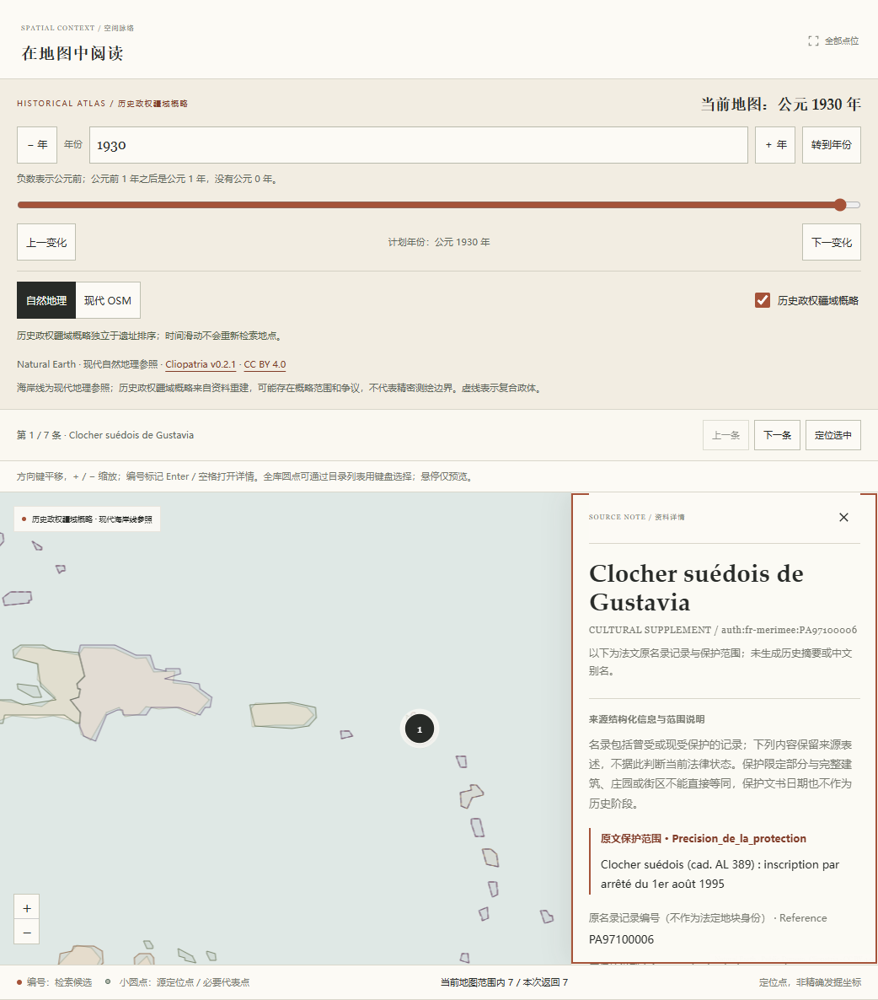
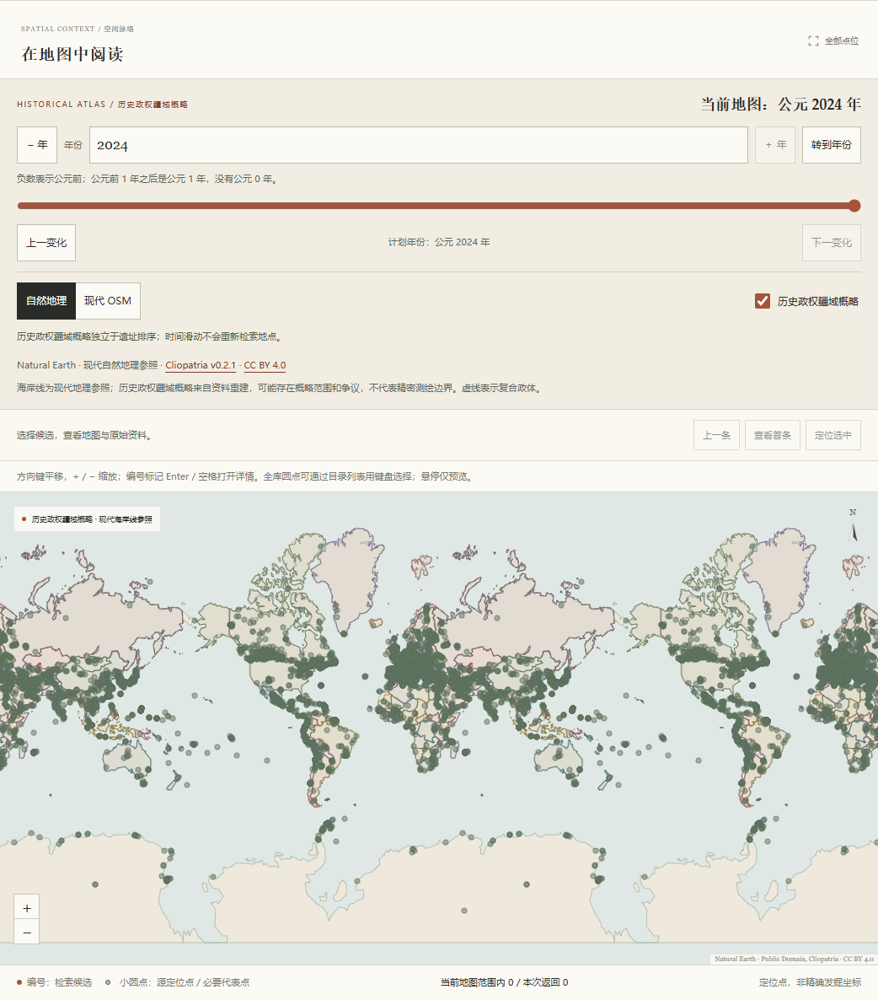

# Mérimée 海外文化资料与地区浏览验收

语料版本为`global-v17`，总计3775项来源资料对象。此批新增449项Mérimée文化名录范围，保留既有3326条全部字段、顺序及共享检索文本；不将名录记录数称为互不重叠的实体遗址数或全球完整清单。

## 固定来源与独立复核

法国文化部官方数据集的完整原CSV有46761行、78字段。按原`Region`精确筛出Guadeloupe120、Martinique124、La Réunion206，共450条候选；11个官方API分页逐字段核同固定CSV。API空串呈`null`的21888个字段仍保留CSV原空串。原档与页面缓存不进入Git，普通安装只读取规范化资料。

代理独立对照原来源核验全部450条，不标为人工或专家确认。`PA97400023`是“参见另一市镇”的指引，关联完整`PA97400026`，不重复新增或继承点位。其余449项按来源通知及限定保护范围采用；相同标题、地址或地籍值不能单独证明同一范围。独立建筑与较大组合范围可相互包含，不据此声称空间互斥。

四条原`Precision_de_la_protection`为空的曾保护记录保留完整`Observations`作范围依据。包含撤销、修改或新的保护令的文字均原样保留，不按关键词自动裁定当前保护状态。原建造世纪、保护日期、创建与更新时间不生成历史阶段；本批无中文别名、无新历史阶段、无推测坐标或边界。

| 规范化资料 | SHA-256 |
|---|---|
| 全450条原字段与来源回执 | `a7b8e79d64bf184b870607fc83435a4f1c7fb021eb312211b56daed6962f7623` |
| 逐条复核与现代统计区域对照 | `f6b41e4368d1b31082502bf501f93e576cb6718c22a0c9e807b49480a64c9709` |
| 449条采用资料 | `d0a462744555ded18bd8df628ca8200552e4ed463356189ed2ddc683de715845` |
| 资料清单 | `863b74cba801fa60a975b759a2818d1dec989418c963605638aee0ae98bf8960` |

原CSV、元数据、许可、坐标轴证据、INSEE及UN M49等22份实际来源已离线重放校验。全量CSV的全部450个选中原行及API原字段一致。原始资料及许可说明见[Mérimée来源说明](../src/archsearch/data/MERIMEE-LICENSE.md)。

## 地区与地图位置

| 现代统计区域 | 采用资料 |
|---|---:|
| GP · Guadeloupe | 112 |
| BL · Saint Barthélemy | 7 |
| MF · Saint Martin (French Part) | 1 |
| MQ · Martinique | 124 |
| RE · Réunion | 205 |

原行没有Pays或Country字段；目录不从法国发布机构推导逐行FR归属。原COG码经INSEE2026原行和UN M49有效表行建立现代统计区域关联。旧Guadeloupe分组中BL7条、MF1条分别可浏览，原Region和Departement保留不改，不涉及国家主权或历史政权归属判断。

原`Commune_forme_editoriale`全文形成82个按现代统计区域区分的选项（77种不同原串），对应449条对象／地区关联。`Saint-Denis;La Possession`等多市镇原串保持一个组合选项。`source-subdivisions-v5`总计179个带国家／地区命名空间的来源地区选项、1714条关系、1712个不同对象；原加拿大13个、香港17个、巴西67个定义及全部原证据逐字段保持不变。SG没有原地区字段，不补造区级关系。[地区来源和重建](../src/archsearch/data/SUBDIVISIONS-LICENSE.md)说明其独立语义。

采用442个提供者公开WGS84参考点，7项保留`null`。三个官方POP同REF页面的命名`lat`／`lon`核实原字段顺序，项目只转为`[经度,纬度]`。例如Delgrès堡原点为`[-61.722949450198406,15.9883992141981]`。来源未明确点位生成方法或测量精度，精度全部`null`；不将小数位数当精度，不补市镇中心。全库现有3382个可绘代表点、3个极区点、390个未采用代表点；原有5851条多来源定位记录与范围图层不变，目录合计7785个逻辑展示位置。

## 本地模型与发现诊断

本机离线重建3775×384的float32归一化E5向量；原15个固定模型文件逐字节未变。向量有限，最大范数误差`1.7881393432617188e-7`。旧3326条索引会明确失效，BM25仍可查询原名。新向量SHA为`f39e22b9c8c79f3d8deacb3927b02a53381bd70e5493754f471922bfd18819f5`，索引清单SHA为`05e90a94f3790fba67c339233069531910c627fda1a34e2e5bba5083fe01a040`。

检索描述按完整原市镇、原分组、核验范围、原建筑描述及历史原文的顺序投影，完整78字段另行保留；BM25与E5共享同一文本。E5仍只处理前512个token，较长原范围和历史原文不会被摘要改写，后段可能不进入向量编码。

14套、每套20对查询分别运行BM25/E5×中文/英文，共1120次无筛选排名；另运行24次预定目标的用户选择地区诊断。只创建一个本地CPU编码器，各套分别保存实际排名与耗时。新14个待标注模板包含9308个查询／候选对，全部相关性为空、`confirmed=false`；原107份名称含qrels的文件逐字节保留，其中也包括较早的准备快照，不将这些文件数等同人工标注数。所有相关性指标继续为`null`。

六个身份目标在任何排名之前固定：Delgrès堡、Pecoul庄园、Bel-Air灯塔、Gustavia瑞典钟楼、Moho岩刻、Maison Martin。中文是查询改写，英文含原法文专名，不能作为严格控制变量的语言基准。其余14题为主题探针，不事后补目标。

| 方法与条件 | 六个目标在Top10中的排名，按上述顺序 |
|---|---|
| 无筛选，中文BM25 | 均未进入 |
| 无筛选，中文E5 | 均未进入 |
| 无筛选，含原法文名的英文BM25／E5 | 1、1、1、1、1、1 |
| 用户选地区，中文BM25 | 均未进入 |
| 用户选地区，中文E5 | 2、未进入、未进入、1、1、1 |

地区来自用户明确选择，不是自动解析中文地名；BL仅7条、MF仅1条，地区内较高排名不能当作相关性准确率。保留实际漏检，不将资料扩充说成中文召回问题已经解决。

## 复现

```powershell
uv run --no-sync python -m archsearch.merimee_data --rebuild
uv run --no-sync python -m archsearch.subdivisions --rebuild
uv run --no-sync archsearch prepare
uv run --no-sync archsearch serve
uv run --no-sync archsearch evaluate --queries src/archsearch/data/queries-merimee.json --output .archsearch/reports/evaluation-merimee.json
```

普通离线重建不需要原始CSV、页面或模型下载。索引准备仍需本地固定模型；首次取得模型需联网。CI使用随代码分发的冻结资料和小型夹具，不下载模型或完整历史归档。

## 实际页面与性能

本地Ruff与32个源模块的Mypy检查通过；pnpm冻结依赖安装、TypeScript检查与构建、212项前端测试、21项审批工作流测试通过。Python全套覆盖1350项：1339项初轮通过，6项遗留目录统计断言按新增442个参考点及5个统计区域同步后复查全部通过，5项因本机Windows符号链接权限跳过；最终通过覆盖1345项。统计修正不改变来源数据或产品逻辑。CI另在Windows／Linux干净环境执行完整测试，不以本地权限跳过代替跨平台检查。

本机真实Chrome访问独立QA服务，核对服务实际返回的JS、CSS与本次构建逐字节一致。五个地区分页合计449个准确身份，全部449个详情API与独审投影相同；442个原点与实际Canvas坐标逐值一致，7个空点不生成标记。原Guadeloupe字段与BL目录关联分开显示，部分保护范围和四条曾保护记录的观察原文完整保留。

浏览器实测通过独立检索与目录条件、复合市镇长ID、分享恢复、版本2导出原字段与实际地图年份、香港22个来源多边形及切换清空、矩形排除空点和清除恢复。390px下无水平溢出，法文原范围及78字段展开可用键盘操作，主要控件至少44px。全部非本机网络请求被阻止时，本地历史疆域、Natural Earth自然地理与来源点仍可使用；联网底图失败有状态提示。

| 本机测量 | 1930年 | 2024年 |
|---|---:|---:|
| 热态年度API完整200响应正文 | 86.67ms | 98.17ms |
| 提交年份至Canvas重绘及两帧 | 242.0ms | 330.9ms |

测量使用全球无筛选3775项、7785个逻辑位置、23355个实际Canvas圆点。首次服务语义查询为5539.90ms（含编码器载入），随后重复查询为12.01ms；这些是本机实际样本，不是其他设备的性能保证。实测期间完整Python测试仍在另一个进程运行；14套离线评测已在浏览器首请求之前完成，不属于并发负载。保留原始冷启动记录及单独的上下文更正，未重启服务补造冷启动样本。

截图等待实际成功底图及署名提交后采集，不使用切换中的旧底图画面。短标题钟楼记录可直接读到法文保护范围；全球图没有查询、选中地点或地区筛选。



共享全球预览随当前版本更新；上面的数值与验收记录仍对应本批global-v17，当前版本见[后续扩充验收](merimee-extension-validation.md)。


