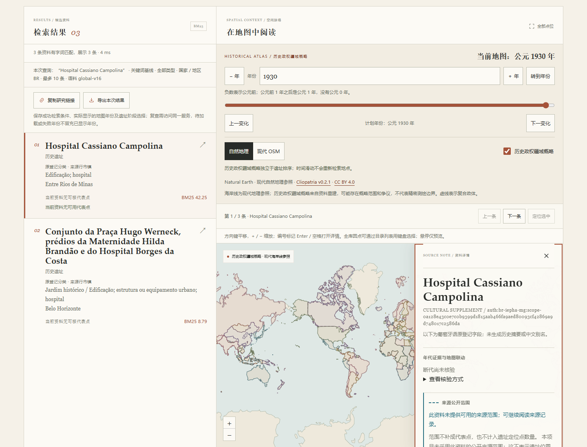
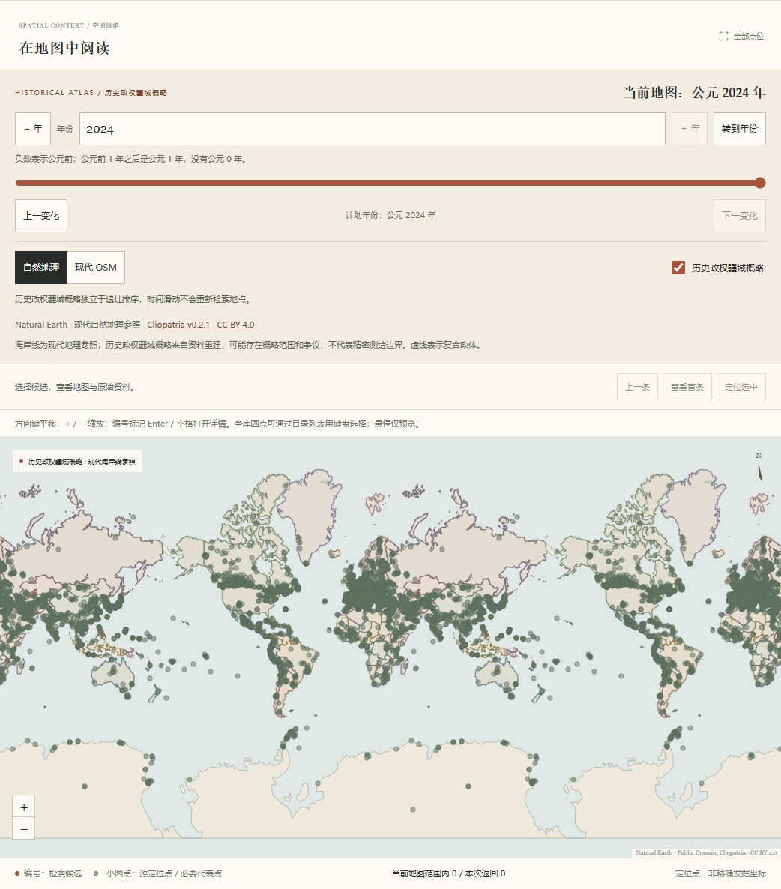

# Iepha-MG 文化登记资料与地区浏览验收

本批新增133项来源限定的文化登记范围，语料为`global-v16`、共3326条。Brazil目录合计154项；203个国家／地区来源标签及7个资料分组不变，这些标签和计数不是全球遗址完整性分母。

## 资料与身份

来源为Iepha-MG在米纳斯吉拉斯州开放数据门户发布的`Patrimônio Cultural Tombado`，固定153行、九原字段，原CSV SHA为`0ef07b94a16da7f01fe43e60fae4ced24546662288e3af93c3e92136b9fbb8df`。来源数据包明确采用CC BY 4.0，页面、条目、导出及[许可说明](../src/archsearch/data/MINAS-LICENSE.md)保留机构、来源、取得日2026-11-05及加工边界。

原类别为BI88、CP51、CH12、BM2。按原保护程序编号与原完整名称形成147个范围决策：133项文化范围纳入，2项可移动物排除，11项仅有自然分类的范围及1项Pampulha既有范围关系未定的条目保持待核。没有把153行算成153个遗址、把程序编号当作唯一整体身份，或将同城视为同一对象。

四组多行记录按来源完整范围各保留一个对象。`PTE058/1984`的两项完整范围不同，仍为两项对象。独立保护的建筑可与较大街区有包含关系，不声称空间互斥。标题采用来源完整名称，所有`names=[]`；原登记简称仍在带字段名的资料中检索和展示，不能把一座组成建筑的简称当整个组合范围的别名。

独立代理逐行对照原CSV、字典、门户元数据及必要的官方范围说明，保存153行／147项决策和8份原档的校验信息；不是人工或专家确认。四份本地规范化JSON可离线重建，十个外部SHA绑定来源、完整批准事实、独立报告及派生内容。原3193条的全部字段、顺序和共享检索文本逐值保持不变。

## 地区、位置与原文

原`municipio`全文形成67种地区选项。139条采用原行证据对应133条对象／地区关系；`Belo Horizonte, Nova Lima e Sabará`保持一个组合值，不拆成三种行政区或三个遗址。全部地区索引为`source-subdivisions-v4`，合计97种来源值、1265条关系、1263个不同对象。加拿大与香港原定义及全部证据不变，分别仍关联992与138个对象。原有巴西21项没有本套市镇证据，清除地区条件后可见完整154项。

133项新增记录没有来源坐标，代表点和精度均为`null`，没有生成历史阶段；现代保护、立案和更新日期不触发地图跳年。全库代表点状态为2940项主图可显示、3项极区、383项未采用代表点。原三组来源点序列及197项来源范围不变，7343个逻辑点仍绘制22029个Canvas世界副本圆点。

数据字典把`0`列为通用缺失标记，登记簿字段说明却另有解释，项目保留冲突而不补造法律事实。153行中唯一`distrito=0`的条目属于待核自然范围，不在133项公开资料中；不能声称在采用资料详情里展示了该行。采用范围中的原登记簿`0`保留并说明歧义。

卡片显示原分类与市镇全文；详情以九个中文字段标签展示葡萄牙语原值并标记`pt-BR`，多行清楚标出来源行序号。仅对符合来源格式的内容作结构展示，缺字段、额外字段、重复键、异常编码、无效行序或超过153的索引都回退完整原文。原值使用文本节点，原`Site.details`和导出值不改写。

## 本地模型与检索诊断

固定`multilingual-e5-small` revision `fd1525a9fd15316a2d503bf26ab031a61d056e98`，15个模型文件未变。3326×384索引在离线模式下准备，float32、有限且归一化；旧3193条索引被明确拒绝，BM25仍能查原葡语名称。新索引SHA为`7b81cdd5a1371a6d38f321cf1f67e8eee9601566e268483295e07f7d21458f9a`，索引清单SHA为`b5b101037e12e7a0d46e1775c2d7f5f846e098526e765fa8bdb11a95b1ef33b7`。

13套20对查询分别运行BM25／E5、中／英文，共1040次无过滤检索，另作24次`country=BR`诊断，共用一个真实本地CPU编码器。113份输入、15个模型文件及全部93份现有qrels（原81份及上批12份）前后保持不变。8555对候选待人工标注，`confirmed=false`、Recall和nDCG等指标为`null`。

六个预声明身份目标为阿拉沙小教堂、巴巴塞纳旧公共监狱、旧米纳斯参议院、DOPS-MG旧址、Mantiqueira隧道及Dom Bosco学校群。它们不是人工相关性gold；其余14题不事后补目标。

| 条件 | 六个预定目标的实际结果 |
|---|---|
| 中文BM25／中文E5，无过滤 | 两种模式均六题未进Top10，共12条目标观测未命中。 |
| 含原葡语专名的英文BM25／E5 | 两种模式六题均第1；不能据此声称已解决纯中文专名召回。 |
| 同题`country=BR` | 中文两种模式仍均未命中，原Top10及耗时保留。 |

同进程热检索均值为BM25中文6.843ms、英文7.286ms，E5中文14.230ms、英文14.419ms。第一次模型初始化加首条warmup为5286.200ms，不能称为纯加载时间；热统计不含warmup或额外国家诊断，只是本机观测。

原始排名、失败和耗时均完整保留，未为提高名次添加中文别名、改写查询、替换目标或补造相关性指标。原名BM25与来源地区目录是当前可用的发现入口。

另作独立的手选来源市镇诊断，不并入1040＋24次原评测：对相同六个中文问题，用户按已知目标的原`municipio`选择地区后，E5目标名次依次为1、1、未进Top10、2、1、1，候选数量为2、1、28、28、1、2；中文BM25仍六题零结果。地区条件来自已知来源对象，不能称为自动地名抽取、盲测或相关性指标。

## 实际浏览器

真实Chrome阻断所有非本机请求后，验证BR目录50／50／50／4分页、133项原始Site逐值一致、67种市镇全文、四个多行整体、乡村／医院／历史中心、Catedral与Casarão完整范围、登记簿原`0`及提示。唯一原`distrito=0`属于未采用行，只在冻结原档及独立解析夹具检查，不伪称为真实公开详情。

验证检索与目录的市镇条件独立、长ID和两套市镇条件分享恢复、实际地图年与原`Site.details`导出保持一致、无点记录不改镜头或年份。香港大潭22个原多边形切到MG资料后清除，成功空态不混成失败；加拿大原省区及全球原点层继续可用。仅浏览器夹具中的HTML字面值和异常字段分别按文本显示或完整回退，没有改写生产资料。

390px窄屏的详情宽度与滚动宽度均326px，九字段均完整换行、13px字体，来源署名12px，没有水平溢出。实际发现目录翻页按钮继承36px旧样式，修正后上一页／下一页均44px，国家、市镇和年份控件也达到44px。原36px失败与其后的修复验证均保留。

服务第一次E5查询含模型初始化，接口5562.96ms、浏览器5687.73ms，独立冷态证据保存后才作热态重试，首个热查询接口16.87ms。前几轮脚本另有API字段名、已选状态及多行定位器等测试工具错误，均保留原失败；没有把热态重跑改称冷态或隐去纯中文漏检。

全球性能检查清除国家、地区、市镇及bbox条件，保持3326条和22029个实际Canvas圆点。1930／2024年完整200年度接口分别87.68／98.8ms；提交年份到Canvas重绘并经过两帧分别248.9／336.7ms。未使用304、未缩减全球点层，该次本机观测符合300ms热接口与1秒渲染目标，不保证其他设备表现。

以下截图来自同一本地服务，资料无坐标状态、完整来源范围和实际显示年份均保留；全球图关闭详情并清除所有地区及矩形条件。

## 自动检查

Ruff与Mypy（31个源文件）通过。本地Windows完整测试为1281项通过、5项符号链接权限跳过，另有原有Starlette弃用提示；pnpm冻结安装、类型检查与构建通过，206项前端测试和21项审批工作流测试通过。新增46项编译器单元、5项地区角色边界和6项真实资料集成测试。

首轮新增集成检查有一处测试将原`PTE058/1984`误写为1985，已对照原CSV修正为精确原值，原失败日志保留；随后完整1286项检查得到上述最终结果。没有放宽原字段或跳过该用例。

普通安装使用随代码分发的规范化资料。原始CSV、网页、模型、索引和评测输出不进入Git；源缓存校验仅在已持有固定8份缓存时执行。模型与历史库准备后，运行期只读本地资料，现代OSM底图仍需联网。
