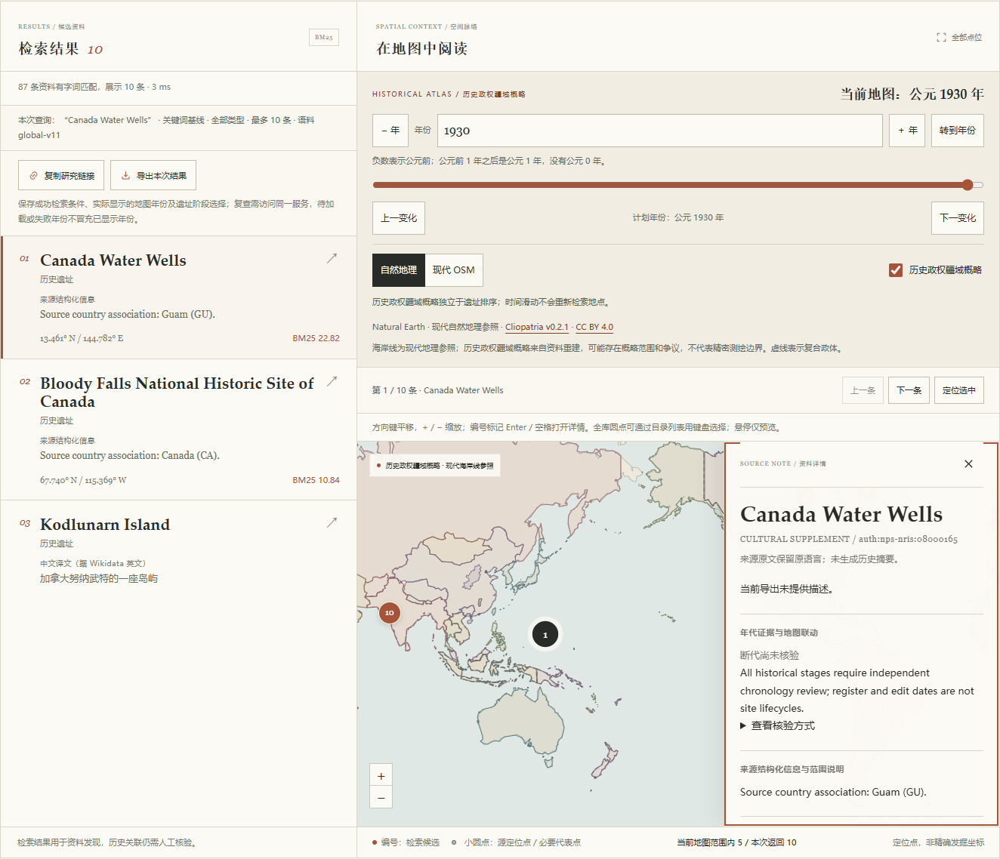

# NPS 太平洋历史登记资料验证记录

`nps-pacific-v1`将 1807 条资料追加为 `global-v11` 的 1940 条。原始 156 个 NRIS 登记对象中，133 个新增、5 个对应既有对象、18 个保留待核；原始 161 个来源要素不能按行直接计作新增遗址。NPS 正式历史登记不是 UNESCO 世界遗产入选，本批也不是完整太平洋文化遗址名录。

截至本记录，已完成独立来源、实际数据整合、全量本地测试、真实模型诊断和本批浏览器实测。跨平台 CI 与最终 PR 交付仍标为“本轮待验证”，不预写外部检查或合并成功。

## 已完成：来源事实与范围审核

固定来源合同 70 项检查、逐条来源审核 10,717 项检查通过。源审读取全部 156 件官方 NPGallery HTML，以独立 DOM 行解析核对身份、对象范围、State、文化类型和位置披露；并与 161 个原属性要素、132 次有界公开几何响应、原 1807 条资料及 5739 个来源点对照。

| 冻结输入或报告 | SHA-256 |
|---|---|
| 来源合同 | `8d567d54e8f4b43c04b7ccdcfef37d89cc3d53ad7e52878d3f2193213c8af99d` |
| 源候选 | `deec5d898956cbf4149d1112688514ab8d45adb67baea050c94ad500a56d07ed` |
| 独立逐条源审 | `891b23a18c71b836a48bd507a17a7a77a75f01fd7b84b93d0fada5b5fdef096e` |
| 独立整合复核 | `7887ba97b6376eb86438ec5a3f50a1d32c8ff1538fc83a3719679836018620e1` |

294 件必要原档的实际 SHA 全部核对，构成为 156 件元数据 HTML、132 件公开几何响应、2 件原属性响应、UN M49 表及 3 件范围补证 HTML。完整缓存、原多边形、审核输出和模型不进入 Git，普通运行不需要原页面缓存。使用范围限于事实字段及极短引文，不把 NPS 托管的第三方资料统一重许可；每个非开放来源 URI 的不同引文跨记录最大合计 19 词。具体权利与来源见 [NPS-LICENSE.md](../src/archsearch/data/NPS-LICENSE.md)。

18 条 hold 继续保留原始处置理由：其中 6 条实际元数据身份／地区冲突，另外 12 条缺少固定原址、移置情况或父子及既有范围关系的充分证据。它们不新增 Site、不追加旧目录、不获取几何。源审曾发现 Rota／Songsong 对象被旧草案误写为 Managaha，以及早期正则解析吞并字段边界；当前候选已修正，原草案逐字归档，正式 HTML 字节未改。

133 条新增对象保留原名和来源别名，英／中文描述均为空，所有历史阶段保持 `not_reviewed`；登记、提名、编辑及元数据中的时期字段没有转成建造或使用阶段。代理审核不等于专家或人工考古断代确认。

## 已完成：代表点、披露与来源分组

| 项目 | 实际结果 |
|---|---:|
| 新增文化对象 | 133 |
| 有采用代表点的新增对象 | 111 |
| 新增对象的原始公开点 | 112 |
| 空代表点 | 22 |
| 仅有公开范围的对象／原范围要素 | 21／22 |
| 明确限制位置披露的新增对象 | 1 |

Canada Water Wells 的两个原点属于同一正式登记组，原顺序及要素身份完整保留，固定首点只是项目初始参考，不是来源主点或几何中心。第二井的独立范围查询命中同一个父对象一次，不新增遗址计数。其余仅有多边形的记录不补中心点；原始登记范围不是古代政治疆界。

Tulauta Village 的单条官方 `Address Restricted` 记录优先于地图服务的一般说明。本批没有请求其几何或额外挖取精点；空值不表示真实地点未知。Wake 两个来源的 `site`／`DISTRICT` 分类差异同时保留，Tinian 的两个原始范围保留，地址缺失没有改成实际位置未知。位置披露状态也不代表游客准入许可。

已采用点逐条核对 NRIS、layer、OBJECTID、GEOM_ID、CR_ID、State、坐标顺序、WGS84 声明、文件与来源序号、实际 URI／SHA 和原始属性。来源可能使用 XY／质心生成法，本项目没有重新计算中心，未将标称 `SRC_ACCU` 当作发掘精度；`location_precision` 均为空，存在状态也不冒充实地确认。

地区标签由原 State 与官方 UN M49 国家或地区行关联，不从坐标或 NPS 管辖推主权。当前使用 201 个来源国家或地区标签、7 个来源分组；新增 AS、GU、MP、UM 四个标签。“NPS太平洋资料分组”是项目来源分组，含 133 个新增与 5 个既有对象，共 138 条，不是 UNESCO 官方分区。

| 国家或地区代码 | 当前目录条数 |
|---|---:|
| AS | 14 |
| GU | 74 |
| MP | 22 |
| UM | 1 |
| FM | 23 |
| MH | 5 |
| PW | 4 |

这些是整体资料的来源地区关联计数，不能相加作为全球遗址总数或领土覆盖率。同名 Japanese Hospital 的两个登记对象分别位于 Saipan／Garapan 和 Rota／Songsong，保留各自 NRIS 与 County；不能仅凭同名、同地区自动合并。

## 已完成：实际整合与离线重建

独立整合复核 5,832 项检查通过。133 条 Site、坐标、披露字段、来源文件和原 provenance 与批准候选逐字段一致，仅增加明确范围的独审绑定。完整 156 条来源处置不变，294 件运行准备缓存实际字节通过校验。

原 1807 条磁盘资料与加载顺序保持冻结基线，规范化字段 SHA 为 `e662428f2a7a3e18cd7b60ec2629eddd36cecb2b05988daeddb3bca6d1d46d84`。运行期只给 Blunts Point、House of Taga、Nan Madol、South Finegayan 和 Bai Ra Irrai 这 5 个既有对象追加可追溯目录关联：原国家或地区、分组、坐标、阶段、原地理来源与引用前缀保留，追加引用的摘录为空。全部 1807 条共享检索文档字节不变，新增 133 条文档也与批准候选一致。

| 生产文件 | SHA-256 |
|---|---|
| `nps_pacific_review.json` | `48ea82f4bbf71ff85619571d465752ed83de53f06c67c573106694544593a966` |
| `nps_pacific_sites.json` | `e8cccd7e31c51d062be78a406cd801d7933dcbf1c8ec62c5fe12ed5d72630595` |
| `nps_pacific_manifest.json` | `b2f037db0858dbf60fa04d5b95212eaf459e074e71c0a127c8596c0ae162518c` |
| `nps_pacific_locations.json` | `1ae88886c8671ed2dbfcbb09e47c64cedfb729126f68c9078d8101a4d4c9e933` |

在阻断网络的独立复核进程中，两次核心与地图侧车重建均与这四个实际生产文件字节相同。原 WHC 5632 条和海牙 107 条来源点的坐标、标签、ref、source_index 及各自来源合同保持不变。新增第三来源覆盖 111 个身份、112 个原点；整体三组共有 1239 个身份、5851 条来源点，5546 个按各身份去重的位置、305 条重合记录。结合必要代表点后为 6301 个主图逻辑点，不是新增遗址数量。

最终代码、数据接入、README、测试及生成文件的独立审查冻结了 32 个路径的实际 SHA，未发现未解决的阻塞；报告 SHA-256 为 `d5aa6b66daa3639a5344563b5abdc5f5a180bee1f49272a8d2360b4cdadbf846`。编译器由另一代理独审，当前只投影正式冻结 pin；本批许可说明、此验证文档和预览 PNG 由未参与撰写的主代理另行复核，未以文档作者自审替代。独审另外运行的真实整合与空间测试 40 项、前端 164 项和类型检查均通过，忽略目录的独立编译与生产 JS／source map 一致。

当前代表点状态为 1898 条可在主图显示、3 条极区记录、39 条未采用坐标。NPS 第三来源的 SHA 明确标识派生审核合同，不冒充一个原始 GIS 导出，也不覆盖 WHC／海牙的许可。注入第三来源故障后，整个多来源点层统一退回原代表点，1940 条基础目录仍可使用，不宣称残余两组数据完整；第二井范围命中也随之停止。

既有历史疆域数据、时间轴和年度服务的来源合同未在本批修改，1930 年等既有历史视图仍沿用原服务；本批没有新增历史阶段或推测疆界。本批浏览器实际核对了目录、范围、选择及分享操作保留成功显示的 1930 年地图，未把阶段未知记录自动改成年份。

## 已完成：本地检查、真实模型与查询诊断

Ruff 全库检查通过，Mypy 的 23 个模块通过；完整 Python 测试 852 项通过、5 项跳过。跳过均为本机 Windows 无特权符号链接权限限制，包含原有 4 项及 NPS 新增 1 项，不代表对应 Linux 场景已经执行。pnpm 冻结安装、TypeScript 检查与构建通过，前端 164 项、审批流程 21 项通过；实际跨平台 CI 仍待取得。

设置 `HF_HUB_OFFLINE=1` 后，复用已缓存固定模型完成 1940×384 归一化 float32 索引准备，15 件模型文件 SHA 与准备前一致。实际索引的形状、有限数值与单位范数均核对；旧 1807 条索引被明确拒绝，提示语料、模型或文本构造版本不匹配并要求重新 `prepare`。完整性证据在本地忽略目录 `.archsearch/qa/nps-pacific/integrity.json`。

原研究问题、全球、区域、南美、海牙、非洲、太平洋／内陆及 NPS 本批八套查询各 20 对，分别运行 BM25／E5 与中／英文，共 640 次，实际全部完成。报告包含排名、耗时、候选池和待标注模板；没有确认的人工相关性标注，所有评测指标继续为 `null`。新增 20 对为面向本批的主题诊断，不是盲测、完整地区问题集或整体准确率估计。

全库条件下，n01 的中文问题为“寻找关岛的历史防御堡垒”，英文对照为“Find historic defensive forts in Guam”。实际结果保留如下：

| 模式与语言 | 实际结果 |
|---|---|
| 中文 E5 | 前 10 没有本批 NPS 新记录 |
| 英文 E5 | 首位为 `auth:nps-nris:74002042`，Fort Nuestra Senora de la Soledad |
| 中文 BM25 | 首位为 `whc:1755` |
| 英文 BM25 | 首位为 `whc:247` |

英文 E5 的首位命中是实际排名观察，不是已确认相关性分数；两种 BM25 首位及中文语义未命中的弱点完整保留。没有据此更换问题、补猜中文译名、改变排序或隐式切换检索模式；地区目录和用户明确选择的原名 BM25 仍是独立访问方式。

本批 20 对诊断的进程内热态单查询中位数为：中文 E5 约 16.61ms、英文 E5 约 13.32ms，中文 BM25 约 5.14ms、英文 BM25 约 4.47ms。该组报告的模型初始化／预热阶段约 1569.68ms，单独记录；这些数值不包含浏览器、网络和完整交互，不是所有机器或端到端性能保证。原始报告位于忽略目录 `.archsearch/reports/global-v11/`，汇总位于 `.archsearch/qa/nps-pacific/evaluation-summary.json`。

## 已完成：真实离线浏览器

真实 Chrome 阻断所有非本机来源后，八组验收通过，记录 185 个本机请求且错误列表为空。最终报告 SHA-256 为 `aff9148e0c58de2866aa4843180ec911e90e6e31331e1a070121cf94d28915c2`，原始请求、导出和截图保存在忽略目录 `.archsearch/qa/nps-pacific/browser/`。

1. 实际页面与 API 的 1940 条语料、201 个国家或地区标签、7 个资料分组、三来源计数和 18903 个世界副本圆点一致，18 条 hold 没有成为新 ID。
2. GU 74、AS 14、MP 22、UM 1 及 NPS 分组 138 条可独立翻页、分享和恢复，不要求先提交查询。
3. 五个既有对象可从新增来源目录关联发现，原文本、坐标、阶段、地理主来源和旧引用保留。
4. Tulauta 的受限位置及 Wake／Truk 的仅范围记录仍为空点，定位操作不可用。NPS 全球矩形范围得到 116 条有点资料，清除后恢复 138 条，不补零坐标或中心。
5. 两处 Japanese Hospital 按 `74002189`／`81000664` 身份独立打开，保留原名和不同点位，不凭同名合并。
6. 在真实主图缩放至 18 级、视窗仅含加拿大第二井后捕获范围，目录仅返回同一个父对象一次；地图三个世界副本不增加对象数。详情与导出保留两个原点、首井代表点和正确派生来源 SHA，1930 年地图、原检索排名和分享往返保持。
7. 390px 窄屏无横向溢出，Space／Enter 打开目录详情、Escape 返回原按钮，双井详情、来源组与范围控件可用键盘访问。桌面预览、手机详情和来源长行经目检清晰并正常换行。
8. 只模拟状态接口的模型缺失，没有删除真实模型；目录仍可浏览，用户明确选择的 BM25 仍可搜索，没有语义请求失败后的隐式模式回退。

浏览器实际发起新中文查询“寻找关岛的历史水井 Canada Water Wells”：首次请求记录约 6067.39ms，包含服务端模型冷加载；后续热态请求约 16.34ms，两次 Canada 目标都未进入 Top10，相关性仍未人工判定。随后用户明确切换 BM25，保留这一操作和失败记录。上述是这两个实际请求的记录，与前一节诊断进程的中位数及初始化时长分别报告，不能当作浏览器完成渲染或端到端性能保证。

初次验收脚本曾隐式返回 Leaflet 实例，导致自动化结果序列化失败；修正测试脚本后完整重跑，失败记录另存审计，没有将其当作产品修复。补拍截图仅等待详情动画完成并清除偶然焦点，不改生产样式或数据。

下图是实际本地运行的双井资料与 1930 年历史参照，非生成示意图；发布副本与最终原始 `desktop-preview.png` 字节一致，SHA-256 为 `3f269872366d2da71fcb409c33265f6a0a75b4c7cd3e73645c5bc96b7bb62af2`。



## 本轮待验证

以下项目尚未取得本轮最终验证结果，不能以历史批次或上面的数据复核代替。

| 项目 | 当前状态与完成条件 |
|---|---|
| 跨平台 CI | 本轮待验证；本地检查已完成，需另确认 Windows／Linux 的实际 quality-gate 结果 |
| PR 交付 | 本轮待验证；提交后的 quality-gate、机器人批准及实际 squash 合并须分别确认 |

## 复现命令

在仓库根目录执行。前两步只用随仓库分发的审核资料离线派生；`prepare` 的模型准备与真实检索另按 README 执行。

```powershell
uv run --no-sync python -m archsearch.nps_data --rebuild
uv run --no-sync python -m archsearch.nps_spatial_data --rebuild
uv run --no-sync python -m archsearch.nps_data --verify-source-cache .archsearch/downloads/nps-pacific-v1
uv run --no-sync archsearch coverage
uv run --no-sync archsearch prepare
uv run --no-sync archsearch serve
uv run --no-sync archsearch evaluate --queries src/archsearch/data/queries-nps-pacific.json --output .archsearch/reports/evaluation-nps-pacific.json
```

缓存校验命令仅用于持有完整 294 件原档的维护环境，普通启动不要求这些原档。重建确定性、源码检查和代理来源审核不等于检索相关性验证；后续结果必须如实保留中文语义失败、缺失字段和尚未完成的标注。
