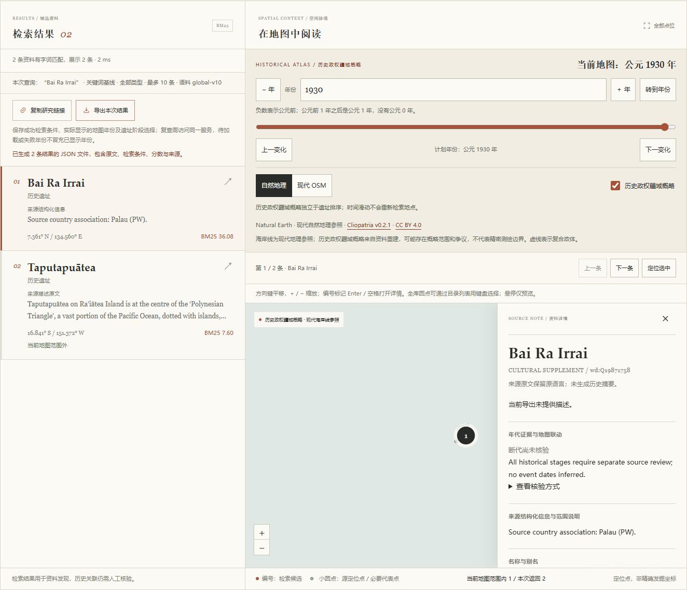

# 太平洋与非洲内陆资料验收

`pacific-interior-supplement-v1`将1800条追加为`global-v10`的1807条。七个文化对象来自正式历史名录、文化预备清单和原作者考古文章；没有把自然地点、行政区或现代馆藏地址当作文化原址。本批不构成地区或全球完整清单，预备清单也不等于世界遗产正式认定。

## 来源和范围

独立源审142项通过，报告SHA-256为`84628016e43cf3c728fea158871d69b70448b01287db9ad9df251d77ab5bb3cf`；修订候选SHA为`acd3f49bb1e13aa51d28a03cf452a749cd8f76e21704608b77147382cfad1c6d`。源审只批准身份、文化资格、范围、公开点和权利边界，不是专家或人工断代确认。

| 文化对象 | 身份 | 定位处理 |
|---|---|---|
| Leluh Ruins | `auth:nps-nris:83004524` | NPS明确Address Restricted，保留空点 |
| Likiep Village Historic District | `auth:whc-tentative:2066` | 环礁范围不能平均为街区点，保留空点 |
| Badrulchau | `auth:palau-register:B.NE-4.4` | 未冻结可复现数字点，保留空点及原身份点号 |
| Bai Ra Irrai | `wd:Q19871758` | 固定同实体Earth P625原值，NRIS76002195通过P649桥接 |
| Sigatoka Sand Dunes | `auth:whc-tentative:1375` | 官方粗坐标与两个同rank声明冲突，不任选／修猜，保留空点 |
| Ngongo Mbata church | `auth:antiquity-projgall:clist347-ngongo-church` | 只采用教堂发掘文化身份，未核定公开数字点 |
| Kindoki | `auth:antiquity-projgall:clist347-kindoki` | 只采用作者确认的考古对象，未核定同范围数字点 |

Airai代表点为`[134.56027777777777,7.361111111111111]`，保留原经度、纬度顺序。precision是来源参数，不是发掘精度；`location_precision`仍为空。其他六处的空值不是实际位置未知，不用村镇中心、单屋点、馆藏地址、图上估点或几何平均替代。

Ngongo旧候选曾含来源未支持的距离及旧村移动说法，已在四个文本路径删除，原草案逐字归档，修订后重新独审。Airai的Wikidata错误美国历史地点描述未进入公开描述或共享检索文档，原始矛盾值留在审计。七条英／中文描述均缺失，不生成历史概述或官方中文译名；资格短摘录仍可查看。共同Antiquity文章的两条资格摘录跨记录合计17词，未以机构名称推定统一开放许可。

七条历史阶段全部`not_reviewed`，没有把登记、提名、发掘或出版日期变成建造、使用年代。原1800条全部字段、顺序和逐文档SHA保持不变，基线记录SHA为`eeffd19cb62aaa4404517e9fd07cb2b3078cf066502b378ae2e18f5c7abcffa6`、ID清单SHA为`c900145f6641be8722fbf2ef21b8beb04b1f44c4ae6305033738357aa47b07af`。

## 编译、缓存与检查

冻结复核SHA为`6ed31ae1c789ffd90fdff950e9103297800d4a1de20d2df22e12d57c1846d869`，派生资料SHA为`b8e1a4f6ffa85af0a97c7e9d943bb461ffe0d84db09b1fcb667e57026142b21a`，清单SHA为`322b85af5aa0620628a4e92ac0a419dc1db3e477a5ff3257683f6d8247b7f7cd`。离线重建两次字节相同，14份必要来源缓存实际SHA通过；普通运行不需要原页面，缓存不进入Git。

稳定整合独审119项通过，报告SHA为`9e3f9a50e0605e68218bc70d79d6d59a9f85ea9bccafc008477b36b78e4dc184`。七条与源审候选逐字段一致，只有独审来源绑定追加。原WHC5632条及海牙107条可绘位置的坐标、标签、ref、source_index和两套来源组合同全部保留。

Ruff通过、Mypy的21个模块通过；完整Python746项通过、4项本机Windows符号链接权限相关跳过；pnpm冻结安装、TypeScript检查、构建、前端163项及审批流程21项通过。新批次27项针对与整合测试覆盖外部pin、基线变化、身份／国家／分区配对、空点元数据、缓存越界／冲突、点号ID、范围排除和无模型关键词检索。CI不下载模型或完整来源。

旧1800条索引被明确拒绝，复用既有固定模型离线重建1807×384归一化float32索引，15份模型文件SHA不变。当前197个来源国家／地区标签、6个来源分区不增加；1787条代表点主图可显示、3条极区点、17条无采用坐标。两套来源仍1128个身份、5739条可绘记录；加入一个必要代表点后主图6189个逻辑点，三个世界副本绘制18567个Canvas圆点。来源国家计数不可相加作为世界总数。

## 真实检索与局限

原研究问题、全球、区域、南美、海牙、非洲和本批七套查询各20对，分别运行BM25／E5与中／英文，共560次，均完成并生成排名、耗时、候选池和待标注模板。没有确认的人工相关性标注，所有指标继续为`null`。

| 首七个固定诊断 | 中文BM25目标排名 | 中文E5目标排名 | 英文E5目标排名 |
|---|---:|---:|---:|
| p01 Leluh | 1 | 未进Top10 | 1 |
| p02 Likiep | 1 | 未进Top10 | 1 |
| p03 Badrulchau | 1 | 未进Top10 | 1 |
| p04 Bai Ra Irrai | 1 | 未进Top10 | 1 |
| p05 Sigatoka | 1 | 未进Top10 | 1 |
| p06 Ngongo Mbata | 1 | 未进Top10 | 1 |
| p07 Kindoki | 5 | 未进Top10 | 1 |

英文BM25七条也均为第1。该集合面向本批专名，不是盲测或整体准确率估计；中文查询失败保留，没有换题、填人工分数、添加猜测译名或隐式切到BM25。完整来源标题配来源国家的实际API集成测试七条均第1；地区目录不依赖模型。

本批诊断热态单查询中位数：中文E5约12.16ms、英文约13.39ms；中文BM25约4.00ms、英文约4.56ms。它们是本机诊断进程检索时间，不包含网络和浏览器、首次模型加载，不是通用性能保证。

## 离线浏览器

真实Chrome仅允许本机8766请求，外网阻断，八组验收通过，未发现本批生产缺陷。报告SHA为`f3be8d4cf5ee71ae3d98663ca3bf3138508858727ea43a3bbb6a0a7d54de617d`，桌面与390px截图均目检。

- 七个详情的身份、代表点与来源链接一致；密克罗尼西亚2、马绍尔群岛2、帕劳3、斐济2、刚果（金）5条目录正确。亚太270条可浏览6页，非洲97条2页。
- 六条空点都能独立分享、恢复和导出，定位按钮禁用，不出现零坐标。全球矩形范围1790条分36页排除无点资料，清除范围后1807条分37页完整恢复。
- 点号ID`B.NE-4.4`通过实际地址栏、重载、详情和导出往返；范围更新与目录切换保留Badrulchau既有排名及实际1930年历史图。
- Airai公开原值和PW来源关联正确，原错误英／乌文描述不进入正文或`build_document`；审计备注的否定说明不冒充原历史描述。
- 七个全库BM25专名均第1，实际API耗时约0.69—1.49ms。新中文Airai问题成功编码但未进Top10；首个浏览器语义请求5378.71ms可能包含模型加载，不能当热态耗时。
- 导出保留实际地图年份、语料版本、独立选中资料、本批混合权利署名及原两套定位来源；390px无横向溢出，Space／Enter打开与Escape焦点返回通过。

本地完整请求、导出及截图保存在忽略目录`.archsearch/qa/pacific/browser/`。以下为真实Airai原名BM25、原始代表点、缺失描述状态与1930年参照，非生成示意图。自然地理底图是简化的现代参照，小岛轮廓缺失不改变原始代表点证据。



## 复现

```powershell
uv run --no-sync python -m archsearch.pacific_data --rebuild
uv run --no-sync archsearch prepare
uv run --no-sync archsearch coverage
uv run --no-sync archsearch serve
uv run --no-sync archsearch evaluate --queries src/archsearch/data/queries-pacific.json --output .archsearch/reports/evaluation-pacific.json
```

来源权利与定位限制见[PACIFIC-LICENSE.md](../src/archsearch/data/PACIFIC-LICENSE.md)。本批主要补文化资料，仅一个可采用新点，不把六处空点记作已填补地理空白，也不把来源标签数当成全球地理覆盖率。更广名录候选仍需核对状态、文化类别和对象范围，不能将原始名录行数当成新增遗址数。
