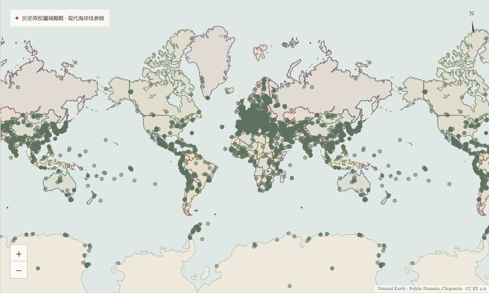

# 北方、岛屿与内陆文化资料验收

2026-11-04，语料`global-v6`，增量`regional-supplement-v1`。本批优先增加实际地域稀疏处的可追溯文化资料与中文可用性。

| 项目 | 上一版 | 本批 |
| --- | --- | --- |
| 资料总数 | 1663 | 1689 |
| 来源国家／地区标签、分区 | 197／6 | 197／6 |
| 文化遗址补充资料 | 38 | 64 |
| 主图可用代表点 | 1656 | 1679 |
| 极区代表点／暂无可用坐标 | 3／4 | 3／7 |
| 主图逻辑绘点，含源点和必要代表点 | 6046 | 6069 |
| 阶段已核验／证据不足／尚未核验 | 149／451／1063 | 149／451／1089 |

26条包括12处北纬60°以北地点、12处太平洋岛屿／澳大利亚内陆对象及2处非洲考古原址。世界遗产文化／混合名录1033／1033与ATS正式历史名录91／91维持独立口径；新增资料不一概称为这些名录的成员。

## 来源、坐标与复核

三组候选分别经过另一代理对固定原文、身份颗粒度、资格、坐标、地区关联、许可和去重进行复核，审批绑定当前候选文件SHA及每个唯一ID。最终整合仅追加获准的国家事实、范围备注、引用角色和忠实译文，逐字段与获批候选核对；原1663条对象、字段、顺序、检索文本及24份既有数据文件未改。全26条仍无历史阶段或默认年，不从发现、名录或研究年份推断建造、使用或连续存在。

23条采用可信公开代表点，3条保留空坐标：Ipiutak遵循官方受限地址，公开清单与地图不重发被拒数字点；Talietumu拒用有范围冲突的Wikidata点；Arahurahu尚无可信同对象数字点，重建布局与古代原址问题在详情保留。原始缓存不进入Git。

Zhokhov使用原作者论文公开分钟坐标，未借用整岛中心；Ekven使用官方同名遗址DMS及西经半球；Bloody Falls独立于范围不同的领地公园；Arvia’juaq／Qikiqtaarjuk仍是一条联合遗址而非两条新身份；Fort Conger保留81.75°N。Shum Laka采用作者论文原址坐标，未采用缺经度的预备页串；Ishango区分原发现地、旧村及布鲁塞尔博物馆。代表点不承诺发掘精度。

实际属地字段与成员统计关联分别保留。格陵兰的GL来源事实不改，DK关联通过官方Greenland遗产的Denmark成员分组及有效代码证据处理，废弃声明未采用；太平洋实际地区依UN M49明确映射到现有亚太界面分区。来源成员、现代自然地理与历史政治归属互不替代。

- 冻结复核规范SHA256：`d81bf00c9fbfd7f33557a63db3f3b577da93516d3f52cccf107df6af73386060`。
- 26条规范化资料SHA256：`ec4c7158a45c65bf12391923ccaef098ec51a66d214009bfb96f689b670ff384`。
- 77份来源工件按URI和SHA校验；部分为规范化实体或主来源文本快照，不一概称原始HTTP响应。
- 两次完全离线编译，产物逐字节一致；普通运行不依赖原始页面或PDF缓存。

具体逐来源权利及加工范围见[区域许可](../src/archsearch/data/REGIONAL-LICENSE.md)。这是代理来源复核，未标成人工或专家确认。

## 中文内容与检索

19条Wikidata英文短描述增加忠实简中译文，保留原文、实体版本、字段、SHA及独立代理语言复核。来源界面和导出明确标记为本项目译文，未冒充原有Wikidata中文；原有中文和缺少英文的记录不覆盖。没有翻译非开放来源全文，也未增加原文没有的北极、狩猎、用途或年代事实。

来源分区、成员映射、位置限制与纯定位元数据的引用角色得到纠正，不再当文化资格片段索引。BM25原先将整句中文当一词，现保留汉字整串及相邻双字片段；“西伯利亚”“电报站”可以匹配较长译文。片段不跨标点、数字或非汉字边界；单字只匹配独立字，双字部分重叠仍可能产生候选。这不是中文词典或精确短语检索，不实时翻译、扩词或转换繁简。英文及其他非汉字词的归一规则不改，但文档长度变化可能影响BM25排序。

实际Chrome中，“西伯利亚”前两条为Zhokhov与Yana，“电报站”返回Barrow Creek和Alice Springs，匹配字段为中文描述；加拿大关键词`encampments`命中Bloody Falls的资格短证据并显示来源片段。分区信息不构成词面证据。BM25仍可能因“利亚”等共有片段检出其他地区资料，不能把这些候选都当相关。

三套各20对双语查询分别运行BM25／E5 × 中文／英文，共240组排名与耗时，报告记录`unicode-han-bigram-v1`及BM25参数。没有已确认人工相关性标注，指标均为`null`。地区组是本批主题诊断集，不是代表性盲测；E5的北极主题及刚果主题全库Top10尚未稳定返回新资料，不能声称整体相关性提高。热态查询约10–16ms，首次E5查询含模型加载约5.4秒，仅为本机观测。

从相同1689篇文档抽取共享资格证据帮助匹配提示，全部文档文本逐字节不变，E5向量和模型无需为词法修正重建。新增语料及译文本身已在本地离线构建1689×384向量；固定模型版本不变。

## 地区浏览与空间诊断

真实Chrome阻断外网，完整验证6069个逻辑绘点的三相邻世界Canvas副本、原址与博物馆区别、跨日界线的Ekven、Fort Conger北纬原值、三条空点、目录与检索排名独立、年份优先、分享及多来源许可导出。390px无横向溢出，Enter／Escape可选中及返回焦点；现代瓦片失败保留本地历史图层、点位及目录。

1930／2024年的热态年度请求约83–85ms；在地图已进入视口的条件下，从浏览器年份事件到成功帧及双次绘制约231–332ms。另保留含Playwright滚动与可点击等待的约2.3秒端到端读数，未用它冒充纯地图渲染时间。首次冷查询与热态查询也分别记录。

按同一份本地Natural Earth现代陆地轮廓，复用632个5°网格中心，计算到完整源点及必要代表点的球面距离：超过500km的样点由259降至216，超过1000km由129降至34。此网格不等面积且漏掉许多小岛，只是空间诊断，不能换算成全球遗址覆盖率。

澳内陆窗口由1处增至6处；Guam、CNMI、American Samoa、Gambier和Chatham各增加一个可信点。固定北亚矩形中增加4点，第5个俄罗斯新点Ekven跨日界线另列。格陵兰矩形也包含加拿大地点，不能按该矩形统计主权或GL条目数。Wallis／Futuna、Tahiti仍无本批可信点，未因收录空坐标身份就宣称填图。

## 验证与剩余缺口

本地464项Python、148项前端与21项审批流程测试通过；Ruff、Mypy、TypeScript、冻结pnpm依赖与前端构建通过。Windows有2项符号链接权限用例明确跳过，Linux由CI复核。CI不下载模型或完整源归档；真实模型、原缓存与浏览器单独在本地验证。

国家／地区标签仍不能替代地域内部的资料密度。南美内陆、部分非洲区域和太平洋小岛仍有空白；原资料仍有593条缺少来源国家、501条缺少地理分类，未按点落边界自动回填。1089条阶段尚未核验，人工相关性标注未完成，北极自然问题的语义排序仍需完善。预备名单还存在旧正式遗产和范围冲突，本批没有直接导入未经核实的全集。
