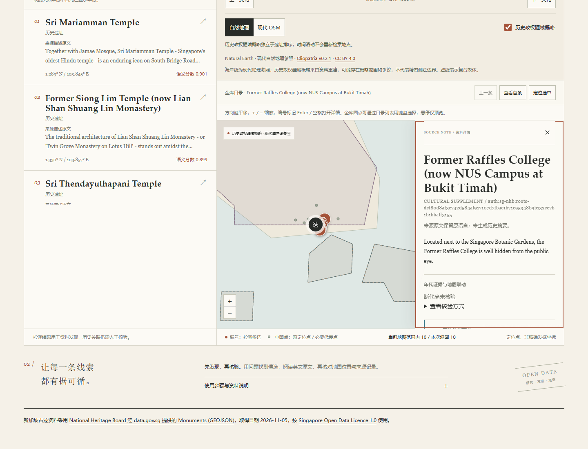
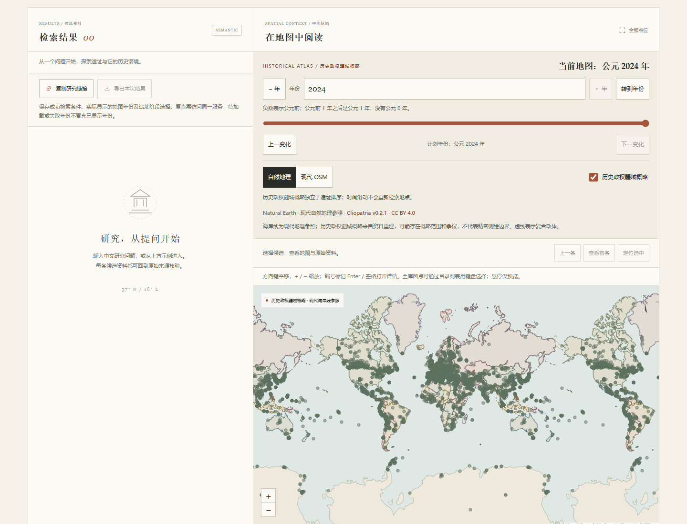

# 新加坡官方古迹与全球目录验收

本批语料由3116增至3193条，版本`global-v15`。新增77项NHB来源限定整体，Singapore目录包含原植物园共78项，国家／地区来源标签仍为203、资料分组仍为7。这不是全球或新加坡最新法定遗产名录的完整性声明。

## 来源与整体范围

固定原GeoJSON`a9566c0c0ae061e1ea429bd5e6221a02cb443f6ce0a63d5089647af25624a4d6`，77条原16字段、Point、顺序及逐行哈希由独立代理重算。20份引用原文件逐SHA核验；完整独立来源事实为`a0c8571137ad37f6a6d97d7619f03d70840a36fc4801779f231909cfad8473f1`。来源采集、来源复审、编译器代码审查与四份正式派生资料读回分别完成；核验不是专家或人工认定。

莱佛士学院的六座建筑及两处庭院有NHB明确说明，未因Raffles同名或邻接将其自动合并为植物园组件；旧`whc:1483`保持原值。三桥是一项整体，医院、钟楼、塔楼等保留来源指定部分，不扩成整机构或整校园。加拿大同名Admiralty对象按原国家、地点、URI区分，未按规范化名称合并。

原业务URI按完整字串生成项目hash身份；两条已失效原链接保留，同时采用另经核实的官方主入口。项目ID不宣称法定编号。原许可英文简介与正面整体范围参与共同的BM25／E5检索文档，排重讨论、待审原因和相关旧对象的审计名称不作为新的正面范围文本。

## 点位、时期与地区

77个提供者原Point按GeoJSON默认经纬度解释并采用作参考代表位置，精度为空；提供者算法未知，未自行转换地址坐标、计算或认定整体中心。没有新增历史阶段，现代名录与更新时间不会切换历史年份。原3116条全部字段、顺序和共享文档逐值保持原值；其文档SHA仍为`df7954880a58ca8f683a325b72a5075c1ba525d3388a9cd8de331cc1630de552`。

三态断代为149项已核阶段、451项证据不足、2593项尚未核验；代表点为2940项主图可显示、3项极区点、250项未采用。三组原定位序列不变，仍为5851条；本批77点按参考代表点保存，来源依据随选中资料保留。全库7343个逻辑点，三个世界副本为22029个Canvas圆点。澳大利亚／香港来源范围保持原197对象、234要素、546环及72540条坐标记录。

加拿大／香港的来源地区关系重新绑定当前语料；没有为新加坡创造区级字段。街道、邮编和参考点不反查地区。来源国家筛选属于现代目录关联，不是历史政治归属。

## 本地模型

固定多语言E5模型已离线重建3193×384的float32归一化向量，全部有限，最大范数误差`1.7881393432617188e-07`，15个模型文件逐SHA不变。旧3116索引被明确拒绝时，原名BM25仍可工作。

新向量SHA为`1055e8083b8265e5de6650dbdafd3bd8eb3243bf242b61f861abc67b43d4093c`，索引清单SHA为`35618079af6fe22f22dcaf1a8c4d21d6e5dd81a3637c1b25ba6c794ad0ba77d0`。20对中英问题属于原名及原文内容诊断，中文提问不作为新增中文别名；只在排名前指定六个发现目标，未为其他题事后建立gold。相关性未由人工完成并确认，指标保持`null`。

12套各20对中英问题，BM25／E5四组共960次无过滤诊断完成，另24次`country=SG`观察分开保存。使用一个CPU编码器，首次模型加载及首次预热合计5277.136ms；该值不是纯模型加载时间。15个模型文件、81份旧qrels和所有排名输入逐SHA保持不变，7862对待标注候选全未填写，23,435项结果读回检查通过。

| 条件 | 热态平均ms | 中位数ms | p95 ms |
|---|---:|---:|---:|
| BM25中文 | 6.302 | 6.376 | 9.424 |
| BM25英文 | 6.924 | 6.746 | 10.545 |
| E5中文 | 14.002 | 13.579 | 17.125 |
| E5英文 | 14.172 | 14.346 | 17.325 |

耗时是本机进程内实测，受当时任务和缓存影响，不作性能保证。六个预定身份仅用于发现诊断，以下名次不是相关性或准确率指标，原始失败没有删除。中文问题可能保留原英文专名。

| 预定目标 | BM25中文 | BM25英文 | E5中文 | E5英文 |
|---|---:|---:|---:|---:|
| Sultan Mosque | 未进Top10 | 1 | 5 | 1 |
| Thian Hock Keng | 未进Top10 | 1 | 未进Top10 | 1 |
| Singapore River Bridges整体 | 未进Top10 | 1 | 1 | 1 |
| Changi原入口门墙及塔楼 | 未进Top10 | 1 | 6 | 1 |
| Former Kandang Kerbau Hospital原三个楼块 | 未进Top10 | 1 | 1 | 1 |
| Former Keng Teck Whay Building | 1 | 1 | 1 | 1 |

加入SG国家条件后，Changi中文E5由第6变为第1，其他预定名次不变；中文“天福宫”仍未进E5前十，中文BM25前五题的目标仍未进前十。英文原名BM25及Singapore目录可用于直接访问；未为当前数据生成未经来源核实的中文别名。

## 真实浏览器与全球地图

在独立的`127.0.0.1:8767`测试服务使用真实Chrome，拦截所有外部请求。Singapore目录两页50／28条完整对应77项NHB及原植物园；77个原Point、234个国家浏览Canvas副本与API逐值一致。全库3193条、7343个逻辑点、22029个实际Canvas副本读回一致，NHB点没有冒充原世界遗产源点序列。原名BM25、同名Admiralty的SG条件、新中文示例E5、当前有效主来源与保留原hash身份均通过。

首次服务中文语义请求为5422.16ms（浏览器5495.4ms），首热重复为12.77ms；后续复验仅记热态，没有重启服务冒充冷测。选择莱佛士学院、三桥及原入口等记录不把现代FME或认定日期切成历史年。香港v3任一区选择大潭仍保留22要素／613顶点，切选新加坡无范围记录后清除旧轮廓，成功空态保留。

版本2导出保持实际地图年、原参考点、选中资料、独立检索／浏览条件和NHB许可及取得日；长hash分享恢复不生成历史阶段。390px初测发现编号长token在详情内被裁，原因是缺少换行规则；已为`.detail-id`增加`overflow-wrap:anywhere`。复验详情宽度与滚动宽度同为326px，署名12px且宽度同为356px，键盘与44px操作控件正常。

另作独立的全球性能补证：清除国家、地区、区级及bbox条件，定位全球，保持3193条及22029个实际Canvas圆点。1930／2024年接口完整200响应分别为97.28／95.68ms，非304且未发送`If-None-Match`。提交年份至地图提交、实际Canvas重绘并经过两帧分别为347.3／347.4ms；该次本机观察符合300ms热年度接口、1秒全球渲染目标，不作其他设备保证。先前在SG78浏览范围测得的244.18／344.6ms另标范围，没有混称全球。

## 自动检查

本地Windows最终完整检查为1224项通过、5项符号链接权限跳过，Ruff通过，Mypy检查30个源文件通过。pnpm冻结安装、TypeScript类型检查与构建通过，201项前端测试和21项工作流测试通过，生成JS及source map同步提交。新增29项编译器单元测试和6项真实资料集成覆盖全事实固定、原3116条、主入口与原ID分离、原Point和空精度、无推造地区、离线重建及未确认评测。

首轮完整检查发现六处旧点位总数断言仍使用扩充前数值，已按原77点更新为7343个逻辑点、2943项全球点位矩形匹配（含3项极区点）。六个失败用例针对复测通过后，再次运行完整1229项检查得到上述最终结果；原失败日志保留，没有忽略失败或放宽来源匹配规则。CI不下载模型或完整源缓存，真实模型与Chrome在本机另行验证。

## 复现与许可

普通安装只需随代码分发的四份规范化资料，无需原网页缓存；离线rebuild编译的是已核冻结事实。原GeoJSON和完整网页不入Git；只有持有固定20份原缓存时才执行源缓存核验。模型和历史库准备后，检索、原参考点和自然地理参照只读本地文件，现代OSM底图仍需联网。

NHB经data.gov.sg提供的原字段及英文简介按Singapore Open Data Licence 1.0使用，页面和导出均保留明显来源、取得日与最新许可链接；外链网页和照片的权利另行保留。详见[来源与加工](../src/archsearch/data/SINGAPORE-LICENSE.md)。
