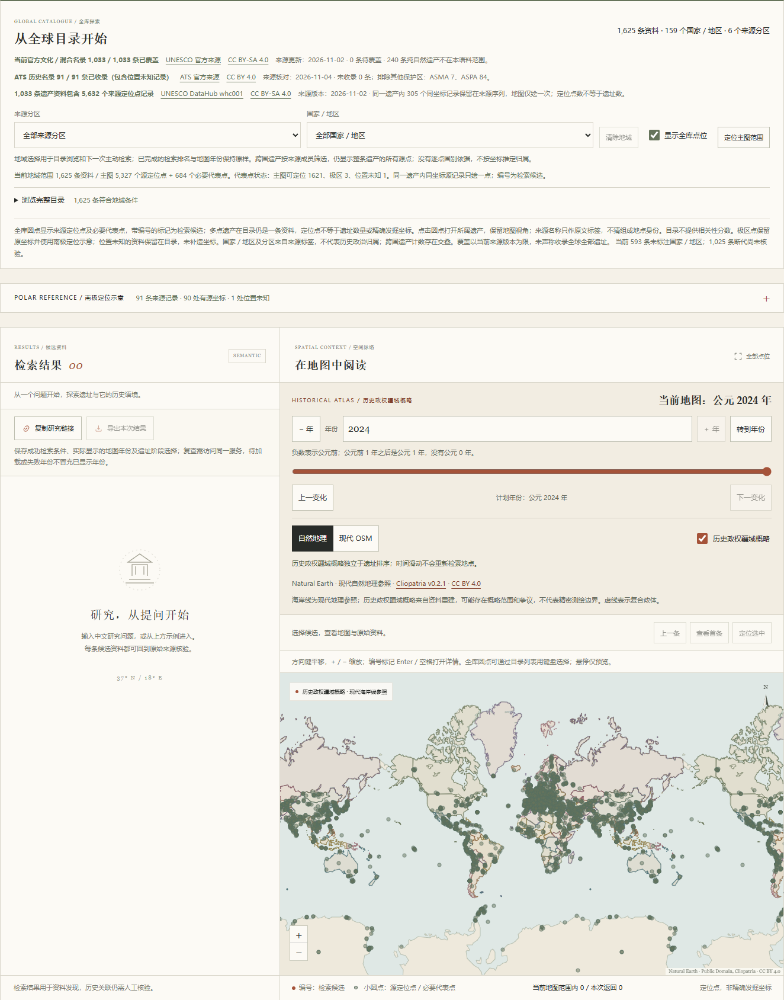

# 完整源定位记录与全球地图验收

2026-11-04，基础语料保持 `global-v4` 的1625条；定位侧车版本 `world-locations-v1`。此批扩展已有遗产的地图位置表达，不新增或重命名遗产，也不改变检索文本、历史阶段、代表点或模型索引合同。

## 数据与身份

| 指标 | 原视图 | 本批 |
| --- | --- | --- |
| 遗产／地点资料 | 1625 | 1625 |
| 来源国家／地区与分区 | 159／6 | 159／6 |
| 主图绘点（每资料内部去重） | 1621个代表点 | 6011个源点及必要原代表点 |
| 固定文化／混合名录 | 1033 | 1033 |
| 完整源定位序列 | 每条只取代表点 | 5632条记录，5327组不同源坐标 |
| 极区／真实位置未知 | 3／1 | 3／1，保留原状态 |

来源仍为[UNESCO DataHub `whc001`](https://data.unesco.org/explore/dataset/whc001/) 的固定2026-11-02快照，CC BY-SA 4.0；记录SHA256 `7e0149d5d509e3259cf2f19d73d20a27e6d34612eb2ed7d7c35b23dd858c57a3`，元数据SHA256 `dc40afdffa29d4cff9e929a68441007906dea7ad6dc71074c0367c755464d6b3`。具体署名与加工见 [源点许可](../src/archsearch/data/SPATIAL-LICENSE.md)。

独立代理直接读取固定原档和既有身份映射，未调用待审归一化函数，逐条构造1033个对象并与正式产物逐字比较。全部原始坐标、名称、编号、序号相同；两次实际重建字节一致。旧17个已跟踪数据文件与原HEAD逐字一致。

侧车SHA256 `7acf15d3e1a2a008aed0f768a7c7d8189809a405e2657789ce5b6046d1239414`。加载器将来源版本、类别选择、身份映射、点序列及产物校验冻结在代码和清单，不能通过同步更改清单哈希静默替换资料。原始名称、点序与身份自更新哈希攻击均被拒绝。

- 1031条有源定位记录；868／1567的原数组为空，不将独立Wikidata代表点写回DataHub源序列。
- 305次同坐标重复发生于11条遗产内，没有跨遗产同坐标源记录；源数据全部保留，绘图仅按同一遗产内部精确坐标合并圆点。
- 3次来源编号重复对应不同点，编号不能作为唯一键；身份使用遗产ID＋零起始`source_index`。2个空名称如实保留。
- 固定源未见非数、越界、(0,0)或超Web Mercator点；通用代码仍区分未知与极区，禁止夹取纬度。
- 来源`components_list`与几何逐点同序，才保留其名称和编号；标签不等于独立核验的组成遗址或发掘位置。

原99条Wikidata代表点不替换，与源点不重合时补绘；独立点与DataHub点在接口、详情和导出中分开。跨国遗产按整条来源成员筛选，保留其全部源点，不按点落在哪一现代或历史边界内推定所属。

## 运行、接口与失败行为

```powershell
uv run --no-sync python -m archsearch.spatial_data --rebuild
uv run --no-sync archsearch serve
```

固定原档默认 `.archsearch/downloads/unesco-datahub-v1/`；缺原档时可显式 `--download`，内容变化会被SHA校验拒绝。规范化侧车随仓库分发，普通启动不下载原档；运行期只读取本地。

`/api/coverage.spatial_locations`与`/api/status`提供独立就绪状态、版本、来源、记录数和实际绘点数。`/api/catalogue`保留1625条身份，附完整`source_points`和同序`source_location_records`，以及`spatial_version`。`GET /api/sites/{id}/locations`将原代表点和源序列分别返回。未知身份404；坏侧车503并提供准备指引，原检索、代表点、历史地图与南极视图继续可用。

前端在版本、坐标、源序与统计全部校验成功后替换点层；取消或过期响应不能回写，新请求失败保留旧成功层。目录分页不重新构造全库点层。源点仅在Canvas绘制，未为6011点创建Tab标记；完整目录和详情原始序列表可用键盘访问。

点击源点选择所属遗产，保持相机和检索排名；年份沿用主遗产已核验阶段的原有规则，不推断每一源点的年代。用户手动调年仍优先于晚到详情。普通目录与“定位选中”使用原代表点。导出`spatial`独立保存成功源点版本、原序、重复、名称、编号及代表点，不添加虚构分数或遗址。

## 真实浏览器和性能

本地FastAPI＋Windows Chrome，阻断所有非本地浏览器请求；1440×1100及390×844视口。

1. 全库1625条、159国家与6分区不变，5632源记录生成6011个绘点。相邻世界副本共18033个Canvas圆点，不增加资料总数。
2. 实际鼠标点击Amazonia Theaters第二源点`Teatro Amazonas`，保持相机与候选排名，打开父遗产，详情保留两处相距较远的原始定位标签。
3. Sydney源点选择仍自动联动主条目1973年，地图相机和排名不变；没有取消原有明确单年阶段行为。
4. `whc:874`的758条记录全部可读可导出，其中546组不同坐标、212次重复出现。原序、标签、重复编号及代表点分别保留。
5. 详情成功刷新保留展开状态、滚动240px和键盘焦点；已修复读取脱离DOM旧列表滚动值导致归零的问题。
6. 侧车未就绪回落时，旧源点详情被定向替换为提示，导出源数组为空，排名与年份保留；恢复后完整序列及版本原样恢复。
7. 1930／2024切图不重建资料身份、源层或排名；390px无横向溢出，所有页面无脚本错误。

本机热态15次测量，包含本地HTTP、gzip解码和JSON解析：覆盖中位3.9ms，全库定位目录50.7ms，758条定位详情4.8ms；1930疆域102.0ms、最大124.4ms，2024中位95.4ms、最大96.9ms。全库定位JSON约1.24MB未压缩。浏览器初始离线视图约439ms，提交1930年至两帧绘制约512ms，2024约343ms；仅代表本机。

全部1625条资料与旧语义索引合同逐字段相同。实际本地E5新中文查询“寻找安第斯山脉的古代道路网络”可返回Qhapaq Ñan；未下载或重建模型。现有双语评测的人工相关性标注仍未完成，指标继续为null，绘点增加不证明检索相关性改善。

329项Python、144项前端及21项审批工作流测试通过；Ruff、Mypy、TypeScript及构建通过。CI仅使用固定小夹具，不下载完整原档或模型；实际浏览器与固定原档重建在本地另外核验。



## 持续覆盖缺口

更完整的源点显示没有增加159个来源国家字段。官方196个世界遗产公约缔约方中，仍有37个没有当前文化／混合名录成员记录；这不是世界全部国家或地区的分母，列支敦士登还在此分母外。领土点可能按FR、DK、GB等成员标签收录，不能据缺少独立筛选代码判断地图没有资料。

本轮已调查预备名单、国家文保目录与Wikidata桥接。官方预备搜索集合存在已列入遗产的旧页面、身份范围冲突、多点、非法DMS和许可差异，未仓促导入；候选和固定证据留待逐项核查。未来扩充仍需区分国家字段、实际地图位置、文化资格和事件断代，不能用自然遗产、猜测坐标或认定年份填空。
