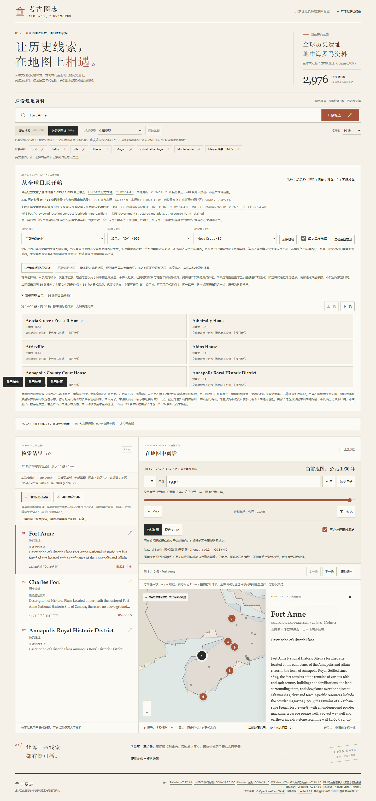

# 来源省／地区浏览验收

本批在 `global-v13` 的2976条资料上增加独立来源省区索引 `source-subdivisions-v1`。没有增加遗址、推断生命周期或更换模型；全球文化资料扩充仍按逐来源独立核验分批推进。

## 来源与覆盖

独立代理对照全部1014个DFHD原始28字段及页面校验信息，采用已批准的977个新增对象及9个既有整体对象，排除6个组成部分和22个待核／不采用记录。再核对Fort Conger的CRHP原位置字段，以及5个既有世界遗产整体的Parks Canada官方位置页。5108项投影读回检查通过，属于代理核验，不是专家或人工确认。

全部992个加拿大对象都有现代来源省区依据。Pimachiowin Aki同时计入Manitoba与Ontario，共993条关联；原文`Manitoba and Ontario`与`Québec`均保留，不从组成部分或坐标推省区。

| 来源省／地区 | 对象数 |
| --- | ---: |
| Alberta | 62 |
| British Columbia | 98 |
| Manitoba | 60 |
| New Brunswick | 62 |
| Newfoundland and Labrador | 48 |
| Northwest Territories | 12 |
| Nova Scotia | 86 |
| Nunavut | 13 |
| Ontario | 271 |
| Prince Edward Island | 22 |
| Quebec | 202 |
| Saskatchewan | 48 |
| Yukon | 9 |

这些计数按整体对象来源成员字段计算，存在跨省交叠；不表示每个源点都位于所选省区，也不提供行政界线或历史主权认定。未采用省区索引的其他国家继续按国家浏览，不把索引覆盖不足说成位置未知。

## 数据与接口

两次离线重建的派生JSON与正式分发文件字节相同，13省全部分页均逐ID核对，无重复或遗漏；筛选目录里的每个原点记录与全库同ID记录完全相同。未知省区、无国家的省区、跨国家条件、重复参数均被拒绝。Pimachiowin Aki的两省详情和Québec原文别名经实际接口核对。

正式复核文件SHA为`2b8515d58b0cf5230c22eb84ba0bfb87a90f4393ec0c332c35baf8a50f2486f5`，派生文件SHA为`db6cd6f641fa4fd29dfd0ed435a426f8921851c646b8e8fb225bfbc079fcab63`。四个外部校验绑定在代码中；修改自带清单不能使未审来源自动获得采用。

2976条Site全部序列化字段、顺序和共享检索文本与本批前快照一致，E5向量及索引清单SHA不变。原有149个带阶段对象、176个阶段和全部定位资料保持原值。本次无需重建2976×384模型索引。

## 浏览器与实际检索

Chrome阻断全部非本机来源后，46个本机API请求完成，页面异常为0。实际恢复Nova Scotia链接并遍历86条的两页；校验切换省区保留成功检索和1930年地图，检索与浏览独立导出，失败／旧后端缺少省区回显保留原目录和点层，快速切国家拒绝晚到省区响应。分享链接恢复两个成功条件，390px下键盘选择正常且无横向溢出。

真实本地E5编码新中文问题“寻找加拿大新斯科舍省的历史要塞”，先限定86个省区对象再排序。Fort Anne仍未进入Top10；主动使用原名`Fort Anne`的BM25为首位。浏览器首次E5记录5735.5ms，含首次模型加载；随后独立热态接口探针记录14.44ms，BM25为7.16ms，均为本机单次结果，不含页面渲染，不作为其他电脑性能保证或相关性指标。

没有新增或确认人工相关性标注，Recall及nDCG继续为`null`。省区筛选提高范围控制能力，不等同于中文检索准确率已经提高。

## 自动检查与降级

新增40项后端用例和1项正式分发数据集成用例，覆盖前置TopK、跨省关联、完整点列、日期变更线、未知／跨国条件、校验绑定、损坏与缺失索引。独审发现的深嵌套JSON异常已修复，默认应用启动回归确认这种损坏只禁用省区；基础国家目录和非空BM25继续可用，带省区的请求明确返回503。

Ruff、27个源文件Mypy、前端类型检查与构建、198项前端测试、21项审批工作流测试通过。Windows全量测试1124项通过、5项符号链接用例按平台条件跳过；随后加入的1项正式数据集成测试与40项省区用例一起复跑通过。Windows／Linux最终结果和机器人批准以受保护main分支的PR检查记录为准；CI不下载模型或全量来源归档。

## 下一批全球资料

本批没有将仍待核的国际候选当作新遗址导入。继续调查非洲、南亚与大洋洲的官方文化名录，先核发布许可、对象粒度、原址／设施区别及现有身份重叠；保留未核验断代和坐标状态。UNESCO预备名单属于申报候选，其正文和再发布条件不能直接套用已采用世界遗产数据集的许可。
